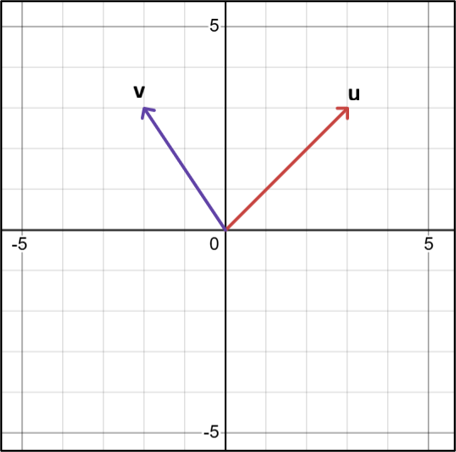
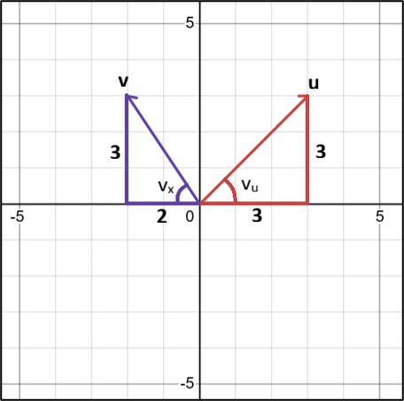
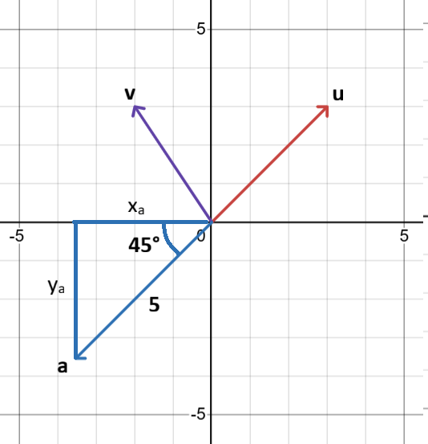

# Bilaga A – Vektorer

## 1. Koordinatsystem och sträckor
Ett **koordinatsystem** (xy-plan) har en horisontell x-axel och en vertikal y-axel som möts i origo $(0, 0)$.

Sträckan $d$ mellan två punkter $(x_1, y_1)$ och $(x_2, y_2)$ ges av Pythagoras sats:

```math
d = \sqrt{(x_2 - x_1)^2 + (y_2 - y_1)^2}
```

Vinkeln som sträckan bildar med positiv x-axel:

```math
\theta = \arctan\left(\frac{y_2 - y_1}{x_2 - x_1}\right)
```

**OBS!** Kontrollera alltid vilken kvadrant punkten befinner sig i och korrigera vinkeln vid behov (+180° för kvadrant II och III).

---

## 2. Vektorer – begrepp och notation
En **vektor** representerar en storhet med både storlek och riktning. I ett plan skrivs vektorn $\mathbf{u}$ med sina komponenter:

```math
\mathbf{u} = (u_x;\, u_y)
```

Till skillnad från ett skalärt tal bär vektorn information om riktning. Vektorer används inom elektroteknik för att representera spänningar och strömmar i AC-system.

---

## 3. Absolutbelopp och vinkel
**Absolutbeloppet** (längden) av $\mathbf{u} = (u_x;\thinspace u_y)$:

```math
|\mathbf{u}| = \sqrt{u_x^2 + u_y^2}
```

**Vinkeln** $v_u$ mot positiv x-axel:

```math
v_u = \arctan\left(\frac{u_y}{u_x}\right) + \text{kvadrantkorrigering}
```

| Kvadrant | $u_x$ | $u_y$ | Korrigering |
|----------|-------|-------|-------------|
| I | + | + | ingen |
| II | − | + | +180° |
| III | − | − | +180° |
| IV | + | − | ingen (negativ vinkel) |

---

## 4. Vinkeln mellan två vektorer
Vinkeln $\alpha$ mellan $\mathbf{u}$ och $\mathbf{v}$ är skillnaden mellan vektorernas vinklar mot positiv x-axel. Beräkna därför först $v_u$ och $v_v$ var för sig och därefter differensen:

```math
\alpha = v_v - v_u
```

Vinkeln mellan två vektorer anges som ett värde mellan 0° och 180°. Blir differensen negativ byter du tecken på den, och blir den större än 180° drar du den från 360°.

---

## 5. Räkna med vektorer

### Addition och subtraktion
```math
\mathbf{u} \pm \mathbf{v} = (u_x \pm v_x;\; u_y \pm v_y)
```

### Multiplikation med ett tal
När en vektor multipliceras med ett tal $k$ multipliceras båda komponenterna med talet:

```math
k\mathbf{u} = (k \cdot u_x;\; k \cdot u_y)
```

Exempelvis gäller för $\mathbf{U} = (3;\thinspace 4)$ att

```math
2\mathbf{U} = (2 \cdot 3;\; 2 \cdot 4) = (6;\, 8)
```

Ett negativt tal byter dessutom riktning på vektorn.

---

## 6. Typexempel

### Typexempel 1 – Vektorer i ett koordinatsystem
Två vektorer $\mathbf{u}$ samt $\mathbf{v}$ visas i nedanstående figur.



**a)** Ta reda på vektorernas koordinater.

**b)** Beräkna vektorernas absolutbelopp $|\mathbf{u}|$ samt $|\mathbf{v}|$.

**c)** Beräkna vektorernas vinklar $v_u$ samt $v_v$.

**d)** Beräkna vinkeln mellan vektorer $\mathbf{u}$ samt $\mathbf{v}$.

**e)** Beräkna en tredje vektor $\mathbf{w} = \mathbf{u} + 2\mathbf{v}$.

**f)** Bestäm en vektor med längden $5$ som är motsatt riktad $\mathbf{u}$.

---

### Lösningar

**a)** Genom att kolla i figuren ser vi att vektor $\mathbf{u}$ har x-koordinaten $3$ samt y-koordinaten $3$. Därmed gäller att

```math
\mathbf{u} = (3;\, 3)
```

Vi ser också att vektor $\mathbf{v}$ har x-koordinaten $-2$ samt y-koordinaten $3$. Därmed gäller att

```math
\mathbf{v} = (-2;\, 3)
```

---

**b)** Vektorernas absolutbelopp är lika med deras respektive hypotenusa och beräknas därmed enkelt med Pythagoras sats.

Detta kan visualiseras genom att rita ut respektive vektor som en triangel, se figuren nedan.



Vektorernas absolutbelopp $|\mathbf{u}|$ samt $|\mathbf{v}|$ beräknas enligt nedan:

```math
|\mathbf{u}| = \sqrt{3^2 + 3^2} = \sqrt{18} \approx 4{,}24
```

```math
|\mathbf{v}| = \sqrt{3^2 + (-2)^2} = \sqrt{13} \approx 3{,}61
```

---

**c)** För att beräkna vektorernas vinklar kan vi använda oss utav tangens. Återigen ser vi vektorerna som trianglar.

För vektor $\mathbf{u} = (3;\thinspace 3)$ gäller att både motstående samt närliggande katet är lika med $3$. Därmed gäller att

```math
\tan(v_u) = \frac{3}{3} = 1,
```

vilket kan transformeras till

```math
v_u = \arctan(1) = 45°
```

För vektor $\mathbf{v}$, som har ett negativt x-värde, kan motsvarande triangel ritas ut såsom visas i ovanstående figur. Notera att vi i detta fall har markerat en vinkel $v_x$, som är den supplementära vinkeln till $v_v$:

```math
v_v + v_x = 180°,
```

vilket innebär att

```math
v_v = 180° - v_x
```

Om vi beräknar vinkel $v_x$ kan vi därmed enkelt beräkna vinkel $v_v$. Vinkel $v_x$ beräknas enkelt med tangens, då motsvarande triangel har en motstående katet som är lika med $3$ samt en närliggande katet som är lika med $2$. Därmed gäller att

```math
\tan(v_x) = \frac{3}{2} = 1{,}5 \quad \Rightarrow \quad v_x = \arctan(1{,}5) \approx 56{,}3°
```

Vi kan sedan enkelt beräkna vinkel $v_v$:

```math
v_v = 180° - v_x = 180° - 56{,}3° = 123{,}7°
```

---

**d)** För att beräkna vinkeln $\alpha$ mellan $\mathbf{v}$ samt $\mathbf{u}$ beräknar vi differensen mellan deras respektive vinklar $v_v$ samt $v_u$:

```math
\alpha = v_v - v_u
```

Vi sätter in värden i formeln och ser då att vinkeln mellan vektorerna är ca 78,7°, då

```math
\alpha = v_v - v_u = 123{,}7° - 45° \approx 78{,}7°
```

---

**e)** Vi beräknar vektor $\mathbf{w}$ algebraiskt genom att sätta in värdena av vektorer $\mathbf{u} = (3;\thinspace 3)$ samt $\mathbf{v} = (-2;\thinspace 3)$ i given formel:

```math
\mathbf{w} = \mathbf{u} + 2\mathbf{v} = (3;\, 3) + 2(-2;\, 3),
```

där

```math
2(-2;\, 3) = (2 \cdot (-2);\; 2 \cdot 3) = (-4;\, 6)
```

Därmed gäller att

```math
\mathbf{w} = (3;\, 3) + (-4;\, 6)
```

För att slutföra beräkningen summerar vi ihop x- och y-värdena och ser då att $\mathbf{w} = (-1;\thinspace 9)$, då

```math
\mathbf{w} = (3 - 4;\; 3 + 6) = (-1;\, 9)
```

---

**f)** Vi kan rita ut en vektor motsatt riktad $\mathbf{u}$ med längden $5$. Låt oss kalla denna vektor $\mathbf{a}$. Att vektorn är motriktad innebär att den är vänd 180°, alltså ett halvt varv från $\mathbf{u}$. För dess vinkel $v_a$ gäller därmed att

```math
v_a = v_u + 180°
```

Eftersom vinkel $v_u$ tidigare beräknades till 45° gäller att vektor $\mathbf{a}$:s vinkel $v_a$ är lika med 225°, då

```math
v_a = 45° + 180° = 225°
```

För en given vektor gäller att dess längd är lika med dess absolutbelopp. Därmed gäller att absolutbeloppet $|\mathbf{a}|$ av vektorn $\mathbf{a}$ är lika med $5$:

```math
|\mathbf{a}| = 5
```

Vi kan sedan beräkna vektor $\mathbf{a}$ via två metoder, grafiskt eller algebraiskt.

#### Metod 1 – Grafisk lösning
Som vi såg tidigare gäller att vektorn kan ritas ut som en triangel, där dess hypotenusa är lika med dess absolutbelopp. Eftersom denna vektor är vänd ett halvt varv från vektor $\mathbf{u}$ kan vi rita vektor $\mathbf{a}$ som en triangel med vinkel 45° sett från 180°, dvs. vänt ett halvt varv.

Med denna information kan vi rita ut vektor $\mathbf{a}$ såsom visas nedan.



Vi kan beräkna absolutbeloppet $|x_a|$ av vektor $\mathbf{a}$:s närliggande katet $x_a$ med cosinus:

```math
\cos 45° = \frac{|x_a|}{5},
```

vilket innebär att

```math
|x_a| = 5 \cdot \cos 45° \approx 3{,}54
```

Eftersom $x_a$ är placerad till vänster om origo är $x_a$ negativ. Därmed gäller att

```math
x_a \approx -3{,}54
```

Vi kan också beräkna absolutbeloppet $|y_a|$ av vektor $\mathbf{a}$:s motstående katet $y_a$ med sinus:

```math
\sin 45° = \frac{|y_a|}{5},
```

vilket innebär att

```math
|y_a| = 5 \cdot \sin 45° \approx 3{,}54
```

Eftersom $y_a$ är placerad under origo är $y_a$ negativ. Därmed gäller att

```math
y_a \approx -3{,}54
```

Via beräknade värden kan sedan vektor $\mathbf{a}$ bestämmas:

```math
\mathbf{a} \approx (-3{,}54;\; -3{,}54)
```

#### Metod 2 – Algebraisk lösning
Vi såg tidigare att vektor $\mathbf{a}$:s vinkel $v_a$ är lika med 225°, då denna är vänd ett halvt varv (180°) från vektor $\mathbf{u}$, vars vinkel $v_u$ tidigare har beräknats till 45°:

```math
v_a = v_u + 180° = 45° + 180° = 225°
```

Vektorns absolutbelopp $|\mathbf{a}|$, som är lika med dess längd, specificerades också till $5$ i uppgiftsbeskrivningen:

```math
|\mathbf{a}| = 5
```

Vi kan enkelt beräkna vektorns x- och y-värde via cosinus samt sinus. Vi börjar med att beräkna vektorns x-värde $x_a$:

```math
\cos v_a = \frac{x_a}{|\mathbf{a}|},
```

vilket är ekvivalent med att

```math
x_a = |\mathbf{a}| \cdot \cos v_a
```

Genom att sätta in värden i ovanstående formel ser vi att vektorns x-värde $x_a$ är lika med $-3{,}54$, då

```math
x_a = 5 \cdot \cos 225° \approx -3{,}54
```

Vi kan sedan beräkna vektor $\mathbf{a}$:s y-värde $y_a$ med sinus:

```math
\sin v_a = \frac{y_a}{|\mathbf{a}|},
```

vilket är ekvivalent med att

```math
y_a = |\mathbf{a}| \cdot \sin v_a
```

Genom att sätta in värden i ovanstående formel ser vi att även vektor $\mathbf{a}$:s y-värde $y_a$ är lika med $-3{,}54$, då

```math
y_a = 5 \cdot \sin 225° \approx -3{,}54
```

Därmed gäller att

```math
\mathbf{a} \approx (-3{,}54;\; -3{,}54)
```

---

## 7. Sammanfattning

| Begrepp | Formel |
|---------|--------|
| Absolutbelopp | $\lvert \mathbf{u}\rvert = \sqrt{u_x^2 + u_y^2}$ |
| Vinkel mot x-axeln | $v = \arctan(u_y/u_x)$ + kvadrantkorrigering |
| Vinkel mellan vektorer | $\alpha = v_v - v_u$ |
| Addition | $(u_x + v_x;\thinspace u_y + v_y)$ |
| Multiplikation med ett tal | $k\mathbf{u} = (ku_x;\thinspace ku_y)$ |

---
