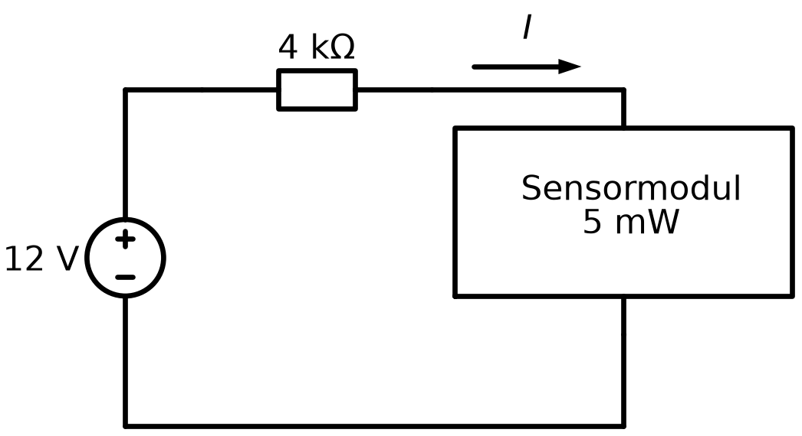

# L07 – Lektionsuppgifter

## Del 1 – Repetitionsuppgifter
### 1.1 – Sensormodul på en järnvägsvagn
En sensormodul ute på en järnvägsvagn matas från vagnens $12\thinspace\text{V}$-system. För att begränsa strömmen vid kortslutning sitter ett skyddsmotstånd på $4\thinspace\text{k}\Omega$ i serie med modulen. Vid en mätning visar det sig att sensormodulen förbrukar $5\thinspace\text{mW}$.



Du vill ta reda på hur stor strömmen $I$ genom kretsen är, men har ingen amperemeter till hands, bara dina kunskaper i ellära.

**a)** Spänningen över skyddsmotståndet är $4I$ (med $I$ i mA ger $\text{k}\Omega \cdot \text{mA} = \text{V}$). Visa att spänningen över sensormodulen blir $12 - 4I$ och att effektsambandet leder till ekvationen

```math
4I^2 - 12I + 5 = 0
```

**b)** Lös ekvationen för strömmen $I$.

**c)** Ekvationen ger två lösningar. Beräkna spänningen över sensormodulen och effektförlusten i skyddsmotståndet för båda fallen. Vilken driftpunkt är mest rimlig för en sensormodul, och varför?

---

## Del 2 – Nytt stoff
I växelströmskretsar (AC) representeras spänningar och strömmar av vektorer, så kallade **visare**: vektorns längd anger storleken och dess vinkel mot positiv x-axel anger fasvinkeln. Två visare med samma riktning är *i fas*, och två motriktade visare är *i motfas*.

### 2.1 – Addition av spänningar
Två växelspänningar representeras av visarna $\mathbf{U}_1 = (3;\thinspace 2)\thinspace\text{V}$ och $\mathbf{U}_2 = (4;\thinspace 6)\thinspace\text{V}$. Bestäm koordinaterna för:

**a)** $\mathbf{U}_1 + \mathbf{U}_2$

**b)** $2\mathbf{U}_1 + 3\mathbf{U}_2$

**c)** $\mathbf{U}_1 - \mathbf{U}_2$

**d)** $-2\mathbf{U}_1 - 4\mathbf{U}_2$

---

### 2.2 – Räkning med tre strömmar
Tre växelströmmar representeras av visarna $\mathbf{I}_a = (1;\thinspace 4)\thinspace\text{A}$, $\mathbf{I}_b = (-4;\thinspace 2)\thinspace\text{A}$ och $\mathbf{I}_c = (3;\thinspace -4)\thinspace\text{A}$. Bestäm koordinaterna för:

**a)** $\mathbf{I}_a + \mathbf{I}_b + \mathbf{I}_c$

**b)** $\mathbf{I}_a - \mathbf{I}_b - \mathbf{I}_c$

**c)** $2\mathbf{I}_a + 4\mathbf{I}_b$

**d)** $2\mathbf{I}_a - 4\mathbf{I}_b$

---

### 2.3 – Absolutbelopp av spänningar
Spänningarna $\mathbf{U}_a = (2;\thinspace 1)\thinspace\text{V}$ och $\mathbf{U}_b = (1;\thinspace -2)\thinspace\text{V}$ är givna. Bestäm i exakt form storleken (absolutbeloppet) av:

**a)** $\mathbf{U}_a$

**b)** $3\mathbf{U}_a + \mathbf{U}_b$

**c)** $\mathbf{U}_a - \mathbf{U}_b$

**d)** $3\mathbf{U}_a - 4\mathbf{U}_b$

---

### 2.4 – Lös ekvationerna
Bestäm $x$ och $y$:

**a)** $(x;\thinspace y) = 5(3;\thinspace 1) + 2(4;\thinspace -5)$

**b)** $(15;\thinspace 12) = (x;\thinspace 10) + (23;\thinspace y)$

---

### 2.5 – Strömmar i fas och i motfas
Om $\mathbf{I}_1 = k \cdot \mathbf{I}_2$ är visarna $\mathbf{I}_1$ och $\mathbf{I}_2$ parallella: i fas om $k > 0$ och i motfas om $k < 0$. Vilka av följande strömmar är parallella med $\mathbf{I} = (2;\thinspace -3)\thinspace\text{A}$?

**a)** $(6;\thinspace -9)\thinspace\text{A}$

**b)** $(-8;\thinspace 16)\thinspace\text{A}$

**c)** $(10;\thinspace 15)\thinspace\text{A}$

**d)** $(-12;\thinspace 18)\thinspace\text{A}$

---

### 2.6 – Bestäm okända koefficienter
Spänningarna $\mathbf{U}_1 = (-2;\thinspace 3)\thinspace\text{V}$ och $\mathbf{U}_2 = (3;\thinspace -1)\thinspace\text{V}$ är givna. Bestäm talen $a$ och $b$ så att

```math
a\mathbf{U}_1 + \mathbf{U}_2 = (0;\, b)\,\text{V}.
```

---

### 2.7 – Fasförskjutning mellan spänning och ström
Spänningen över en last är $\mathbf{U} = (4;\thinspace 4)\thinspace\text{V}$ och strömmen genom den är $\mathbf{I} = (-1;\thinspace 2)\thinspace\text{A}$.

**a)** Beräkna storlekarna $|\mathbf{U}|$ och $|\mathbf{I}|$.

**b)** Beräkna fasvinklarna $v_U$ och $v_I$ mot positiv x-axel.

**c)** Beräkna fasförskjutningen, alltså vinkeln $\alpha$ mellan $\mathbf{U}$ och $\mathbf{I}$.

---

## Del 3 – Extrauppgifter
Uppgifterna nedan är extra träning och görs med fördel på egen hand efter lektionen. De flesta går att räkna i huvudet eller med papper och penna.

### 3.1 – Avstånd mellan punkter
Beräkna avståndet mellan punkterna:

**a)** $(0, 0)$ och $(3, 4)$

**b)** $(1, 2)$ och $(4, 6)$

**c)** $(-2, 1)$ och $(2, -2)$

**d)** $(5, -1)$ och $(5, 7)$

**e)** $(-3, 2)$ och $(1, 2)$

---

### 3.2 – Vektorn mellan två punkter
Vektorn från punkten $A$ till punkten $B$ ges av $\overrightarrow{AB} = (x_B - x_A;\thinspace y_B - y_A)$.

**a)** $A = (1, 2)$ och $B = (5, 5)$. Bestäm $\overrightarrow{AB}$ och $|\overrightarrow{AB}|$.

**b)** $A = (-1, 4)$ och $B = (2, 0)$. Bestäm $\overrightarrow{AB}$ och $|\overrightarrow{AB}|$.

**c)** Bestäm $\overrightarrow{BA}$ i **a)** och jämför med $\overrightarrow{AB}$.

**d)** Vad gäller allmänt mellan $\overrightarrow{AB}$ och $\overrightarrow{BA}$?

---

### 3.3 – Spänningens storlek
Bestäm spänningens storlek $|\mathbf{U}|$ i exakt form och som närmevärde med två decimaler.

**a)** $\mathbf{U} = (6;\thinspace 8)\thinspace\text{V}$

**b)** $\mathbf{U} = (-5;\thinspace 12)\thinspace\text{V}$

**c)** $\mathbf{U} = (1;\thinspace 1)\thinspace\text{V}$

**d)** $\mathbf{U} = (-3;\thinspace -3)\thinspace\text{V}$

**e)** $\mathbf{U} = (0;\thinspace -7)\thinspace\text{V}$

---

### 3.4 – Fasvinkel
Bestäm strömmens fasvinkel $v$ mot positiv x-axel. Ange vilken kvadrant visaren ligger i och om kvadrantkorrigering behövs.

**a)** $\mathbf{I} = (1;\thinspace 1)\thinspace\text{A}$

**b)** $\mathbf{I} = (-1;\thinspace 1)\thinspace\text{A}$

**c)** $\mathbf{I} = (-1;\thinspace -1)\thinspace\text{A}$

**d)** $\mathbf{I} = (1;\thinspace -1)\thinspace\text{A}$

**e)** $\mathbf{I} = (4;\thinspace 3)\thinspace\text{A}$

---

### 3.5 – Från storlek och fasvinkel till komponenter
En spänning med storleken $|\mathbf{U}|$ och fasvinkeln $v$ mot positiv x-axel har komponenterna

```math
U_x = |\mathbf{U}| \cos v, \qquad U_y = |\mathbf{U}| \sin v.
```

Bestäm komponenterna:

**a)** $|\mathbf{U}| = 10\thinspace\text{V}$, $v = 30°$

**b)** $|\mathbf{U}| = 5\thinspace\text{V}$, $v = 90°$

**c)** $|\mathbf{U}| = 4\thinspace\text{V}$, $v = 180°$

**d)** $|\mathbf{U}| = 2\thinspace\text{V}$, $v = 225°$

**e)** Kontrollera i **a)** att $\sqrt{U_x^2 + U_y^2} = 10\thinspace\text{V}$.

---

### 3.6 – Fasförskjutning
Beräkna först fasvinklarna $v_U$ och $v_I$ mot positiv x-axel och därefter fasförskjutningen $\alpha$, alltså vinkeln mellan spänningen och strömmen.

**a)** $\mathbf{U} = (1;\thinspace 0)\thinspace\text{V}$, $\mathbf{I} = (1;\thinspace 1)\thinspace\text{A}$

**b)** $\mathbf{U} = (3;\thinspace 0)\thinspace\text{V}$, $\mathbf{I} = (0;\thinspace 4)\thinspace\text{A}$

**c)** $\mathbf{U} = (2;\thinspace 1)\thinspace\text{V}$, $\mathbf{I} = (-1;\thinspace 3)\thinspace\text{A}$

**d)** $\mathbf{U} = (2;\thinspace 2)\thinspace\text{V}$, $\mathbf{I} = (-3;\thinspace -3)\thinspace\text{A}$

---

### 3.7 – Motstånd och spole i serie
Över ett motstånd och en spole i serie ligger spänningarna $\mathbf{U}_R = (12;\thinspace 0)\thinspace\text{V}$ och $\mathbf{U}_L = (0;\thinspace 5)\thinspace\text{V}$.

**a)** Beräkna den totala spänningen $\mathbf{U} = \mathbf{U}_R + \mathbf{U}_L$.

**b)** Beräkna storleken $|\mathbf{U}|$.

**c)** Beräkna fasvinkeln mot positiv x-axel.

**d)** Varför är $|\mathbf{U}|$ inte lika med $12 + 5 = 17\thinspace\text{V}$?

---

### 3.8 – Motstånd, spole och kondensator i serie
I en seriekrets ligger spänningen $\mathbf{U}_R = (30;\thinspace 0)\thinspace\text{V}$ över motståndet, $\mathbf{U}_L = (0;\thinspace 70)\thinspace\text{V}$ över spolen och $\mathbf{U}_C = (0;\thinspace -30)\thinspace\text{V}$ över kondensatorn.

**a)** Beräkna den totala spänningen $\mathbf{U} = \mathbf{U}_R + \mathbf{U}_L + \mathbf{U}_C$.

**b)** Beräkna storleken $|\mathbf{U}|$.

**c)** Beräkna fasvinkeln mot positiv x-axel.

**d)** Vad blir den totala spänningen om kondensatorns spänning i stället är $(0;\thinspace -70)\thinspace\text{V}$? Vad innebär resultatet?

---

### 3.9 – Enhetsvektorer
En enhetsvektor har längden $1$ och fås som $\hat{\mathbf{u}} = \dfrac{\mathbf{u}}{|\mathbf{u}|}$. Strömmen $\mathbf{I} = (3;\thinspace 4)\thinspace\text{A}$ är given.

**a)** Bestäm enhetsvektorn i strömmens riktning.

**b)** Kontrollera att svaret i **a)** verkligen har längden $1$.

**c)** Bestäm enhetsvektorn i riktning $(-6;\thinspace 8)$.

**d)** Bestäm en ström med storleken $15\thinspace\text{A}$ som är i fas med $\mathbf{I}$.

**e)** Bestäm en ström med storleken $15\thinspace\text{A}$ som är i motfas med $\mathbf{I}$.

---

### 3.10 – Trefassystem
I ett trefassystem har de tre fasspänningarna samma storlek men olika fasvinklar: $\mathbf{U}_1 = (230;\thinspace 0)\thinspace\text{V}$, $\mathbf{U}_2 = (-115;\thinspace -199)\thinspace\text{V}$ och $\mathbf{U}_3 = (-115;\thinspace 199)\thinspace\text{V}$.

**a)** Beräkna summan $\mathbf{U}_1 + \mathbf{U}_2 + \mathbf{U}_3$.

**b)** Vad innebär resultatet?

**c)** Beräkna storleken och fasvinkeln för $\mathbf{U}_2$.

**d)** Beräkna huvudspänningen $\mathbf{U}_{12} = \mathbf{U}_1 - \mathbf{U}_2$ och dess storlek.

---

### 3.11 – I fas och i motfas
Spänningen $\mathbf{U} = (4;\thinspace -6)\thinspace\text{V}$ är given.

**a)** Vilka av $(2;\thinspace -3)\thinspace\text{V}$, $(-8;\thinspace 12)\thinspace\text{V}$, $(6;\thinspace -4)\thinspace\text{V}$ och $(-2;\thinspace 3)\thinspace\text{V}$ är parallella med $\mathbf{U}$?

**b)** Vilka av dem är i motfas med $\mathbf{U}$?

**c)** Bestäm $t$ så att $(t;\thinspace 9)\thinspace\text{V}$ blir parallell med $\mathbf{U}$.

**d)** Kan en visare vara parallell med sig själv? Motivera.

---

### 3.12 – Motstånd och kondensator parallellt
Genom ett motstånd och en kondensator som är parallellkopplade flyter strömmarna $\mathbf{I}_R = (4;\thinspace 0)\thinspace\text{A}$ och $\mathbf{I}_C = (0;\thinspace 3)\thinspace\text{A}$.

**a)** Beräkna den totala strömmen $\mathbf{I} = \mathbf{I}_R + \mathbf{I}_C$.

**b)** Beräkna storleken $|\mathbf{I}|$.

**c)** Beräkna fasvinkeln mot positiv x-axel.

**d)** Hur stor måste kondensatorströmmen vara för att fasvinkeln ska bli $45°$?

---

### 3.13 – Effekttriangeln
Effekten i en växelströmskrets kan beskrivas med vektorn $\mathbf{S} = (P;\thinspace Q)$, där $P$ är den aktiva effekten i watt (W) och $Q$ är den reaktiva effekten i var. Vektorns storlek $|\mathbf{S}|$ är den skenbara effekten i voltampere (VA). En motor har $P = 800\thinspace\text{W}$ och $Q = 600\thinspace\text{var}$.

**a)** Beräkna den skenbara effekten $|\mathbf{S}|$.

**b)** Beräkna vektorns vinkel $v$ mot positiv x-axel.

**c)** Effektfaktorn är $\cos v$. Beräkna den.

**d)** En kondensator kopplas in och bidrar med vektorn $(0;\thinspace -600)$. Bestäm den nya vektorn $\mathbf{S}$ och den nya skenbara effekten.

---

### 3.14 – Hitta felet
Varje rad innehåller ett vanligt vektorfel. Förklara felet och ange det korrekta svaret.

**a)** $|(3;\thinspace 4)| = 3 + 4 = 7$

**b)** $2(3;\thinspace -1) = (6;\thinspace -1)$

**c)** Två visare har vinklarna $30°$ och $100°$ mot positiv x-axel, så vinkeln mellan dem är $130°$.

**d)** Vektorn $(-3;\thinspace 4)$ bildar vinkeln $\arctan\!\left(\dfrac{4}{-3}\right) \approx -53{,}1°$ mot positiv x-axel.

**e)** $|-2\mathbf{u}| = -2|\mathbf{u}|$

---
