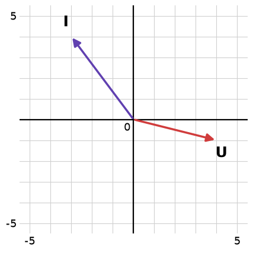

# L08 – Lektionsuppgifter

## Del 1 – Repetitionsuppgifter
### 1.1 – Spänning och ström som visare
En växelspänning $\mathbf{U}$ och en växelström $\mathbf{I}$ representeras av visarna i nedanstående figur. Spänningen anges i V och strömmen i A.



**a)** Ta reda på visarnas koordinater.

**b)** Beräkna storlekarna (absolutbeloppen) $|\mathbf{U}|$ samt $|\mathbf{I}|$.

**c)** Beräkna fasvinklarna $v_U$ samt $v_I$ mot positiv x-axel.

**d)** Beräkna fasförskjutningen, alltså vinkeln $\alpha$ mellan $\mathbf{U}$ och $\mathbf{I}$.

**e)** Strömmen $\mathbf{I}$ möts i en nod av en andra ström $\mathbf{I}_2 = (7;\thinspace -1)\thinspace\text{A}$. Beräkna den totala strömmen $\mathbf{I}_{\text{tot}} = \mathbf{I} + \mathbf{I}_2$ samt dess storlek.

**f)** Bestäm en ström med storleken $10\thinspace\text{A}$ som är i motfas med $\mathbf{I}$.

---

## Del 2 – Nytt stoff
### 2.1 – Är sambandet en funktion?
Avgör om strömmen $I$ är en funktion av spänningen $U$. Motivera ditt svar.

**a)** $I = \dfrac{U}{10}$ (Ohms lag för ett $10\thinspace\Omega$-motstånd)

**b)** Mätparen $(U, I)$ med $U$ i V och $I$ i mA: $\lbrace(2, 100),\ (4, 200),\ (6, 250),\ (8, 250)\rbrace$

**c)** Mätparen $(U, I)$ med $U$ i V och $I$ i mA: $\lbrace(1, 2),\ (1, 5),\ (2, 3)\rbrace$

---

### 2.2 – Definitions- och värdemängd
Bestäm definitionsmängden och värdemängden.

**a)** Temperatursensorn `TMP36` ger utspänningen $U(T) = 0{,}01T + 0{,}5$ (i V) vid temperaturen $T$ (i °C). Sensorn fungerar för $-40 \leq T \leq 125$.

**b)** Spänningen över ett $100\thinspace\Omega$-motstånd som utvecklar effekten $P$ (i W) är $U(P) = \sqrt{100P}$.

**c)** Effekten i ett $10\thinspace\Omega$-motstånd är $P(U) = \dfrac{U^2}{10}$, där spänningen kan vara $-20 \leq U \leq 20$ (i V).

---

### 2.3 – Linjär resistans hos en temperaturberoende resistor
Resistansen $R$ (i $\Omega$) hos en viss temperaturberoende resistor beror linjärt på temperaturen $T$ (i °C) enligt $R(T) = kT + m$. Vid $T = 0\thinspace°\text{C}$ är $R = 100\thinspace\Omega$, och vid $T = 50\thinspace°\text{C}$ är $R = 175\thinspace\Omega$.

**a)** Bestäm $k$ och $m$.

**b)** Beräkna resistansen vid $T = 25\thinspace°\text{C}$.

---

### 2.4 – Ett batteri som åldras
Ett nytt litiumjonbatteri har kapaciteten $4000\thinspace\text{mAh}$ och förlorar 3 % av kapaciteten per år. Efter $x$ år är kapaciteten

```math
C(x) = 4000 \cdot 0{,}97^x\,\text{mAh}
```

**a)** Beräkna $C(10)$ och tolka svaret.

**b)** Ett batteri brukar räknas som uttjänt när kapaciteten har sjunkit till 80 %. Efter hur många år händer det?

---

### 2.5 – Effekt som potensfunktion av strömmen
Effekten $P$ (i $W$) som utvecklas i ett motstånd $R = 50\thinspace\Omega$ beror på strömmen $I$ (i $A$) enligt:

```math
P(I) = R \cdot I^2
```

**a)** Vilken typ av funktion är $P(I)$?

**b)** Beräkna $P(0{,}5)$ och $P(2)$.

**c)** En säkring i kretsen begränsar strömmen till $0 \leq I \leq 3\thinspace A$. Bestäm definitions- och värdemängd för $P(I)$ inom detta intervall.

---

### 2.6 – Tolkning av mätvärden
En spänning $U(t)$ mäts vid flera tidpunkter under en urladdning:

| $t$ (s) | 0 | 1 | 2 | 3 | 4 |
|---|---|---|---|---|---|
| $U(t)$ (V) | 12 | 9 | 6 | 3 | 0 |

**a)** Visa att sambandet mellan $t$ och $U(t)$ är linjärt utifrån tabellen.

**b)** Bestäm en formel $U(t) = kt + m$ utifrån tabellen.

**c)** Om mönstret i tabellen fortsatte, vid vilken tidpunkt $t$ skulle $U(t) = -3\thinspace V$? Är detta ett rimligt värde för en urladdningsspänning? Motivera varför den linjära modellen inte kan gälla för alla $t \geq 0$.

---

## Del 3 – Extrauppgifter
Uppgifterna nedan är extra träning och görs med fördel på egen hand efter lektionen. De flesta går att räkna i huvudet eller med papper och penna.

### 3.1 – Beräkna funktionsvärden
Ett batteri har klämspänningen $U(I) = 12 - 2I$ (i V), ett motstånd utvecklar effekten $P(I) = 5I^2$ (i W) och strömmen genom en last är $I(R) = \dfrac{24}{R}$ (i A). Beräkna:

**a)** $U(1)$

**b)** $U(4)$

**c)** $P(0)$

**d)** $P(3)$

**e)** $I(8)$

**f)** $I(12)$

---

### 3.2 – Lös ekvationen $f(x) = c$
Samma funktioner som i uppgift 3.1.

**a)** Vid vilken ström är klämspänningen $9\thinspace\text{V}$?

**b)** Bestäm nollstället till $U(I)$. Vad innebär det för batteriet?

**c)** Vid vilken ström utvecklar motståndet $20\thinspace\text{W}$?

**d)** Kan $P(I)$ bli negativ? Motivera.

**e)** Vilken resistans ger strömmen $0{,}5\thinspace\text{A}$?

---

### 3.3 – Definitionsmängd
Bestäm den matematiska definitionsmängden. Ange sedan vilka värden som är fysikaliskt rimliga.

**a)** $I(R) = \dfrac{10}{R}$

**b)** $I(R) = \dfrac{12}{R + 2}$

**c)** $U(P) = \sqrt{50P}$

**d)** $X(f) = \dfrac{1000}{f}$

---

### 3.4 – Värdemängd
Bestäm värdemängden.

**a)** $P(I) = 10I^2$ (i W) för $0 \leq I \leq 2$ (i A)

**b)** $U(I) = 12 - 2I$ (i V) för $0 \leq I \leq 6$ (i A)

**c)** En likriktare ger utspänningen $u_{\text{ut}} = |u_{\text{in}}|$ för $-10 \leq u_{\text{in}} \leq 10$ (i V).

**d)** $T(U) = 100U - 50$ (i °C) för $0{,}1 \leq U \leq 1{,}75$ (i V)

---

### 3.5 – Linjär funktion ur två punkter
Bestäm den linjära funktionen.

**a)** Ett batteri har klämspänningen $9\thinspace\text{V}$ vid $0\thinspace\text{A}$ och $8\thinspace\text{V}$ vid $2\thinspace\text{A}$. Bestäm $U(I)$.

**b)** En temperatursensor ger $0{,}5\thinspace\text{V}$ vid $0\thinspace°\text{C}$ och $1{,}5\thinspace\text{V}$ vid $100\thinspace°\text{C}$. Bestäm $U(T)$.

**c)** Ett Pt100-element har resistansen $100\thinspace\Omega$ vid $0\thinspace°\text{C}$ och $138{,}5\thinspace\Omega$ vid $100\thinspace°\text{C}$. Bestäm $R(T)$.

**d)** En laddström är $2\thinspace\text{A}$ vid $t = 0\thinspace\text{s}$ och $2\thinspace\text{A}$ vid $t = 5\thinspace\text{s}$. Bestäm $I(t)$.

---

### 3.6 – Tolkning av $k$ och $m$
Ett belastat batteri har klämspänningen $U(I) = 12 - 0{,}5I$ (i V), där $I$ är strömmen i A.

**a)** Vad betyder $k$ grafiskt?

**b)** Vad betyder $m$ grafiskt?

**c)** Är $U(I)$ växande eller avtagande? Motivera.

**d)** Bestäm nollstället till $U(I)$.

**e)** Vad representerar $k = -0{,}5$ respektive $m = 12$ fysikaliskt?

---

### 3.7 – Potensfunktioner
Effekten i ett $10\thinspace\Omega$-motstånd är $P(I) = 10I^2$ (i W).

**a)** Beräkna $P(3)$ och $P(-3)$. Varför blir effekten densamma när strömmen byter riktning?

**b)** Hur många gånger större blir effekten om strömmen tredubblas?

**c)** Hur ändras effekten om strömmen halveras?

**d)** Effekten kan också skrivas $P(U) = \dfrac{U^2}{10}$. Beräkna $P(5)$ och $P(10)$. Hur ändras effekten när spänningen fördubblas?

---

### 3.8 – Exponentialfunktioner
En förstärkarkedja fördubblar signalen i varje steg, så att $u(n) = 5 \cdot 2^n$ (i mV) efter $n$ steg. En dämpare halverar i stället signalen i varje steg, så att $g(n) = 100 \cdot 0{,}5^n$ (i mV).

**a)** Beräkna $u(0)$, $u(1)$ och $u(3)$.

**b)** Beräkna $g(0)$, $g(1)$ och $g(3)$.

**c)** Vilken av funktionerna är växande respektive avtagande? Vad är det som avgör?

**d)** Vad är $C$ i respektive funktion, och vilken betydelse har det?

---

### 3.9 – Förändringsfaktor
**a)** Elpriset ökar med 5 % per år. Vilken är förändringsfaktorn $a$?

**b)** Ett batteris kapacitet minskar med 20 % per år. Vilken är $a$?

**c)** En signal dämpas till 70 % av sitt värde för varje steg den passerar. Startamplituden är $2\thinspace\text{V}$. Skriv en funktion för amplituden efter $n$ steg.

**d)** Beräkna amplituden efter $3$ steg.

**e)** Efter hur många steg understiger amplituden $1\thinspace\text{V}$?

---

### 3.10 – Linjärt eller exponentiellt?
Två storheter har mätts upp en gång per år: $f(x)$ är antalet laddstolpar i en kommun (i hundratal) och $g(x)$ är antalet uppkopplade sensorer i ett nät (i tusental), där $x$ är antal år.

| $x$ | $0$ | $1$ | $2$ | $3$ | $4$ |
|-----|-----|-----|-----|-----|-----|
| $f(x)$ | $3$ | $5$ | $7$ | $9$ | $11$ |
| $g(x)$ | $3$ | $6$ | $12$ | $24$ | $48$ |

**a)** Vilken av funktionerna är linjär? Motivera utifrån tabellen.

**b)** Vilken är exponentiell? Motivera.

**c)** Bestäm en formel för $f(x)$.

**d)** Bestäm en formel för $g(x)$.

**e)** Beräkna $f(10)$ och $g(10)$.

---

### 3.11 – Nollställen
Bestäm nollställena och tolka dem.

**a)** Klämspänningen $U(I) = 12 - 4I$ (i V) för ett batteri, där $I$ är strömmen i A.

**b)** Effekten $P(I) = 12I - 2I^2$ (i W) som samma sorts batteri, med inre resistansen $2\thinspace\Omega$, levererar till en last.

**c)** Spänningen $U(t) = 6 - 0{,}5t$ (i V) under en urladdning, där $t$ är tiden i s.

---

### 3.12 – Spänningsdelare som funktion
En spänningsdelare består av $R_1 = 1\thinspace\text{k}\Omega$ och en potentiometer med resistansen $x$ (i $\text{k}\Omega$). Utspänningen ges av:

```math
U(x) = 12 \cdot \frac{x}{1 + x}\,\text{V}, \qquad 0 \leq x \leq 9
```

**a)** Beräkna $U(0)$, $U(1)$ och $U(9)$.

**b)** Bestäm värdemängden $V_U$ för det angivna intervallet.

**c)** Vid vilket $x$ blir $U = 8\thinspace\text{V}$?

**d)** Kan $U$ någonsin nå $12\thinspace\text{V}$? Motivera.

---

### 3.13 – Urladdning av en kondensator
Spänningen över en urladdande kondensator ges av:

```math
u(t) = 10 \cdot e^{-t/2}\,\text{V}, \qquad t \geq 0
```

där $t$ anges i sekunder.

**a)** Beräkna $u(0)$.

**b)** Beräkna $u(2)$ och $u(4)$.

**c)** Är funktionen växande eller avtagande?

**d)** Bestäm värdemängden $V_u$ för $t \geq 0$.

**e)** Blir $u(t)$ någonsin exakt noll? Motivera.

---

### 3.14 – Sant eller falskt
Avgör om påståendet är sant eller falskt och motivera kortfattat.

**a)** Effekten $P(I) = RI^2$ blir negativ om strömmen är negativ.

**b)** Strömmen $I(R) = \dfrac{12}{R}$ är definierad för alla $R$.

**c)** Att $U(2) = 5$ betyder att $U$ har ett nollställe vid $I = 2\thinspace\text{A}$.

**d)** Om samma spänning $U$ har uppmätts med två olika strömmar $I$, är $I$ inte en funktion av $U$.

**e)** Spänningen $u(t) = 3 \cdot 2^t$ (i V) har startvärdet $3\thinspace\text{V}$.

---
