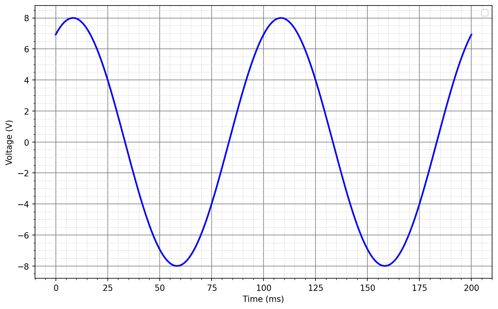

# L09 - Lösningsförslag till lektionsuppgifter

## Del 1 - Repetitionsuppgifter

### 1.1 – Laddning av kondensator
En kondensator laddas i en RC-krets med spänningen

```math
u_c (t)=5(1-e^{-t/2})
```

där
* $u_c(t)$ = spänningen över kondensatorn i $V$,
* $t$ = tiden i sekunder (definierad för $0≤t≤10$).

**a)** Beräkna kondensatorspänningen $u_c(t)$ vid $t=0$.

**b)** Bestäm spänningens värdemängd.

**c)** Bestäm den tidpunkt $t$ då spänningen $u_c(t)$ över kondensatorn är $4$ $V$.

---

### Lösning

**a)**

```math
u_c(0) = 5(1 - e^{0}) = 5(1 - 1) = 0\,\text{V}
```

**b)** Eftersom $e^{-t/2}$ avtar från $1$ (vid $t=0$) mot $e^{-5}\approx 0{,}0067$ (vid $t=10$) är $u_c(t)$ växande på intervallet. Minimivärdet är $u_c(0) = 0\thinspace\text{V}$ och maximivärdet är:

```math
u_c(10) = 5(1 - e^{-5}) \approx 5 \cdot 0{,}9933 \approx 4{,}97\,\text{V}
```

Värdemängden är alltså $0\thinspace\text{V} \leq u_c(t) \leq 4{,}97\thinspace\text{V}$.

**c)** Vi sätter $u_c(t) = 4$:

```math
5(1 - e^{-t/2}) = 4 \quad \Rightarrow \quad 1 - e^{-t/2} = 0{,}8 \quad \Rightarrow \quad e^{-t/2} = 0{,}2
```

Vi tar den naturliga logaritmen i båda led:

```math
-\frac{t}{2} = \ln 0{,}2 \quad \Rightarrow \quad t = -2\ln 0{,}2 \approx 3{,}22\,\text{s}
```

---

### 1.2 – Rörelse i en servomotor
En servomotors vinkelposition (i grader) ges av

```math
v(t)=-0{,}5t^2+4t,
```

där $t$ = tiden i sekunder (definierad för $0≤t≤8$).

**a)** Beräkna vinkeln $v$ vid $t = 0$, $2$, $4$, $6$ och $8$ s.

**b)** Rita grafen och markera när servomotorn når sin maximala vinkel.

**c)** Bestäm vid vilka tidpunkter vinkeln är $3{,}5°$.

---

### Lösning

**a)** Vi beräknar $v(t)$ för respektive tidpunkt:

```math
v(0) = 0, \quad v(2) = -0{,}5 \cdot 4 + 8 = 6, \quad v(4) = -0{,}5 \cdot 16 + 16 = 8
```

```math
v(6) = -0{,}5 \cdot 36 + 24 = 6, \quad v(8) = -0{,}5 \cdot 64 + 32 = 0
```

| $t$ (s) | 0 | 2 | 4 | 6 | 8 |
|---|---|---|---|---|---|
| $v(t)$ (°) | 0 | 6 | 8 | 6 | 0 |

**b)** Funktionen är en nedåtvänd parabel. Toppunkten (maximal vinkel) nås där $v'(t) = -t + 4 = 0$, dvs. vid $t = 4\thinspace\text{s}$, vilket ger $v(4) = 8°$. Grafen är symmetrisk kring $t = 4\thinspace\text{s}$ och passerar genom punkterna i tabellen ovan.

**c)** Vi sätter $v(t) = 3{,}5$:

```math
-0{,}5t^2 + 4t = 3{,}5
```

Vi multiplicerar med $-2$ i båda led:

```math
t^2 - 8t = -7 \quad \Rightarrow \quad t^2 - 8t + 7 = 0
```

Faktorisering ger $(t-1)(t-7) = 0$, alltså:

```math
t_1 = 1\,\text{s}, \quad t_2 = 7\,\text{s}
```

Båda tidpunkterna ligger inom det definierade intervallet $0 \leq t \leq 8$.

---

### 1.3 – Förstärkning i ett elektroniskt system
I ett förstärkarsystem beskrivs förstärkningen av följande rationella funktion:

```math
G(x)=\frac{x^2+x-12}{x^2-16}
```

där
* $G(x)$ = förstärkningsfaktorn,
* $x$ = en dimensionslös variabel.

**a)** Faktorisera både täljare och nämnare.

**b)** Ange vilka värden på x som inte är tillåtna.

**c)** Förenkla uttrycket så långt som möjligt.

---

### Lösning

**a)** Täljaren faktoriseras genom att hitta två tal som multipliceras till $-12$ och summeras till $1$: $4$ och $-3$.

```math
x^2 + x - 12 = (x+4)(x-3)
```

Nämnaren faktoriseras med konjugatregeln:

```math
x^2 - 16 = (x+4)(x-4)
```

**b)** Nämnaren är noll när $x = 4$ eller $x = -4$, vilket innebär att:

```math
x \neq 4, \quad x \neq -4
```

**c)** Vi förkortar den gemensamma faktorn $(x+4)$:

```math
G(x) = \frac{(x+4)(x-3)}{(x+4)(x-4)} = \frac{x-3}{x-4}, \quad x \neq \pm 4
```

---

## Del 2 - Nytt stoff

### 2.1 -  Vinklar till radianer
Omvandla följande vinklar till radianer:

**a)** $-30°$

**b)** $20°$

**c)** $225°$

**d)** $-45°$

**e)** $300°$

---

### Lösning

Vi använder sambandet $v_{rad} = v_{grad} \cdot \dfrac{\pi}{180°}$:

**a)** $-30° = -\dfrac{30\pi}{180} = -\dfrac{\pi}{6}$

**b)** $20° = \dfrac{20\pi}{180} = \dfrac{\pi}{9}$

**c)** $225° = \dfrac{225\pi}{180} = \dfrac{5\pi}{4}$

**d)** $-45° = -\dfrac{45\pi}{180} = -\dfrac{\pi}{4}$

**e)** $300° = \dfrac{300\pi}{180} = \dfrac{5\pi}{3}$

---

### 2.2 - Vinklar till grader
Omvandla följande vinklar till grader:

**a)** $π/2$

**b)** $3π/4$

**c)** $-5π/6$

**d)** $-1$

**e)** $2{,}2$

---

### Lösning

Vi använder sambandet $v_{grad} = v_{rad} \cdot \dfrac{180°}{\pi}$:

**a)** $\dfrac{\pi}{2} = 90°$

**b)** $\dfrac{3\pi}{4} = 135°$

**c)** $-\dfrac{5\pi}{6} = -150°$

**d)** $-1\thinspace\text{rad} = -\dfrac{180°}{\pi} \approx -57{,}3°$

**e)** $2{,}2\thinspace\text{rad} = \dfrac{2{,}2 \cdot 180°}{\pi} \approx 126{,}1°$

---

### 2.3 - Bestämning av en växelspännings egenskaper

En växelspänning visas i figuren nedan.



**OBS!** Toppvärdet nås efter ca $8{,}33$ ms.

Bestäm:
* Spänningens amplitud $|U|$ i $V$.
* Spänningens frekvens $f$ i $Hz$.
* Spänningens vinkelhastighet $\omega$ i $rad/s$.
* Spänningens fas $δ$ i $rad$.
* Spänningens ekvation på formen $u(t) = |U|\sin(\omega t + δ)$.

---

### Lösning

Ur figuren avläser vi att kurvan svänger mellan $-8\thinspace\text{V}$ och $8\thinspace\text{V}$, samt att den upprepas med en period på $100\thinspace\text{ms}$ (toppar vid ca $8{,}33\thinspace\text{ms}$ och $108{,}33\thinspace\text{ms}$):

```math
|U| = 8\,\text{V}, \qquad T = 100\,\text{ms} = 0{,}1\,\text{s}
```

Frekvensen ges av:

```math
f = \frac{1}{T} = \frac{1}{0{,}1} = 10\,\text{Hz}
```

Vinkelhastigheten blir därmed:

```math
\omega = 2\pi f = 2\pi \cdot 10 = 20\pi\,\text{rad/s}
```

Utan fasförskjutning hade toppvärdet nåtts efter en fjärdedel av perioden, dvs. efter $T/4 = 25\thinspace\text{ms}$. Eftersom toppen istället nås redan efter $8{,}33\thinspace\text{ms}$ ligger kurvan $25 - 8{,}33 = 16{,}67\thinspace\text{ms}$ tidigare, vilket är $16{,}67/100 = 1/6$ av en period. Kurvan är alltså framåtskjuten, vilket ger en positiv fas:

```math
δ = \frac{1}{6} \cdot 2\pi = \frac{\pi}{3}\,\text{rad}
```

**Kontroll:** toppvärdet nås när $20\pi t + \pi/3 = \pi/2$, dvs. $t = \dfrac{\pi/2 - \pi/3}{20\pi} = \dfrac{1}{120}\thinspace\text{s} \approx 8{,}33\thinspace\text{ms}$ ✓

Spänningens ekvation är därmed:

```math
u(t) = 8\sin\!\left(20\pi t + \frac{\pi}{3}\right)\,\text{V}
```

---

### 2.4 - Växelspänning med given fasförskjutning

En växelspänning har amplituden $3$ $V$, frekvensen $25$ $Hz$ och fasen $45°$.
Bestäm växelspänningens ekvation $u(t)$ med fasen i $rad$ och rita sinuskurvan över en period $T$.

---

### Lösning

Fasen omvandlas till radianer:

```math
δ = 45° \cdot \frac{\pi}{180°} = \frac{\pi}{4}\,\text{rad}
```

Vinkelhastigheten:

```math
\omega = 2\pi f = 2\pi \cdot 25 = 50\pi\,\text{rad/s}
```

Spänningens ekvation blir därmed:

```math
u(t) = 3\sin\!\left(50\pi t + \frac{\pi}{4}\right)\,\text{V}
```

Periodtiden är $T = 1/f = 1/25 = 0{,}04\thinspace\text{s} = 40\thinspace\text{ms}$. Kurvan ritas som en sinuskurva med amplitud $3\thinspace\text{V}$ och period $40\thinspace\text{ms}$, förskjuten $T/8 = 5\thinspace\text{ms}$ tidigare än en ofasad sinuskurva (eftersom fasen $\pi/4$ motsvarar $1/8$ av en period).

---

### 2.5 - Beräkning av en växelspännings fas

Ekvationen för en växelspänning är:

```math
u(t) = 5\sin(60πt + δ)\,\text{V}.
```

Vid tiden $t = 10$ $ms$ gäller att $u(t)$ = $1{,}25$ $V$. Beräkna fasen $δ$.

---

### Lösning

Vi sätter in $t = 0{,}01\thinspace\text{s}$ och $u(t) = 1{,}25\thinspace\text{V}$:

```math
5\sin(60\pi \cdot 0{,}01 + δ) = 1{,}25 \quad \Rightarrow \quad \sin(0{,}6\pi + δ) = 0{,}25
```

För en sinusekvation $\sin v = x$ gäller de två allmänna lösningarna $v_1 = \sin^{-1}(x)$ och $v_2 = \pi - \sin^{-1}(x)$. Med $\sin^{-1}(0{,}25) \approx 0{,}2527\thinspace\text{rad}$ ger detta:

**Fall 1:**

```math
0{,}6\pi + δ_1 = 0{,}2527 \quad \Rightarrow \quad δ_1 \approx 0{,}2527 - 1{,}885 \approx -1{,}63\,\text{rad}
```

**Fall 2:**

```math
0{,}6\pi + δ_2 = \pi - 0{,}2527 \quad \Rightarrow \quad δ_2 \approx 2{,}889 - 1{,}885 \approx 1{,}00\,\text{rad}
```

**Kontroll:** $u(0{,}01) = 5\sin(0{,}6\pi - 1{,}63) \approx 5\sin(0{,}253) \approx 1{,}25\thinspace\text{V}$ ✓, och $5\sin(0{,}6\pi + 1{,}00) \approx 5\sin(2{,}889) \approx 1{,}25\thinspace\text{V}$ ✓ — båda lösningarna stämmer.

---

## Del 3 – Extrauppgifter

### 3.1 – Grader till radianer

---

### Lösning
Vi använder $v_{\text{rad}} = v_{\text{grad}} \cdot \dfrac{\pi}{180°}$ och förkortar bråket.

**a)** $60° = \dfrac{60\pi}{180} = \dfrac{\pi}{3}$

**b)** $120° = \dfrac{120\pi}{180} = \dfrac{2\pi}{3}$

**c)** $-90° = -\dfrac{90\pi}{180} = -\dfrac{\pi}{2}$

**d)** $210° = \dfrac{210\pi}{180} = \dfrac{7\pi}{6}$

**e)** $15° = \dfrac{15\pi}{180} = \dfrac{\pi}{12}$

**f)** $360° = \dfrac{360\pi}{180} = 2\pi$

Ett helt varv är alltså $2\pi$ radianer, vilket är sinusfunktionens period.

---

### 3.2 – Radianer till grader

---

### Lösning
Vi använder $v_{\text{grad}} = v_{\text{rad}} \cdot \dfrac{180°}{\pi}$.

**a)** $\dfrac{\pi}{3} = \dfrac{180°}{3} = 60°$

**b)** $\dfrac{5\pi}{4} = \dfrac{5 \cdot 180°}{4} = 225°$

**c)** $-\dfrac{\pi}{2} = -90°$

**d)** $\dfrac{7\pi}{6} = \dfrac{7 \cdot 180°}{6} = 210°$

**e)** $3\thinspace\text{rad} = \dfrac{3 \cdot 180°}{\pi} \approx 171{,}9°$

**f)** $0{,}5\thinspace\text{rad} = \dfrac{0{,}5 \cdot 180°}{\pi} \approx 28{,}6°$

Notera i **e)** och **f)** att en radian är knappt $57{,}3°$ – ett bra tal att komma ihåg för överslagsräkning.

---

### 3.3 – Sinusvärden

---

### Lösning
Sinus avläses som **y-koordinaten** på enhetscirkeln.

**a)** $\sin 0 = 0$

**b)** $\sin\dfrac{\pi}{2} = 1$ (högsta punkten, motsvarar $90°$)

**c)** $\sin \pi = 0$ (motsvarar $180°$)

**d)** $\sin\dfrac{3\pi}{2} = -1$ (lägsta punkten, motsvarar $270°$)

**e)** $\sin\dfrac{\pi}{6} = \dfrac{1}{2}$ (motsvarar $30°$)

**f)** $\sin\dfrac{\pi}{4} = \dfrac{\sqrt{2}}{2} \approx 0{,}707$ (motsvarar $45°$)

Värdemängden är $[-1, 1]$ – sinus kan alltså aldrig bli större än $1$ eller mindre än $-1$.

---

### 3.4 – Frekvens, periodtid och vinkelhastighet

---

### Lösning
| $f$ | $T$ | $\omega$ |
|-----|-----|----------|
| $50\thinspace\text{Hz}$ | $20\thinspace\text{ms}$ | $100\pi \approx 314\thinspace\text{rad/s}$ |
| $1\thinspace\text{kHz}$ | $1\thinspace\text{ms}$ | $2000\pi \approx 6283\thinspace\text{rad/s}$ |
| $200\thinspace\text{Hz}$ | $5\thinspace\text{ms}$ | $400\pi\thinspace\text{rad/s}$ |
| $400\thinspace\text{Hz}$ | $2{,}5\thinspace\text{ms}$ | $800\pi \approx 2513\thinspace\text{rad/s}$ |

Uträkningarna rad för rad:

```math
T = \frac{1}{50} = 0{,}020\,\text{s}, \qquad \omega = 2\pi \cdot 50 = 100\pi
```

```math
f = \frac{1}{10^{-3}} = 1000\,\text{Hz}, \qquad \omega = 2\pi \cdot 1000 = 2000\pi
```

```math
f = \frac{\omega}{2\pi} = \frac{400\pi}{2\pi} = 200\,\text{Hz}, \qquad T = \frac{1}{200} = 5\,\text{ms}
```

```math
T = \frac{1}{400} = 2{,}5\,\text{ms}, \qquad \omega = 2\pi \cdot 400 = 800\pi
```

---

### 3.5 – Avläs egenskaper ur ekvationen

---

### Lösning
Ur $u(t) = |U|\sin(\omega t + \delta)$ läses amplituden av framför sinus, vinkelhastigheten framför $t$ och fasen som den konstanta termen. Frekvensen fås ur $f = \dfrac{\omega}{2\pi}$ och periodtiden ur $T = \dfrac{1}{f}$.

**a)** $|U| = 5\thinspace\text{V}$, $\omega = 100\pi\thinspace\text{rad/s}$, $f = 50\thinspace\text{Hz}$, $T = 20\thinspace\text{ms}$, $\delta = 0$

**b)** $|U| = 12\thinspace\text{V}$, $\omega = 200\pi\thinspace\text{rad/s}$, $f = 100\thinspace\text{Hz}$, $T = 10\thinspace\text{ms}$, $\delta = \dfrac{\pi}{2}$

**c)** $|U| = 3\thinspace\text{V}$, $\omega = 50\pi\thinspace\text{rad/s}$, $f = 25\thinspace\text{Hz}$, $T = 40\thinspace\text{ms}$, $\delta = -\dfrac{\pi}{6}$

**d)** $|U| = 8\thinspace\text{V}$, $\omega = 2000\pi\thinspace\text{rad/s}$, $f = 1000\thinspace\text{Hz}$, $T = 1\thinspace\text{ms}$, $\delta = 0$

I **c)** är fasen negativ, vilket betyder att kurvan är **försenad** jämfört med en ofasad sinuskurva.

---

### 3.6 – Skriv ekvationen

---

### Lösning
**a)** $\omega = 2\pi \cdot 50 = 100\pi$:

```math
u(t) = 10\sin(100\pi t)\,\text{V}
```

**b)** $\omega = 2\pi \cdot 100 = 200\pi$ och $90° = \dfrac{\pi}{2}$:

```math
u(t) = 6\sin\!\left(200\pi t + \frac{\pi}{2}\right)\,\text{V}
```

**c)** Först frekvensen ur periodtiden, sedan fasen i radianer:

```math
f = \frac{1}{5 \times 10^{-3}} = 200\,\text{Hz}, \qquad \omega = 400\pi, \qquad -60° = -\frac{\pi}{3}
```

```math
u(t) = 2\sin\!\left(400\pi t - \frac{\pi}{3}\right)\,\text{V}
```

**d)**

```math
u(t) = 325\sin\!\left(100\pi t + \frac{\pi}{4}\right)\,\text{V}
```

Detta är ungefär det svenska elnätet: $230\thinspace\text{V}$ RMS motsvarar amplituden $325\thinspace\text{V}$.

---

### 3.7 – Momentanvärden
$u(t) = 10\sin(100\pi t)$ V

---

### Lösning
Periodtiden är $T = \dfrac{2\pi}{100\pi} = 0{,}02\thinspace\text{s} = 20\thinspace\text{ms}$.

**a)**

```math
u(0) = 10\sin 0 = 0\,\text{V}
```

**b)** Vinkeln blir $100\pi \cdot 0{,}005 = 0{,}5\pi$:

```math
u(5\,\text{ms}) = 10\sin\frac{\pi}{2} = 10\,\text{V}
```

**c)** Vinkeln blir $\pi$:

```math
u(10\,\text{ms}) = 10\sin \pi = 0\,\text{V}
```

**d)** Vinkeln blir $1{,}5\pi$:

```math
u(15\,\text{ms}) = 10\sin\frac{3\pi}{2} = -10\,\text{V}
```

**e)** Nollgenomgångarna sker vid vinklarna $0$, $\pi$ och $2\pi$, alltså:

```math
t = 0, \qquad t = 10\,\text{ms}, \qquad t = 20\,\text{ms}
```

Kurvan passerar noll två gånger per period, en gång på väg upp och en gång på väg ner.

---

### 3.8 – Effektivvärde och effekt

---

### Lösning
**a)**

```math
U_{\text{RMS}} = \frac{12}{\sqrt{2}} \approx 8{,}49\,\text{V}
```

**b)** Amplituden fås ur effektivvärdet, och $\omega = 2\pi \cdot 50 = 100\pi$:

```math
|U| = 230\sqrt{2} \approx 325\,\text{V}
```

```math
u(t) = 325\sin(100\pi t)\,\text{V}
```

**c)** Effekten beräknas ur **effektivvärdet**, inte ur amplituden:

```math
P = \frac{U_{\text{RMS}}^2}{R} = \frac{\left(12/\sqrt{2}\right)^2}{100} = \frac{144/2}{100} = \frac{72}{100} = 0{,}72\,\text{W}
```

Hade man felaktigt räknat med amplituden hade svaret blivit dubbelt så stort.

---

### 3.9 – Fasförskjutning i tid
$T = 20\thinspace\text{ms}$

---

### Lösning
En hel period motsvarar $2\pi$ radianer, så en fas $\delta$ svarar mot tiden $\dfrac{\delta}{2\pi} \cdot T$.

**a)** $\dfrac{\pi}{2}$ är en fjärdedels varv:

```math
\frac{T}{4} = 5\,\text{ms}
```

**b)** $\dfrac{\pi}{6}$ är en tolftedels varv:

```math
\frac{T}{12} = \frac{20}{12} \approx 1{,}67\,\text{ms}
```

**c)** Tidigare topp betyder **positiv** fas. Förskjutningen är $\dfrac{2}{20} = \dfrac{1}{10}$ av en period:

```math
\delta = \frac{1}{10} \cdot 2\pi = \frac{\pi}{5} \approx 0{,}628\,\text{rad}
```

**d)** Senare topp betyder **negativ** fas. Förskjutningen är $\dfrac{5}{20} = \dfrac{1}{4}$ av en period:

```math
\delta = -\frac{1}{4} \cdot 2\pi = -\frac{\pi}{2}\,\text{rad}
```

---

### 3.10 – Två spänningar med fasskillnad

---

### Lösning
**a)** $u_2$ har den större fasen och ligger därmed **före** $u_1$:

```math
\frac{\pi}{3} = 60°
```

**b)** Periodtiden är $T = \dfrac{2\pi}{100\pi} = 20\thinspace\text{ms}$, och $60°$ är en sjättedel av ett varv:

```math
\frac{T}{6} = \frac{20}{6} \approx 3{,}33\,\text{ms}
```

**c)** Vid $t = 5\thinspace\text{ms}$ är $100\pi t = \dfrac{\pi}{2}$:

```math
u_1 = 4\sin\frac{\pi}{2} = 4\,\text{V}
```

```math
u_2 = 4\sin\!\left(\frac{\pi}{2} + \frac{\pi}{3}\right) = 4\sin\frac{5\pi}{6} = 4 \cdot \frac{1}{2} = 2\,\text{V}
```

$u_2$ har alltså redan passerat sitt toppvärde när $u_1$ når sitt.

**d)** Ja. Båda har amplituden $4\thinspace\text{V}$ och samma vinkelhastighet $100\pi\thinspace\text{rad/s}$, alltså frekvensen $50\thinspace\text{Hz}$. Det enda som skiljer dem åt är fasen.

---

### 3.11 – Lös en trigonometrisk ekvation
$u(t) = 6\sin(100\pi t)$ V

---

### Lösning
**a)** Sätt $u(t) = 3$ och dividera med $6$:

```math
\sin(100\pi t) = 0{,}5
```

Den första vinkeln med sinus $0{,}5$ är $\dfrac{\pi}{6}$:

```math
100\pi t = \frac{\pi}{6} \quad \Rightarrow \quad t = \frac{1}{600}\,\text{s} \approx 1{,}67\,\text{ms}
```

**b)** Den andra lösningen i samma halvperiod är $\pi - \dfrac{\pi}{6} = \dfrac{5\pi}{6}$:

```math
100\pi t = \frac{5\pi}{6} \quad \Rightarrow \quad t = \frac{5}{600}\,\text{s} \approx 8{,}33\,\text{ms}
```

**c)** Toppvärdet nås när vinkeln är $\dfrac{\pi}{2}$:

```math
100\pi t = \frac{\pi}{2} \quad \Rightarrow \quad t = \frac{1}{200}\,\text{s} = 5\,\text{ms}
```

Notera att $5\thinspace\text{ms}$ ligger mitt emellan svaren i **a)** och **b)** – kurvan är symmetrisk kring sin topp.

**d)** Sinusfunktionen är **periodisk** med perioden $2\pi$. Varje lösning upprepas därför en gång per period, alltså var $20$:e millisekund:

```math
t \approx 1{,}67 + 20n\,\text{ms} \qquad \text{och} \qquad t \approx 8{,}33 + 20n\,\text{ms}, \quad n = 0, 1, 2, \ldots
```

---

### 3.12 – Sant eller falskt

---

### Lösning
**a)** **Falskt.** Värdemängden är $[-1, 1]$, eftersom sinus är en y-koordinat på enhetscirkeln.

**b)** **Sant.** $T = \dfrac{1}{f}$, så en fördubblad frekvens ger halva periodtiden.

**c)** **Falskt.** $\omega$ mäts i **rad/s**. Det är frekvensen $f$ som mäts i hertz, och sambandet är $\omega = 2\pi f$.

**d)** **Sant.** En positiv fas gör att kurvan når sina värden tidigare, vilket motsvarar en förskjutning åt vänster i grafen.

**e)** **Sant.** Ett halvt varv är $\pi$ radianer.

**f)** **Falskt.** Amplituden mäts från noll till toppvärdet. Avståndet mellan lägsta och högsta värde är topp-till-topp-värdet, alltså $2|U|$.

---

## Del 4 – Matematik i C

### 4.1 – Sinus i C

**a)** $\sin 30^{\circ} = 0{,}5$ och $30^{\circ} = 30 \cdot \dfrac{\pi}{180} = \dfrac{\pi}{6} \approx 0{,}5236$ rad.

**b)** `sin(30.0)` ger $-0{,}988$ och `sin(deg_to_rad(30.0))` ger $0{,}5$. `sin()` tolkar alltid vinkeln som radianer, så `sin(30.0)` är sinus av $30$ rad, ungefär $1719°$, och inte av $30°$.

**c)** Programmet ska skriva ut ungefär följande:

```text
t (ms)   u (V)
 0       5.000
 2       9.135
 4       9.781
 6       6.691
 8       1.045
10      -5.000
12      -9.135
14      -9.781
16      -6.691
18      -1.045
20       5.000
```

**d)** $\omega = 100\pi$ ger $f = 50$ Hz och $T = 20$ ms, och tabellen syns upprepa sig: $u(20\,\text{ms}) = u(0) = 5$ V, och andra halvperioden är första halvperioden med ombytt tecken. Det största värdet i tabellen är $9{,}781$ V, eftersom toppen inte infaller vid någon av tabellens tidpunkter. $u(t) = 10$ V när

```math
100\pi t + \frac{\pi}{6} = \frac{\pi}{2} \quad \Rightarrow \quad t = \frac{1}{300}\,\text{s} \approx 3{,}33\,\text{ms},
```

alltså mellan raderna för $2$ och $4$ ms.

---
