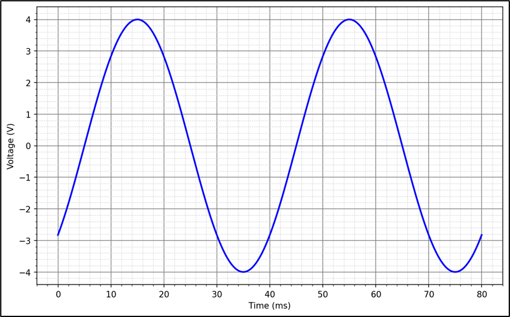
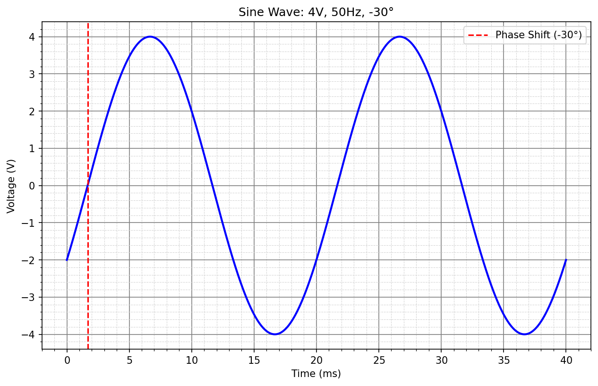

# L10 - Lösningsförslag till övningsuppgifter

### 1.1 - Vinklar till radianer
Omvandla följande vinklar till radianer:

**a)** $15^\circ$

**b)** $-75^\circ$

### Lösning

**a)** $15^\circ$ motsvarar $\frac{\pi}{12}$ radianer, då

```math
v_{rad} = \frac{v_{grad} \cdot \pi}{180^\circ} = \frac{15^\circ \cdot \pi}{180^\circ} = \frac{\pi}{12}
```

**b)** $-75^\circ$ motsvarar $-\frac{5\pi}{12}$ radianer, då

```math
v_{rad} = \frac{v_{grad} \cdot \pi}{180^\circ} = \frac{-75^\circ \cdot \pi}{180^\circ} = -\frac{5\pi}{12}
```

---

### 1.2 – Vinklar till grader
Omvandla följande vinklar till grader:

**a)** $-π/6$

**b)** $3π/2$

### Lösning

**a)** $-π/6$ radianer motsvarar $-30^\circ$, då

```math
v_{grad} = \frac{v_{rad} \cdot 180^\circ}{\pi} = \frac{-π/6 \cdot 180^\circ}{\pi}  = -\frac{180 \cdot \pi}{6\pi} = -30^\circ
```

**b)** $3π/2$ radianer motsvarar $270^\circ$, då

```math
v_{grad} = \frac{v_{rad} \cdot 180^\circ}{\pi} = \frac{3π/2 \cdot 180^\circ}{\pi}  = \frac{540 \cdot \pi}{2\pi} = 270^\circ
```

---

### 1.3 – Bestämning av en växelspännings egenskaper
En växelspänning visas i figuren nedan.



Bestäm spänningens ekvation på formen $u(t)=|U|sin⁡(\omega t+δ)$.

### Lösning

Genom att inspektera figuren ser vi att amplituden $|U|$ = $4$ $V$:

```math
|U| = 4 V
```

Vi ser också att periodtiden $T$ = $40$ $ms$, vilket medför att frekvensen $f$ = $25$ $Hz$, då

```math
f = \frac{1}{T} = \frac{1}{40m} = 25 Hz
```

Därmed gäller att vinkelhastigheten $\omega$ = $50\pi$ $rad/s$, då

```math
\omega = 2{\pi}f = 2{\pi} * 25 = 50\pi\,{rad/s} 
```

Vi ser också att toppvärdet nås efter $15 ms$. Utan fasförskjutning hade toppvärdet nåtts efter
$1/4$ av periodtiden, vilket i detta fall är $40m$ * $0.25$ = $10$ $ms$. Kurvan är då förskjuten $5$ $ms$ efter i tid. Fasförskjutningen $δ$ är därmed negativ:

```math
δ < 0
```

Vi omvandlar förskjutningen till radianer. Eftersom en hel period $T$ = $40$ $ms$ motsvarar ett helt varv gäller att $5$ $ms$, som är $5m$ / $40m$ = $1/8$ av ett varv. Eftersom ett varv motsvarar
$2\pi$ radianer gäller då att fasförskjutningen $δ$ är lika med $-\frac{\pi}{4}$, då

```math
δ = -2\pi * \frac{1}{8} = -\frac{2\pi}{8} = -\frac{\pi}{4}\,{rad}
```

Spänningens ekvation är därmed lika med

```math
u(t) = 4\sin\left(50\pi t - \frac{\pi}{4}\right)\,\text{V}
```

---

### 1.4 – Ekvation samt graf för en växelspänning
En växelspänning har amplituden $4$ $V$, frekvensen $50$ $Hz$ och fasen $-30°$.

Bestäm växelspänningens ekvation $u(t)$ (fasen i $rad$) och rita sinuskurvan över en period $T$.

### Lösning
Av uppgiftsbeskrivningen vet vi att amplituden $|U| = 4$ $V$, frekvensen $f$ = $50$ $Hz$ samt att fasen
$δ$ = $-30^\circ$, vilket motsvarar $-\frac{\pi}{6}$ radianer, då

```math
δ = \frac{-30^\circ \cdot \pi}{180^\circ} = -\frac{\pi}{6}\,{rad} 
```

Frekvensen $f$ = $50$ $Hz$ medför att periodtiden $T$ = $20$ $ms$, då

```math
T = \frac{1}{f} = \frac{1}{50} = 0,02\,{s} = 20\,{ms}
```

En fasförskjutning $δ$ på $-\frac{\pi}{6}\thinspace\text{rad}$ motsvarar $1/12$ av ett varv, då

```math
\frac{(\frac{\pi}{6})}{2\pi} = \frac{\pi}{6 \cdot 2\pi} = \frac{1}{12}
```

Att fasen $δ$ är negativ indikerar att spänningen är $1/12$ efter i tid. Eftersom periodtiden $T$
är lika med $20$ $ms$ gäller att spänningen är ${1,67}$ $ms$ efter i tid, då

```math
\Delta t = T \cdot \frac{1}{12} = 20m \cdot \frac{1}{12} = \frac{20}{12} \approx 1,67\,{ms} 
```

Med denna information kan vi rita ut spänningen såsom visas nedan:



---

### 1.5 – Beräkning av en växelströms fas
Ekvationen för en given växelspänning är:

```math
u(t)=6sin⁡(80πt+δ)
```

Vid tiden $t=15$ $ms$ gäller att $u(t) = 3$ $V$. Beräkna fasen $δ$.

### Lösning
Av ovanstående information kan ovanstående ekvation skrivas (med tiden $t$ i sekunder):

```math
u(0,015)=6sin⁡(80\pi \cdot 0,015 + δ) = 3,
```

vilket kan förenklas till

```math
6sin⁡(1,2\pi + δ) = 3
```

Vi dividerar med $6$ i respektive led:

```math
sin⁡(1,2\pi + δ) = 0,5
```

Vi använder sedan $\sin^{-1}$ för att beräkna rötterna. För en sinusekvation $sin$ $v$ = $x$ gäller att

```math
v_1 = \sin^{-1}(x)
```

```math
v_2 = \pi - \sin^{-1}(x)
```

Vi beräknar den första roten $δ_1$ via den första ekvationen ovan:

```math
1,2\pi + δ_1 = \sin^{-1}(0,5),
```

vilket kan omvandlas till

```math
δ_1 = \sin^{-1}(0,5) - 1,2\pi ≈ - 3,25\,{rad}
```

Vi beräknar sedan den andra roten $δ_2$ via den andra ekvationen ovan:

```math
1,2\pi + δ_2 = \pi - \sin^{-1}(0,5),
```

vilket kan omvandlas till

```math
δ_2 = \pi - \sin^{-1}(0,5) - 1,2\pi ≈ -1,15\,{rad}
```

Vi kontrollräknar de erhållna rötterna - vid $t$ = $0,015$ s bör spänningen $u(0,015)$ vara lika med 3 V.

Vi börjar med den första roten $δ_1$ ≈ $-3,25$ $rad$:

```math
u(0,015)=6\sin(80\pi \cdot 0,015 -3,25) \approx 3\,\text{V} \quad \Rightarrow \quad \text{OK!}
```

Vi testar sedan den andra roten $δ_2$ ≈ $-1,15$ $rad$:

```math
u(0,015)=6\sin(80\pi \cdot 0,015 -1,15) \approx 3\,\text{V} \quad \Rightarrow \quad \text{OK!}
```

---

## Del 2 - Nytt stoff

### 2.1 - Logaritmiska ekvationer
Lös följande logaritmiska ekvationer:

**a)** $5^x = 125$

**b)** $2^{x-3} = 128$

**c)** $e^{x+1} = 120$

---

### Lösning

**a)** Vi utnyttjar att $log\thinspace{5^x}$ = $x * log\thinspace{5}$. Därmed logaritmerar vi respektive led:

```math
x \cdot log\,{5} = log\,{125}
```

Genom att dividera med $log\thinspace{5}$ i respektive led kan vi sedan beräkna $x$:

```math
x = \frac{log\,{125}}{log\,{5}} = 3
```

**b)** Vi utnyttjar att $log$ $2^{x - 3}$ = $(x - 3) * log\thinspace 2$. Därmed logaritmerar vi respektive led:

```math
(x - 3) * log\,2 = log\,{128}
```

Vi dividerar sedan med $log\thinspace{2}$ i respektive led:

```math
x - 3 = \frac{log\,{128}}{log\,{2}}
```

Vi adderar sedan $3$ i respektive led för att beräkna $x$:

```math
x = \frac{log\,{128}}{log\,{2}} + 3 = 7 + 3 = 10
```

**c)** Vi utnyttjar att $ln$ $e^{x + 1}$ = $x + 1$, då

```math
ln\,e^{x + 1} = (x + 1) * ln\,e
```

samt att $ln\thinspace{e}\thinspace=\thinspace{1}$, vilket medför att

```math
(x + 1) * ln\,e = (x + 1) * 1 = x + 1
```
Därmed logaritmerar vi respektive led:

```math
(x + 1) = ln\,{120}
```

Vi subtraherar sedan $1$ i respektive led för att beräkna $x$:

```math
x = ln\,{120} - 1 ≈ 4,79 - 1 = 3,79
```

---

### 2.2 - Halveringstid för laddning i ett batteri  
Laddningen för ett batteri kan beskrivas via motsvarande spänning i enlighet med följande funktion:

```math
u(t) = U_0 * a^t
```

där 
* $u(t)$ är nuvarande laddning,
* $U_0$ är den ursprungliga laddningen,
* $a$ är förändringsfaktorn,
* $t$ är antalet passerade timmar.

Ett batteri tappar halva sin laddning på $40$ timmar. Beräkna efter hur lång tid endast $10$ % av laddningen återstår.

---

### Lösning
Förändringsfaktorn $a$ är okänd, men kan beräknas, då vi vet att halveringstiden är $40$ timmar. Med andra ord, om $U_0$ är den ursprungliga laddningsmängden så återstår $0,5U_0$ efter 40 timmar:

```math
u(40) = U_0 ∗ a^{40} = 0,5U_0
```

Vi dividerar med $U_0$ i båda led och erhåller då följande ekvation:

```math
a^{40} = 0,5
```

Vi upphöjer sedan båda led med exponenten $1/40$ för att isolera förändringsfaktorn $a$ i vänsterledet, då

```math
a^{40 \cdot 1/40} = a
```

Därmed gäller att

```math
a = 0,5^{1/40} ≈ 0,983
```

Vi lägger till den beräknade förändringsfaktorn $a$ i ovanstående funktion:

```math
u(t) ≈ U_0 ∗ 0,983^t
```

Vi söker sedan efter hur många timmar $t$ som laddningen är nere på $10$ % av den ursprungliga mängden. Med andra ord, om $U_0$ är den ursprungliga laddningsmängden söker vi efter hur många timmar $t$ som kvarvarande mängd $u(t)$ är lika med $0,1U_0$:

```math
u(t) ≈ U_0 ∗ 0,983^t=0,1U_0
```

Återigen dividerar vi med $U_0$ i båda led:

```math
0,983^t=0,1
```

För att få ned $t$ från exponenten i vänsterledet använder vi logaritmer i båda led. För vänsterledet gäller följande:


```math
log\,{0,983^t} = t \cdot log\,{0,983}
```

Ekvationen kan därmed skrivas om till följande:

```math
t \cdot log\,{0,983} = log\,{0,1}
```

Vi dividerar sedan med $log\thinspace{0,983}$ i båda led för att få $t$ isolerad i vänsterledet:

```math
t = \frac{log\,{0,1}}{log\,{0,5^{1/40}}} ≈ 132,88\,{h}
```

Här har det oavrundade värdet $a = 0,5^{1/40}$ använts i nämnaren; med det avrundade värdet $0,983$ blir svaret i stället $134,3$ timmar.

Detta motsvarar ungefär $132$ timmar samt $53$ minuter, då

```math
0,88 \cdot 60\,\text{min} \approx 53\,\text{min}
```

---

### 2.3 – Linjär förstärkning

Två signaler har spänningsnivåerna $L_1 = 15\thinspace\text{dB}$ och $L_2 = 49\thinspace\text{dB}$.

Beräkna den linjära spänningsförstärkningen $G_{lin}$ mellan dessa två nivåer.  

Använd följande formel:

```math
G_{dB} = 20\log_{10}(G_{lin})  
```

och tänk på att  
```math
G_{dB} = L_2 - L_1.
```

---

### Lösning

Vi beräknar först skillnaden i `dB`:

```math
G_{dB} = L_2 - L_1 = 49\,\text{dB} - 15\,\text{dB} = 34\,\text{dB}
```

Därefter beräknar vi den linjära förstärkningen:

```math
G_{lin} = 10^{G_{dB}/20} = 10^{34/20} = 10^{1{,}7} \approx 50{,}12
```

---

### 2.4 – Beräkning av effektivvärde i $dBV$

Sambandet mellan en spännings effektivvärde samt motsvarande värde i $dBV$ (decibel Volt) visas nedan:

```math
U_{dBV} = 20 \log_{10} \left( \frac{U_{RMS}}{1\,V} \right)
```
där 
* $U_{RMS}$ = spänningens effektivvärde i $V$,
* $U_{dBV}$ = spänningen i $dBV$.

En sinusspänning har nivån $17{,}0$ $dBV$. Bestäm amplituden i $V$.

---

### Lösning

Vi transformerar ovanstående formel för att beräkna $U_{RMS}$. Vi börjar med att vända på
uttrycket samt dividera med $20$ i respektive led:

```math
log_{10} \left( \frac{U_{RMS}}{1\,V} \right) = \frac{U_{dBV}}{20}
```

Vi upphöjer sedan båda led med basen $10$ för att isolera $\frac{U_{RMS}}{1\thinspace V}$ i vänsterledet, då

```math
10^{log_{10} \left( \frac{U_{RMS}}{1\,V} \right)} = \frac{U_{RMS}}{1\,V}
```

Därmed gäller att

```math
\frac{U_{RMS}}{1\,V} = 10^{\frac{U_{dBV}}{20}},
```

vilket är ekvivalent med att

```math
U_{RMS} = 10^{\frac{U_{dBV}}{20}} * 1\,{V} = 10^{\frac{U_{dBV}}{20}}
```

Vi beräknar sedan $U_{RMS}$ genom att sätta in $U_{dBV}$ = $17$ $dBV$ i uttrycket:

```math
U_{RMS} = 10^{\frac{17}{20}} \approx 7,08\,V
```

Vi beräknar sedan spänningens amplitud via motsvarande RMS-värde:

```math
U_{RMS} = \frac{|U|}{\sqrt{2}},
```

vilket innebär att

```math
|U| = U_{RMS} * \sqrt{2} \approx 7,08 * \sqrt{2} \approx 10,0\,{V}
```

Spänningens amplitud $|U|$ uppgår därmed till ca $10,0\thinspace V$.

---

## Del 3 – Extrauppgifter

### 3.1 – Logaritmer utan miniräknare

---

### Lösning
Logaritmen svarar på frågan "vilken exponent behövs?".

**a)** $\log 100 = \log 10^2 = 2$

**b)** $\log 1000 = \log 10^3 = 3$

**c)** $\log 1 = \log 10^0 = 0$

**d)** $\log 0{,}01 = \log 10^{-2} = -2$

**e)** $\ln e = \ln e^1 = 1$

**f)** $\ln 1 = \ln e^0 = 0$

Notera att logaritmen av $1$ alltid är noll, oavsett bas.

---

### 3.2 – Logaritmlagarna

---

### Lösning
**a)** Summan av två logaritmer är logaritmen av produkten:

```math
\log 3 + \log 4 = \log(3 \cdot 4) = \log 12
```

**b)** Differensen är logaritmen av kvoten:

```math
\log 20 - \log 4 = \log\frac{20}{4} = \log 5
```

**c)** Koefficienten flyttas upp som exponent:

```math
2\log 5 = \log 5^2 = \log 25
```

**d)**

```math
\log 2 + \log 5 = \log 10 = 1
```

**e)** Först flyttas trean upp som exponent, sedan används kvotlagen:

```math
3\log 2 - \log 4 = \log 8 - \log 4 = \log\frac{8}{4} = \log 2
```

---

### 3.3 – Exponentialekvationer

---

### Lösning
**a)** Skriv $32$ som en tvåpotens:

```math
2^x = 2^5 \quad \Rightarrow \quad x = 5
```

**b)**

```math
10^x = 10^{-3} \quad \Rightarrow \quad x = -3
```

**c)** Baserna kan inte skrivas lika, så vi logaritmerar båda led:

```math
x\log 5 = \log 100 \quad \Rightarrow \quad x = \frac{\log 100}{\log 5} = \frac{2}{0{,}699} \approx 2{,}86
```

**d)** Här passar den naturliga logaritmen bäst:

```math
x = \ln 20 \approx 3{,}00
```

**e)** Skriv $64$ som en fyrpotens:

```math
4^{x+1} = 4^3 \quad \Rightarrow \quad x + 1 = 3 \quad \Rightarrow \quad x = 2
```

Går baserna att skriva lika är det alltid snabbast – annars logaritmerar man.

---

### 3.4 – Logaritmiska ekvationer

---

### Lösning
Metoden är den omvända: upphöj $10$ (eller $e$) i båda led.

**a)**

```math
x = 10^2 = 100
```

**b)**

```math
x = e^0 = 1
```

**c)**

```math
x + 5 = 10^1 = 10 \quad \Rightarrow \quad x = 5
```

**d)** Dividera först med $2$:

```math
\log x = 2 \quad \Rightarrow \quad x = 100
```

**e)**

```math
2x = e^1 = e \quad \Rightarrow \quad x = \frac{e}{2} \approx 1{,}36
```

---

### 3.5 – Spänningsförstärkning i dB

---

### Lösning
**a)** Kvoten är $\dfrac{1}{0{,}010} = 100$:

```math
G_{\text{dB}} = 20\log 100 = 20 \cdot 2 = 40\,\text{dB}
```

**b)** Kvoten är $1$:

```math
G_{\text{dB}} = 20\log 1 = 0\,\text{dB}
```

Signalen passerar oförändrad – $0\thinspace\text{dB}$ betyder alltså varken förstärkning eller dämpning.

**c)** Kvoten är $\dfrac{0{,}5}{5} = 0{,}1$:

```math
G_{\text{dB}} = 20\log 0{,}1 = 20 \cdot (-1) = -20\,\text{dB}
```

**d)** Ett negativt värde betyder **dämpning**: utsignalen är mindre än insignalen. Kvoten är då mindre än $1$, och logaritmen av ett tal mellan $0$ och $1$ är negativ.

---

### 3.6 – Från dB till linjär förstärkning

---

### Lösning
**a)**

```math
G_{\text{lin}} = 10^{20/20} = 10^1 = 10
```

**b)**

```math
G_{\text{lin}} = 10^{60/20} = 10^3 = 1000
```

**c)**

```math
G_{\text{lin}} = 10^{6/20} = 10^{0{,}3} \approx 2{,}00
```

$6\thinspace\text{dB}$ motsvarar alltså ungefär en fördubbling av spänningen – ett mycket användbart minnesvärde.

**d)**

```math
G_{\text{lin}} = 10^{-3/20} = 10^{-0{,}15} \approx 0{,}708
```

**e)** Först den linjära förstärkningen, sedan multiplikation med insignalen:

```math
G_{\text{lin}} = 10^{26/20} = 10^{1{,}3} \approx 20{,}0
```

```math
U_{\text{ut}} = 20{,}0 \times 50\,\text{mV} \approx 1{,}0\,\text{V}
```

---

### 3.7 – Effektförstärkning i dB

---

### Lösning
**a)**

```math
G_{\text{dB}} = 10\log\frac{100}{1} = 10 \cdot 2 = 20\,\text{dB}
```

**b)**

```math
G_{\text{dB}} = 10\log\frac{10}{20} = 10\log 0{,}5 \approx -3{,}01\,\text{dB}
```

**c)** Effekten är proportionell mot **kvadraten** på spänningen, $P = \dfrac{U^2}{R}$. Sätter man in det i effektformeln blir logaritmen:

```math
10\log\left(\frac{U_{\text{ut}}}{U_{\text{in}}}\right)^2 = 10 \cdot 2\log\frac{U_{\text{ut}}}{U_{\text{in}}} = 20\log\frac{U_{\text{ut}}}{U_{\text{in}}}
```

Tvåan från kvadraten flyttas ut ur logaritmen och gör $10$ till $20$. Båda formlerna beskriver alltså samma sak.

**d)** Fördubblad **effekt**:

```math
10\log 2 \approx 3{,}01\,\text{dB} \approx 3\,\text{dB}
```

Fördubblad **spänning**:

```math
20\log 2 \approx 6{,}02\,\text{dB} \approx 6\,\text{dB}
```

Därför talar man om "3 dB-gränsen" för effekt och "6 dB per fördubbling" för spänning.

---

### 3.8 – Kaskadkopplade steg

---

### Lösning
**a)** Dämpningen räknas som en negativ förstärkning:

```math
G_{\text{TOT}} = 12 + 18 - 4 = 26\,\text{dB}
```

**b)**

```math
G_{\text{lin}} = 10^{26/20} = 10^{1{,}3} \approx 20{,}0
```

**c)** Varje steg för sig:

```math
10^{12/20} \approx 3{,}98, \qquad 10^{18/20} \approx 7{,}94, \qquad 10^{-4/20} \approx 0{,}631
```

```math
3{,}98 \times 7{,}94 \times 0{,}631 \approx 20{,}0 \quad ✓
```

**d)** Linjära förstärkningar **multipliceras** när steg kopplas i kaskad, men decibelvärden **adderas**. Det följer direkt av logaritmlagen $\log(ab) = \log a + \log b$. Att addera och subtrahera i huvudet är betydligt enklare än att multiplicera, vilket är hela poängen med dB-skalan.

---

### 3.9 – Nivå i dBV

---

### Lösning
**a)**

```math
U_{\text{dBV}} = 20\log 1 = 0\,\text{dBV}
```

Referensen är just $1\thinspace\text{V}$, så $0\thinspace\text{dBV}$ motsvarar exakt en volt.

**b)**

```math
U_{\text{dBV}} = 20\log 10 = 20\,\text{dBV}
```

**c)**

```math
U_{\text{dBV}} = 20\log 0{,}1 = -20\,\text{dBV}
```

**d)** Lös ut effektivvärdet:

```math
U_{\text{RMS}} = 10^{12/20} = 10^{0{,}6} \approx 3{,}98\,\text{V}
```

**e)** Amplituden är $\sqrt{2}$ gånger effektivvärdet:

```math
|U| = 3{,}98 \times \sqrt{2} \approx 5{,}63\,\text{V}
```

---

### 3.10 – Halverings- och fördubblingstid

---

### Lösning
**a)** Efter varje timme återstår 98 %:

```math
a = 1 - 0{,}02 = 0{,}98
```

**b)** Sätt $a^t = 0{,}5$ och logaritmera:

```math
t\log 0{,}98 = \log 0{,}5 \quad \Rightarrow \quad t = \frac{\log 0{,}5}{\log 0{,}98} = \frac{-0{,}301}{-0{,}00877} \approx 34{,}3\,\text{h}
```

**c)** Här är $a = 1{,}10$ och vi söker en fördubbling:

```math
t = \frac{\log 2}{\log 1{,}10} = \frac{0{,}301}{0{,}0414} \approx 7{,}3\,\text{dygn}
```

**d)** En fördubbling innebär att $f(t) = 2C$:

```math
C \cdot a^t = 2C \quad \Rightarrow \quad a^t = 2
```

Startvärdet $C$ förkortas bort – fördubblingstiden beror alltså inte på hur mycket man börjar med. Logaritmera båda led:

```math
t\log a = \log 2 \quad \Rightarrow \quad t = \frac{\log 2}{\log a}
```

Samma räkning med $0{,}5$ i stället för $2$ ger halveringstiden.

---

### 3.11 – Hitta felet

---

### Lösning
**a)** Det är **produkten**, inte summan, som blir en summa av logaritmer:

```math
\log(ab) = \log a + \log b
```

Uttrycket $\log(a + b)$ kan inte förenklas alls.

**b)** En kvot av logaritmer är inte logaritmen av en kvot. Här är det i stället ett basbyte:

```math
\frac{\log 8}{\log 2} = \log_2 8 = 3
```

**c)** Exponenten flyttas ut som en **faktor**, inte som en exponent på logaritmen:

```math
\log(a^n) = n\log a
```

**d)** $G_{\text{dB}} = 0$ ger $G_{\text{lin}} = 10^0 = 1$, alltså att signalen passerar **oförändrad**. En signal som försvinner skulle ge $G_{\text{lin}} \to 0$, vilket motsvarar $G_{\text{dB}} \to -\infty$.

**e)** Tiopotens och tiologaritm tar ut varandra:

```math
10^{\log x} = x
```

**f)** $\ln 0$ är **odefinierat**. Det finns ingen exponent som gör $e$ upphöjt till något lika med noll; $\ln x \to -\infty$ när $x \to 0$. Det är $\ln 1$ som är noll.

---

## Del 4 – Matematik i C

### 4.1 – Decibel i C

**a)** $20\log_{10} 1 = 0$ dB, $20\log_{10} 10 = 20$ dB och $20\log_{10} 100 = 40$ dB. Kvoten för $-3$ dB är $10^{-3/20} \approx 0{,}708$.

**b)** Programmet ska skriva ut ungefär följande:

```text
kvot      dB    tillbaka
   0.5   -6.02      0.500
     1    0.00      1.000
     2    6.02      2.000
    10   20.00     10.000
   100   40.00    100.000
  1000   60.00   1000.000
```

`ratio_from_db()` ger tillbaka samma kvot, eftersom $10^{x}$ och $\log_{10}$ är varandras inverser.

**c)** En fördubbling lägger till $20\log_{10} 2 \approx 6{,}02$ dB och en tiodubbling $20$ dB, oavsett var man börjar, eftersom $\log_{10}(a \cdot b) = \log_{10} a + \log_{10} b$. En kvot mindre än $1$ ger negativa dB, alltså en dämpning: halveringen ger $-6{,}02$ dB.

---
