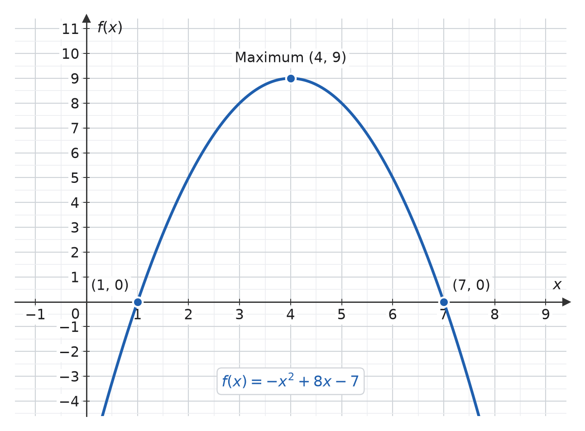
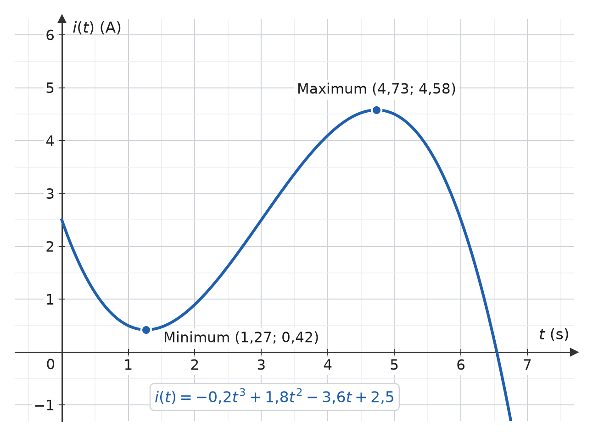

# L12 – Lösningsförslag till lektionsuppgifter

## Del 1 - Lektionsuppgifter

### 1.1 - Derivering av funktioner
Derivera följande funktioner:

**a)** $f(x) = -3x^2 + 5x + 2$

**b)** $f(x) = 2x^3 - 5x^2 + \frac{2x}{3} - 4$

**c)** $f(x) = 2x^4 - x^3 + \frac{3x^2}{5} + 4x - 1$

---

### Lösning

**a)** $f'(x) = -6x + 5$

**b)** $f'(x) = 6x^2 - 10x + \frac{2}{3}$

**c)** $f'(x) = 8x^3 - 3x^2 + \frac{6x}{5} + 4$

---

### 1.2 – Analys av en parabel

Betrakta följande funktion:

```math
f(x) = -x^2 + 8x - 7
```

**a)** Derivera funktionen $f(x)$, dvs. bestäm uttrycket för $f'(x)$.

**b)** Bestäm var funktionen är stationär, dvs. lös ekvationen $f'(x) = 0$.

**c)** Avgör med hjälp av den andra derivatan om punkten är ett **maximum** eller **minimum**.

**d)** Beräkna funktionens största eller minsta värde.

**e)** Rita upp grafen till $f(x)$ via [Geogebra](https://www.geogebra.org/graphing?lang=en), kontrollera att
dina svar stämmer.

---

### Lösning

**a)** Vi deriverar $f(x)$ för att bestämma $f'(x)$:

```math
 f'(x) = -2x + 8
 ```

**b)** Vi bestämmer när $f'(x) = 0$:

```math 
f'(x) = -2x + 8 = 0
```

Vi adderar $2x$ i respektive led och erhåller då följande uttryck:

```math
8 = 2x
```

Genom att vända på uttrycket samt dividera med $2$ i båda led ser vi att $f'(x) = 0$ när $x = 4$:

```math
x = 4
```

**c)** Vi bestämmer den andra derivatan $f''(x)$ genom att derivera $f'(x)$:

```math
f''(x) = -2
```

Vi är intresserade av den andra derivatan i extrempunkten $x = 4$, dvs. $f''(4)$.\
Eftersom $f''(x) = -2$ för alla $x$ gäller att

```math
f''(4) = f''(x) = -2
```

Eftersom $f''(4) = -2$ gäller att funktionen har ett maximum när $x = 4$:
* $f'(4) = 0$ indikerar att lutningen i denna punkt är $0$ => kurvan vänder.
* $f''(4) < 0$ indikerar att lutningen är på väg att minska => aktuellt värde är ett maximum och kurvan är därmed på väg nedåt.

**d)** Vi beräknar funktionens maxvärde genom att sätta in extremvärdet $x=4$ i den givna funktionen $f(x)$.\
Därmed beräknar vi $f(4)$:

```math
f(4) = -4^2 + 8*4 - 7 = -16 + 32 - 7 = 9
```

Funktionen har därmed en maximipunkt i $(x, y) = (4, 9)$.

**e)** Funktionens graf visas nedan. Denna indikerar att våra beräkningar stämmer:



---

### 1.3 – Analys av strömförlopp i en RC-krets

Strömmen genom en viss RC-krets kan approximeras med följande polynomfunktion:

```math
i(t) = -0,2t^3 + 1,8t^2 - 3,6t + 2,5
```

där  
* $i(t)$ = strömmen genom kretsen i $A$,  
* $t$ = tiden i sekunder.

**a)** Derivera funktionen för att bestämma uttrycket för strömmens förändring (strömändringshastigheten) $i'(t)$.

**b)** Beräkna den tidpunkt (eller tidpunkter) då strömmen är stationär, dvs. när $i'(t) = 0$.

**c)** Bestäm med hjälp av den **andra derivatan** om respektive stationär punkt är ett **maximum** eller **minimum**.

**d)** Beräkna strömmens maximi- och minimivärde, dvs. strömmen $i(t)$ i de stationära punkterna.

**e)** Rita grafen till $i(t)$ via [Geogebra](https://www.geogebra.org/graphing?lang=en), kontrollera att
dina svar stämmer.

--- 

### Lösning

**a)** Vi deriverar $i(t)$ för att bestämma $i'(t)$:

```math
i'(t) = -0,6t^2 + 3,6t - 3,6
```

**b)** Vi bestämmer när $i'(t) = 0$:

```math
i'(t) = -0,6t^2 + 3,6t - 3,6 = 0
```

Ovanstående uttryck kan skrivas om till

```math
0,6t^2 = 3,6t - 3,6
```

Vi dividerar med $0,6$ i respektive led och erhåller då följande uttryck:

```math
t^2 = 6t - 6
```

Vi beräknar rötterna för $t$ via PQ-formeln:

```math
t = \frac{6}{2} \pm \sqrt{(\frac{6}{2})^2 - 6},
```

vilket kan skrivas om till

```math
t = 3 \pm \sqrt{3^2 - 6},
```

där

```math
3^2 - 6 = 3
```

Därmed gäller att

```math
t = 3 \pm \sqrt{3}
```

Därmed kan vi beräkna rötterna:


```math
t_1 = 3 - \sqrt{3} \approx 1,27 s
```

```math
t_2 = 3 + \sqrt{3} \approx 4,73 s
```

Strömmen är därmed stationär efter ungefär $1,27$ $s$ samt $4,73$ $s$.

**c)** Vi bestämmer den andra derivatan $i''(t)$ genom att derivera $i'(t)$:

```math
i''(t) = -1,2t + 3,6
```

Vi är intresserade av den andra derivatan i extrempunkterna $t_1$ samt $t_2$.

Vi börjar med att bestämma $i''(t_1)$:

```math
i''(t_1) \approx i''(1,27) = -1,2 * 1,27 + 3,6 \approx 2,08 => minvärde
```

Eftersom $i''(t_1) > 0 $ gäller att funktionen har ett minimum vid tiden $t_1$:
* $i'(t_1) = 0$ indikerar att lutningen i denna punkt är $0$ => kurvan vänder.
* $i''(t_1) > 0$ indikerar att lutningen är på väg att öka => aktuellt värde är ett minimum och kurvan är därmed på väg uppåt.

Vi bestämmer sedan $i''(t_2)$:

```math
i''(t_2) \approx i''(4,73) = -1,2 * 4,73 + 3,6 \approx -2,08 => maxvärde
```

Eftersom $i''(t_2) < 0 $ gäller att funktionen har ett maximum vid tiden $t_2$:
* $i'(t_2) = 0$ indikerar att lutningen i denna punkt är $0$ => kurvan vänder.
* $i''(t_2) < 0$ indikerar att lutningen är på väg att minska => aktuellt värde är ett maximum och kurvan är därmed på väg nedåt.

**d)** Vi beräknar funktionens min- respektive maxvärde genom att sätta in extrempunkterna $t_1$ samt $t_2$ i den givna funktionen $i(t)$.

Vi börjar med att beräkna minimipunkten $i(t_1)$:

```math
i(t_1) \approx i(1,27) = -0,2 * 1,27^3 + 1,8 * 1,27^2 - 3,6 * 1,27 + 2,5 \approx 0,42 A
```

Funktionen har därmed en minimipunkt $0,42$ $A$ efter ca $1,27$ $s$.

Vi beräknar sedan maximipunkten $i(t_2)$:

```math
i(t_2) \approx i(4,73) = -0,2 * 4,73^3 + 1,8 * 4,73^2 - 3,6 * 4,73 + 2,5 \approx 4,58 A
```
Funktionen har därmed en maximipunkt $4,58$ $A$ efter ca $4,73$ $s$.

**e)** Funktionens graf visas nedan. Denna indikerar att våra beräkningar stämmer:



---

## Del 2 – Extrauppgifter
### 2.1 – Derivera polynom

---

### Lösning
Regeln $\dfrac{d}{dx}Cx^n = Cnx^{n-1}$ används genomgående.

**a)** $f'(x) = 5x^4$

**b)** $f'(x) = 12x^2$

**c)** $f'(x) = 0$ – derivatan av en konstant är alltid noll.

**d)** $f'(x) = 4x - 5$

**e)** $f'(x) = -12x^3 + 1$

**f)** $f'(x) = \dfrac{3x^2}{3} = x^2$

---

### 2.2 – Ändringskvot och derivatans definition
$f(x) = x^2$

---

### Lösning
**a)** Sätt in i ändringskvoten och utveckla kvadraten:

```math
\frac{f(2+h) - f(2)}{h} = \frac{(2+h)^2 - 2^2}{h} = \frac{4 + 4h + h^2 - 4}{h} = \frac{4h + h^2}{h} = 4 + h
```

**b)** När $h \to 0$ försvinner den sista termen:

```math
\lim_{h \to 0} (4 + h) = 4
```

**c)** Deriveringsregeln ger $f'(x) = 2x$, alltså $f'(2) = 4$ ✓ Samma svar.

**d)**

```math
h = 0{,}1: \quad 4 + 0{,}1 = 4{,}1, \qquad h = 0{,}01: \quad 4 + 0{,}01 = 4{,}01
```

Ju mindre $h$, desto närmare kommer sekantens lutning tangentens lutning. Det är precis vad gränsvärdet i definitionen uttrycker.

---

### 2.3 – Derivatan i en punkt
$f(x) = x^3 - 3x$

---

### Lösning
**a)**

```math
f'(x) = 3x^2 - 3
```

**b)**

```math
f'(0) = -3
```

**c)**

```math
f'(2) = 12 - 3 = 9
```

**d)** Tangenten är vågrät där derivatan är noll:

```math
3x^2 - 3 = 0 \quad \Rightarrow \quad x^2 = 1 \quad \Rightarrow \quad x = 1 \text{ eller } x = -1
```

---

### 2.4 – Tangentens ekvation
$f(x) = x^2 - 4x + 5$, $x_0 = 3$

---

### Lösning
**a)**

```math
f(3) = 9 - 12 + 5 = 2
```

**b)**

```math
f'(x) = 2x - 4 \quad \Rightarrow \quad f'(3) = 2
```

**c)** Sätt in i $y = f'(x_0)(x - x_0) + f(x_0)$:

```math
y = 2(x - 3) + 2 = 2x - 4
```

**d)**

```math
2x - 4 = 0 \quad \Rightarrow \quad x = 2
```

---

### 2.5 – Stationär punkt hos en parabel
$f(x) = x^2 - 6x + 8$

---

### Lösning
**a)**

```math
f'(x) = 2x - 6
```

**b)**

```math
2x - 6 = 0 \quad \Rightarrow \quad x = 3
```

**c)**

```math
f''(x) = 2 > 0 \quad \Rightarrow \quad \text{minimum}
```

**d)**

```math
f(3) = 9 - 18 + 8 = -1
```

Minimipunkten är $(3,\thinspace -1)$.

---

### 2.6 – Stationära punkter hos en tredjegradsfunktion
$f(x) = x^3 - 3x^2 - 9x + 5$

---

### Lösning
**a)**

```math
f'(x) = 3x^2 - 6x - 9 = 3(x^2 - 2x - 3) = 3(x - 3)(x + 1)
```

**b)** Nollproduktmetoden ger:

```math
x_1 = -1, \qquad x_2 = 3
```

**c)** Andra derivatan är $f''(x) = 6x - 6$:

```math
f''(-1) = -12 < 0 \quad \Rightarrow \quad \text{maximum}
```

```math
f''(3) = 12 > 0 \quad \Rightarrow \quad \text{minimum}
```

**d)**

```math
f(-1) = -1 - 3 + 9 + 5 = 10 \quad \text{(maximum)}
```

```math
f(3) = 27 - 27 - 27 + 5 = -22 \quad \text{(minimum)}
```

---

### 2.7 – Växande och avtagande
$f(x) = x^2 - 4x$

---

### Lösning
**a)**

```math
f'(x) = 2x - 4
```

**b)** Funktionen växer där derivatan är positiv:

```math
2x - 4 > 0 \quad \Rightarrow \quad x > 2
```

**c)** Och avtar där derivatan är negativ:

```math
2x - 4 < 0 \quad \Rightarrow \quad x < 2
```

**d)** Vid $x = 2$ är $f'(2) = 0$. Funktionen vänder från avtagande till växande, alltså en **minimipunkt**. Det stämmer med $f''(x) = 2 > 0$.

---

### 2.8 – Andra derivatan

---

### Lösning
**a)**

```math
f'(x) = 4x^3 - 4x, \qquad f''(x) = 12x^2 - 4
```

**b)**

```math
f'(x) = 15x^2 + 2, \qquad f''(x) = 30x
```

**c)**

```math
f'(x) = -2x + 7, \qquad f''(x) = -2
```

**d)** Tecknet på $f''(x)$ anger kurvans **konkavitet**: är $f''(x) > 0$ vänder kurvan uppåt (som en dalgång), är $f''(x) < 0$ vänder den nedåt (som en kulle). Det är därför andraderivatan avgör om en stationär punkt är ett minimum eller ett maximum.

---

### 2.9 – Ström genom en kondensator
$C = 100\thinspace\mu\text{F}$, $u(t) = 4t^2 + 2t$ V

---

### Lösning
**a)**

```math
u'(t) = 8t + 2
```

**b)** Multiplicera med kapacitansen:

```math
i_C(t) = C\,u'(t) = 100 \times 10^{-6}(8t + 2) = (8t + 2) \times 10^{-4}\,\text{A} = (0{,}8t + 0{,}2)\,\text{mA}
```

**c)**

```math
i_C(1) = 0{,}8 + 0{,}2 = 1{,}0\,\text{mA}
```

**d)**

```math
0{,}8t + 0{,}2 = 2 \quad \Rightarrow \quad t = \frac{1{,}8}{0{,}8} = 2{,}25\,\text{s}
```

Notera att strömmen genom en kondensator beror på hur **snabbt** spänningen ändras, inte på spänningens storlek.

---

### 2.10 – Spänning över en spole
$L = 0{,}5\thinspace\text{H}$, $i(t) = 2t^2 - 4t + 3$ A

---

### Lösning
**a)**

```math
i'(t) = 4t - 4
```

**b)**

```math
u_L(t) = L\,i'(t) = 0{,}5(4t - 4) = 2t - 2\,\text{V}
```

**c)**

```math
2t - 2 = 0 \quad \Rightarrow \quad t = 1\,\text{s}
```

**d)** Vid $t = 1\thinspace\text{s}$ är $i'(1) = 0$, alltså är strömmen **stationär**. Eftersom $i''(t) = 4 > 0$ är det ett minimum, och strömmen är då $i(1) = 2 - 4 + 3 = 1\thinspace\text{A}$. En spole utvecklar alltså ingen spänning i det ögonblick strömmen slutar ändra sig.

---

### 2.11 – Maximal effekt
$P(I) = 24I - 3I^2$ W

---

### Lösning
**a)**

```math
P'(I) = 24 - 6I
```

**b)**

```math
24 - 6I = 0 \quad \Rightarrow \quad I = 4\,\text{A}
```

**c)**

```math
P''(I) = -6 < 0 \quad \Rightarrow \quad \text{maximum}
```

**d)**

```math
P(4) = 96 - 48 = 48\,\text{W}
```

---

### 2.12 – Förändringshastighet i en signal
$u(t) = -2t^2 + 12t$ V, $0 \leq t \leq 6\thinspace\text{s}$

---

### Lösning
**a)**

```math
u'(t) = -4t + 12
```

**b)** Sätt derivatan till noll:

```math
-4t + 12 = 0 \quad \Rightarrow \quad t = 3\,\text{s}
```

```math
u(3) = -18 + 36 = 18\,\text{V}
```

Eftersom $u''(t) = -4 < 0$ är det ett maximum.

**c)**

```math
u'(1) = -4 + 12 = 8\,\text{V/s}
```

Spänningen **ökar** med $8\thinspace\text{V/s}$.

**d)** En minskning med $4\thinspace\text{V/s}$ betyder $u'(t) = -4$:

```math
-4t + 12 = -4 \quad \Rightarrow \quad t = 4\,\text{s}
```

---

### 2.13 – Tolkning av derivatans tecken
$f'(1) = 3$, $f'(2) = 0$, $f'(3) = -2$, $f''(2) = -5$

---

### Lösning
**a)** $f'(1) = 3 > 0$, alltså är funktionen **växande** vid $x = 1$.

**b)** $f'(3) = -2 < 0$, alltså är funktionen **avtagande** vid $x = 3$.

**c)** $f'(2) = 0$ gör $x = 2$ till en **stationär punkt**, och $f''(2) = -5 < 0$ gör den till en **maximipunkt**.

**d)** Grafen stiger fram till $x = 2$, planar ut med vågrät tangent i toppen och faller därefter. Det stämmer överens med de tre derivatavärdena: positiv före, noll i, negativ efter.

---

### 2.14 – Hitta felet

---

### Lösning
**a)** Exponenten flyttas ned som faktor och minskas med ett – man behåller inte något extra $x$:

```math
f'(x) = 3x^2
```

**b)** Derivatan av en konstant är noll, eftersom en konstant funktion inte ändrar sig:

```math
f'(x) = 0
```

**c)** Derivatan av $4x$ är lutningen, alltså en konstant:

```math
f'(x) = 4
```

**d)** Termen $2x$ ska deriveras till $2$, inte behållas:

```math
f'(x) = 6x + 2
```

**e)** **Falskt.** En stationär punkt kan vara ett maximum, ett minimum eller en terrasspunkt. Det är andraderivatans tecken som avgör vilket.

**f)** **Falskt.** $f''(x)$ fås genom att derivera $f'(x)$ **en gång till**, inte genom att kvadrera den. Till exempel ger $f(x) = x^3$ att $f'(x) = 3x^2$ och $f''(x) = 6x$, inte $9x^4$.

---

## Del 3 – Matematik i C

### 3.1 – Derivatans definition i C

**a)** $f'(x) = 2x$, så $f'(3) = 6$.

**b)** Se lösningen i [`code/main.c`](./code/main.c). Koden förklaras i [`code/README.md`](./code/README.md). Programmet skriver ut följande:

```text
x = 3, f'(3) = 7 when h = 1
x = 3, f'(3) = 6.1 when h = 0.1
x = 3, f'(3) = 6.01 when h = 0.01
x = 3, f'(3) = 6.001 when h = 0.001
x = 3, f'(3) = 6.0001 when h = 0.0001
x = 3, f'(3) = 6.00001 when h = 1e-05
x = 3, f'(3) = 6 when h = 1e-06
```

**c)** Lutningen närmar sig $6$, alltså $f'(3)$, och avvikelsen är precis $h$. Algebraiskt:

```math
\frac{f(3 + h) - f(3)}{h} = \frac{(3 + h)^2 - 9}{h} = \frac{9 + 6h + h^2 - 9}{h} = \frac{6h + h^2}{h} = 6 + h
```

När $h \to 0$ går lutningen mot $6$, vilket är derivatans definition i praktiken.

---
