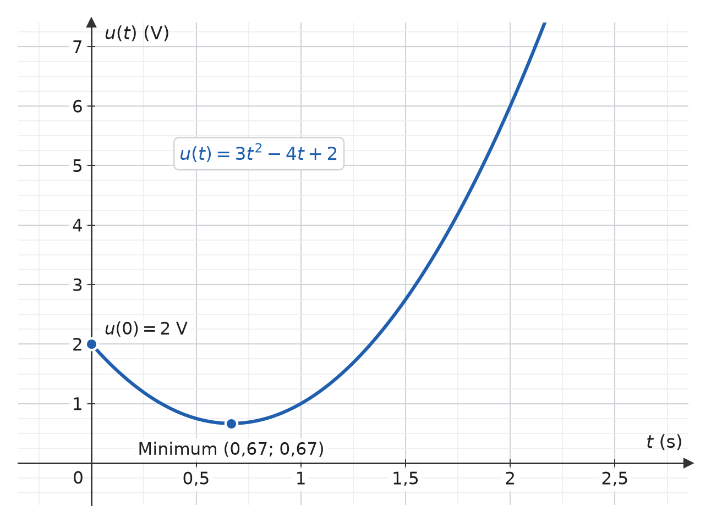
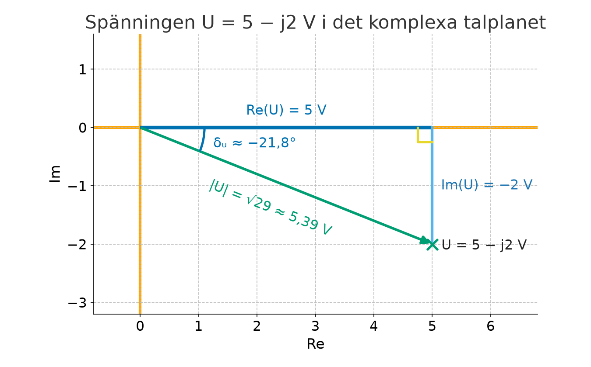
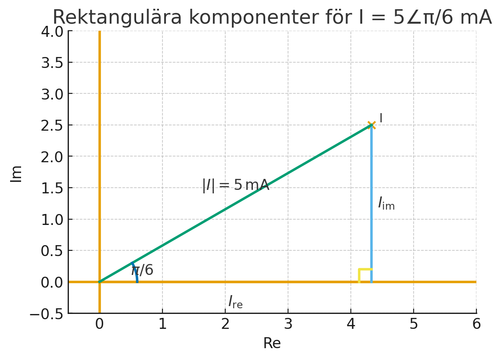

# L15 - Lösningsförslag till lektionsuppgifter

## Del 1 - Repetitionsuppgifter

### 1.1 - Återfå tidsfunktion från derivata (spänningssignal)

En sensorspänning $u(t)$ i en mätkrets är inte känd direkt, men dess derivata $u'(t)$ är uppmätt till

```math
u'(t) = 6t − 4\,\,\text{V/s}
```

Det är också känt att startspänningen $u(0)$ = $2$ $V$.

**a)** Bestäm ett uttryck för u(t).

**b)** Bestäm spänningen efter $3$ sekunder.

**c)** Beräkna den bestämda integralen $\int_0^3 u'(t)\,dt$. Jämför värdet med $u(3)$ från b) och förklara en eventuell skillnad.

**d)** Beräkna den tidpunkt då spänningen är stationär, dvs. när $u'(t) = 0$.

**e)** Bestäm med hjälp av den **andra derivatan** om den stationära punkten är ett **maximum** eller **minimum**.

**f)** Beräkna den stationära punktens koordinater, dvs. tidpunkten $t$ och spänningen $u(t)$ i punkten.

**g)** Rita grafen till $u(t)$ via [Geogebra](https://www.geogebra.org/graphing?lang=en), kontrollera att dina svar stämmer.

---

### Lösning
**a)** Vi integrerar $u'(t)$ för att bestämma $u(t)$:

```math
u(t) = \int u'(t)\,\,dt = \int (6t - 4)\,\,dt = \frac{6t^2}{2} - 4t + C,
```

vilket kan skrivas om till

```math
u(t) = 3t^2 - 4t + C
```

Vi kan också bestämma integrationskonstanten $C$, då vi känner till att startspänningen $u(0) = 2$ $V$:

```math
u(0) = 3 * 0^2 - 4 * 0 + C = 2,
```

vilket kan skrivas om till

```math
C = 2
```

Därmed kan ett slutgiltigt uttryck för $u(t)$ bestämmas:

```math
u(t) = 3t^2 - 4t + 2\,\,V
```

**b)** För att bestämma spänningen efter $3$ sekunder beräknar vi $u(3)$:

```math
u(3) = 3 * 3^2 - 4 * 3 + 2 = 3 * 9 - 12 + 2 = 17\,\,V
```

**c)** Vi integrerar $u'(t)$ mellan $0$ och $3$ sekunder:

```math
\int_0^3 u'(t)\,dt = \int_0^3 (6t - 4)\,dt = \Big[3t^2 - 4t\Big]_0^3 = (3 \cdot 3^2 - 4 \cdot 3) - (3 \cdot 0^2 - 4 \cdot 0) = 27 - 12 - 0 = 15\,V
```

Den bestämda integralen blir alltså $15\,V$, medan $u(3) = 17\,V$. Skillnaden är $17 - 15 = 2\,V$, vilket är startspänningen $u(0) = C$.

Förklaringen är att integrationskonstanten $C$ tar ut sig när vi integrerar mellan två gränser:

```math
\int_0^3 u'(t)\,dt = \Big[3t^2 - 4t + C\Big]_0^3 = (15 + C) - (0 + C) = 15\,V
```

Den bestämda integralen ger därför bara **förändringen** av spänningen under intervallet, alltså $u(3) - u(0) = 17 - 2 = 15\,V$. För att få själva spänningen $u(3)$ måste startspänningen läggas till:

```math
u(3) = u(0) + \int_0^3 u'(t)\,dt = 2 + 15 = 17\,V
```

**d)** Spänningen är stationär när derivatan är noll:

```math
u'(t) = 6t - 4 = 0 \quad \Rightarrow \quad 6t = 4 \quad \Rightarrow \quad t = \frac{4}{6} = \frac{2}{3} \approx 0{,}67\,s
```

**e)** Vi beräknar den andra derivatan, alltså derivatan av $u'(t)$:

```math
u''(t) = 6
```

Eftersom den andra derivatan är positiv för alla $t$, även för $t = \frac{2}{3}$, är punkten en minimipunkt:

```math
u''\left(\frac{2}{3}\right) = 6 > 0 \quad \Rightarrow \quad \text{minimipunkt}
```

**f)** Vi beräknar spänningen i den stationära punkten:

```math
u\left(\frac{2}{3}\right) = 3 \cdot \left(\frac{2}{3}\right)^2 - 4 \cdot \frac{2}{3} + 2 = \frac{4}{3} - \frac{8}{3} + 2 = \frac{2}{3} \approx 0{,}67\,V
```

Den stationära punkten har därmed koordinaterna $\left(\frac{2}{3}; \frac{2}{3}\right) \approx (0{,}67; 0{,}67)$. Spänningen sjunker alltså från $2\,V$ till som lägst ungefär $0{,}67\,V$ efter ungefär $0{,}67$ sekunder och ökar sedan.

**g)** Funktionens graf visas nedan. Denna indikerar att våra beräkningar stämmer:



---

## Del 2 - Nytt stoff

### 2.1 - Rektangulär => polär form
Omvandla spänningen $U = 5 - j2$ $V$ till polär form.

---

### Lösning

Vi vill bestämma spänningen $U$ på följande form:

```math
U = |U|\,\,∠\,δ_u\,\,V,
```

där
* $|U|$ = spänningens absolutbelopp (och tillika amplitud),
* $δ_u$ = spänningens fasvinkel.

Vi börjar med att rita ut $U$ i det komplexa talplanet, såsom visas nedan:



Spänningens absolutbelopp (och tillika amplitud) $|U|$ kan enkelt beräknas via Pythagoras sats:

```math
|U| = \sqrt{5^2 + (-2)^2} = \sqrt{25 + 4} = \sqrt{29} \approx 5,39\,\, V
```

Vi beräknar sedan spänningens fasvinkel $δ_u$ med $tan^{-1}$:

```math
\tan δ_u = \frac{-2}{5},
```

vilket kan skrivas om till

```math
δ_u = \tan^{-1} \frac{-2}{5} \approx -0,38 \pm k{\pi} \approx -21,8° \pm k * 180°.
```

Eftersom $U$ ligger i fjärde kvadranten $(270°≤δ_u≤360°)$ samt att $-21,8°$ motsvarar $360°-21,8°=338,2°$ är den beräknade fasvinkeln $δ_u$ korrekt.

Därmed gäller att

```math
U = 5 - j2 \approx 5,39\,\,∠\,-0,38\,\,rad\,\,V
```

---

### 2.2 - Polär => rektangulär form
Omvandla strömmen $I = 5$ $∠$ $\frac{\pi}{6}$ $mA$ till rektangulär form.

---

### Lösning

Vi vill bestämma strömmen $I$ på följande form:

```math
I = I_{re} + jI_{im},
```

där
* $I_{re}$ = strömmens reella del,
* $I_{im}$ = strömmens imaginära del. 

Enligt uppgift är strömmens absolutbelopp (och tillika amplitud) $|I|=5$ $mA$. Vi känner också till att strömmens fasvinkel $δ_i = \frac{\pi}{6}$ $rad$, vilket medför att strömmen kan visualiseras som en triangel i det komplexa talplanet, såsom visas nedan: 



Som synes kan den reella delen $I_{re}$ samt den imaginära delen $I_{im}$ beräknas trigonometriskt (via cosinus samt sinus).

Vi beräknar först den reella delen $I_{re}$ med cosinus:

```math
\cos δ_i = \frac{I_{re}}{|I|},
```

som kan skrivas om till

```math
I_{re} = |I| * \cos δ_i
```

Genom att sätta in värden i ovanstående uttryck ser vi att $I_{re} \approx 4,33$ $mA$, då

```math
I_{re} = 5 * \cos \frac{\pi}{6} \approx 4,33\,\,mA
```

Vi beräknar sedan den imaginära delen $I_{im}$ med sinus:

```math
\sin δ_i = \frac{I_{im}}{|I|},
```

som kan skrivas om till

```math
I_{im} = |I| * \sin δ_i
```

Genom att sätta in värden i ovanstående uttryck ser vi att $I_{im} = 2,5$ $mA$, då

```math
I_{im} = 5 * \sin \frac{\pi}{6} = 2,5\,\,mA
```

Därmed kan strömmen $I$ skrivas på rektangulär form såsom visas nedan:

```math
I \approx 4,33 + j2,5\,\,mA
```

---

### 2.3 - Beräkning av impedans
En krets matas med spänningen från uppgift *2.1*. Strömmen från uppgift *2.2* flödar genom kretsen.
Beräkna kretsens impedans $Z$ med "Ohms lag":

```math
Z = \frac{U}{I},
```

där
* $Z$ = kretsens impedans i $\Omega$,
* $U$ = matningsspänningen i $V$,
* $I$ = strömmen genom kretsen i $mA$.

Svara både i polär samt rektangulär form.

---

### Lösning

Vi beräknar impedansen $Z$ genom att bestämma kvoten $\frac{U}{I}$ på polär form:

```math
Z = \frac{U}{I} \approx \frac{5,39\,\,∠\,-0,38}{5m\,∠\,\frac{\pi}{6}}
```

Impedansens amplitud $|Z|$ beräknas genom att dividera spänningens samt strömmens amplituder $|U|$ samt $|I|$.
Eftersom spänningen mäts i $V$ och strömmen mäts i $mA$ erhålls svaret i $k\Omega$:

```math
|Z| = \frac{|U|}{|I|} \approx \frac{5,39}{5m} \approx 1,08\,\,k\Omega
```

Impedansens fasvinkel $δ_z$ erhålls genom att subtrahera spänningens samt strömmens fasvinklar $δ_u$ samt $δ_i$:

```math
δ_z = δ_u - δ_i \approx -0,38 - \frac{\pi}{6} \approx -0,9\,\, rad
```

**Notering**: Anledningen till att vi subtraherar dessa är på grund av divisionen $Z = \frac{U}{I}$; fasvinklar beräknas som
exponenter, varvid division medför subtraktion, medan multiplikation medför addition.

Därmed kan impedansen $Z$ uttryckas på polär form såsom visas nedan:

```math
Z \approx 1,08\,\,∠\,-0,9\,\,rad\,\,k\Omega
```

Vi omvandlar sedan $Z$ till rektangulär form på samma sätt som genomfördes för strömmen $I$ i *2.2*.

Den reella delen $Z_{re}$ beräknas enkelt via cosinus:

```math
Z_{re} = |Z| * \cos δ_z \approx 1,08 * \cos -0,9 \approx 0,67\,\,k\Omega
```

Den imaginära delen $Z_{im}$ beräknas enkelt via sinus:

```math
Z_{im} = |Z| * \sin δ_z \approx 1,08 * \sin -0,9 \approx -0,85\,\,k\Omega
```

Därmed kan impedansen $Z$ skrivas på rektangulär form såsom visas nedan:

```math
Z \approx 0,67 - j0,85\,\, k\Omega
```

---

## Del 3 – Extrauppgifter
### 3.1 – Den imaginära enheten

---

### Lösning
Allt följer ur definitionen $j^2 = -1$.

**a)** $j^2 = -1$

**b)** $j^3 = j^2 \cdot j = -j$

**c)** $j^4 = j^2 \cdot j^2 = (-1)(-1) = 1$

**d)** $j^5 = j^4 \cdot j = j$

Potenserna upprepar sig alltså med perioden $4$.

**e)** Förläng med $j$:

```math
\frac{1}{j} = \frac{j}{j^2} = \frac{j}{-1} = -j
```

**f)**

```math
x^2 = -25 \quad \Rightarrow \quad x = \pm\sqrt{-25} = \pm j5
```

---

### 3.2 – Real- och imaginärdel

---

### Lösning
**a)**

| $z$ | $\text{Re}(z)$ | $\text{Im}(z)$ |
|-----|----------------|----------------|
| $4 - j3$ | $4$ | $-3$ |
| $-2 + j5$ | $-2$ | $5$ |
| $j6$ | $0$ | $6$ |
| $-7$ | $-7$ | $0$ |

Notera att imaginärdelen är ett **reellt tal** – den innehåller inte något $j$.

**b)** $z_3 = j6$ är rent imaginärt, eftersom realdelen är noll.

**c)** $z_4 = -7$ är rent reellt, eftersom imaginärdelen är noll. Alla vanliga reella tal är alltså också komplexa tal.

---

### 3.3 – Addition och subtraktion
$z_1 = 3 + j2$, $z_2 = -1 + j5$

---

### Lösning
Real- och imaginärdelar hanteras var för sig.

**a)**

```math
z_1 + z_2 = (3 - 1) + j(2 + 5) = 2 + j7
```

**b)**

```math
z_1 - z_2 = (3 + 1) + j(2 - 5) = 4 - j3
```

**c)**

```math
2z_1 + 3z_2 = (6 + j4) + (-3 + j15) = 3 + j19
```

**d)**

```math
z_2 - 2z_1 = (-1 + j5) - (6 + j4) = -7 + j
```

---

### 3.4 – Multiplikation

---

### Lösning
Multiplicera ut som vanligt och använd $j^2 = -1$.

**a)**

```math
(2 + j3)(1 + j4) = 2 + j8 + j3 + j^2 12 = 2 - 12 + j11 = -10 + j11
```

**b)** Ett konjugatpar – konjugatregeln ger ett reellt svar:

```math
(3 - j2)(3 + j2) = 9 - j^2 4 = 9 + 4 = 13
```

**c)**

```math
j(5 - j2) = j5 - j^2 2 = 2 + j5
```

**d)** Kvadreringsregeln:

```math
(1 + j)^2 = 1 + 2j + j^2 = 1 + 2j - 1 = j2
```

---

### 3.5 – Konjugat

---

### Lösning
Konjugatet fås genom att byta tecken på imaginärdelen.

**a)** $5 - j2$

**b)** $-3 + j7$

**c)**

```math
(4 + j3)(4 - j3) = 16 + 9 = 25
```

**d)** Allmänt med $z = x + jy$:

```math
z\bar{z} = (x + jy)(x - jy) = x^2 - j^2y^2 = x^2 + y^2 = |z|^2
```

Produkten av ett tal och dess konjugat är alltså alltid reell och icke-negativ – det är precis den egenskap som utnyttjas vid division.

---

### 3.6 – Division

---

### Lösning
**a)** Förläng med nämnarens konjugat $1 + j$:

```math
\frac{4 + j2}{1 - j} \cdot \frac{1 + j}{1 + j} = \frac{4 + j4 + j2 + j^2 2}{1 + 1} = \frac{2 + j6}{2} = 1 + j3
```

**b)** Multiplicera täljare och nämnare med $-j$ (eller använd $1/j = -j$):

```math
\frac{6 + j8}{j} = (6 + j8)(-j) = -j6 - j^2 8 = 8 - j6
```

**c)** Förläng med $3 - j4$:

```math
\frac{10(3 - j4)}{9 + 16} = \frac{30 - j40}{25} = 1{,}2 - j1{,}6
```

**d)** Produkten av nämnaren och dess konjugat är alltid **reell** (se uppgift 3.5). När nämnaren väl är ett reellt tal kan man dividera real- och imaginärdelen var för sig, vilket annars inte går.

---

### 3.7 – Absolutbelopp

---

### Lösning
**a)** $|3 + j4| = \sqrt{9 + 16} = 5$

**b)** $|-5 + j12| = \sqrt{25 + 144} = 13$

**c)** $|j7| = \sqrt{0 + 49} = 7$

**d)** $|-8| = \sqrt{64 + 0} = 8$

**e)** $|1 - j| = \sqrt{1 + 1} = \sqrt{2} \approx 1{,}41$

Absolutbeloppet är alltid icke-negativt – minustecknen försvinner vid kvadreringen.

---

### 3.8 – Fasvinkel med kvadrantkorrigering

---

### Lösning
**a)** Kvadrant I, ingen korrigering:

```math
\delta = \arctan\left(\frac{4}{4}\right) = 45°
```

**b)** Kvadrant II, lägg till $180°$:

```math
\delta = \arctan\left(\frac{4}{-4}\right) + 180° = -45° + 180° = 135°
```

**c)** Kvadrant III, lägg till $180°$:

```math
\delta = \arctan\left(\frac{-4}{-4}\right) + 180° = 45° + 180° = 225°
```

**d)** Kvadrant IV, ingen korrigering:

```math
\delta = \arctan\left(\frac{-4}{4}\right) = -45°
```

**e)** Kvadrant I:

```math
\delta = \arctan\left(\frac{4}{3}\right) \approx 53{,}1°
```

Notera att **a)** och **c)** ger samma $\arctan$-värde på räknaren trots att talen ligger åt rakt motsatta håll. Det är därför kvadranten alltid måste kontrolleras.

---

### 3.9 – Rektangulär till polär form

---

### Lösning
**a)** $|z| = \sqrt{36 + 64} = 10$, kvadrant I:

```math
z = 10\,\angle\,53{,}1°
```

**b)** $|z| = \sqrt{9 + 16} = 5$, kvadrant II:

```math
\delta = \arctan\left(\frac{4}{-3}\right) + 180° \approx -53{,}1° + 180° = 126{,}9°
```

```math
z = 5\,\angle\,126{,}9°
```

**c)** $|z| = \sqrt{2} \approx 1{,}41$, kvadrant III:

```math
z = 1{,}41\,\angle\,225°
```

**d)** $|z| = 5$, talet pekar rakt nedåt längs den imaginära axeln:

```math
z = 5\,\angle\,-90°
```

---

### 3.10 – Polär till rektangulär form

---

### Lösning
Använd $x = |z|\cos\delta$ och $y = |z|\sin\delta$.

**a)**

```math
z = 10\cos 30° + j10\sin 30° \approx 8{,}66 + j5
```

**b)**

```math
z = 4\cos 90° + j4\sin 90° = 0 + j4
```

**c)**

```math
z = 6\cos 180° + j6\sin 180° = -6 + j0
```

**d)**

```math
z = 2\cos(-60°) + j2\sin(-60°) = 1 - j1{,}73
```

**e)**

```math
z = 8\cos\frac{\pi}{4} + j8\sin\frac{\pi}{4} \approx 5{,}66 + j5{,}66
```

---

### 3.11 – Spänning som komplext tal
$U = 12 + j5\thinspace\text{V}$

---

### Lösning
**a)**

```math
|U| = \sqrt{144 + 25} = \sqrt{169} = 13\,\text{V}
```

**b)** Kvadrant I:

```math
\delta = \arctan\left(\frac{5}{12}\right) \approx 22{,}6°
```

**c)**

```math
U = 13\,\angle\,22{,}6°\,\text{V}
```

**d)** Fasvinkeln anger hur mycket spänningen är förskjuten i tid relativt referensen – i praktiken hur många grader den ligger före eller efter strömmen. Absolutbeloppet $13\thinspace\text{V}$ är spänningens storlek.

---

### 3.12 – Impedans på rektangulär form
$Z_R = 30\thinspace\Omega$, $Z_L = j40\thinspace\Omega$

---

### Lösning
**a)** Seriekopplade impedanser adderas:

```math
Z = 30 + j40\,\Omega
```

**b)**

```math
|Z| = \sqrt{900 + 1600} = \sqrt{2500} = 50\,\Omega
```

**c)**

```math
\delta_Z = \arctan\left(\frac{40}{30}\right) \approx 53{,}1°
```

**d)** **Induktiv.** Imaginärdelen är positiv, vilket är kännetecknet för en induktiv krets. Fasvinkeln ligger då mellan $0°$ och $90°$.

---

### 3.13 – Ohms lag med komplexa tal
$U = 10\thinspace\text{V}$, $Z = 3 + j4\thinspace\Omega$

---

### Lösning
**a)**

```math
|U| = 10\,\text{V}, \qquad |Z| = \sqrt{9 + 16} = 5\,\Omega
```

**b)** Förläng med nämnarens konjugat:

```math
I = \frac{10}{3 + j4} \cdot \frac{3 - j4}{3 - j4} = \frac{30 - j40}{25} = 1{,}2 - j1{,}6\,\text{A}
```

**c)**

```math
|I| = \sqrt{1{,}44 + 2{,}56} = \sqrt{4} = 2\,\text{A}
```

```math
\frac{|U|}{|Z|} = \frac{10}{5} = 2\,\text{A} \quad ✓
```

**d)**

```math
\delta_I = \arctan\left(\frac{-1{,}6}{1{,}2}\right) \approx -53{,}1°
```

Strömmen ligger alltså $53{,}1°$ **efter** spänningen, vilket är exakt impedansens fasvinkel med omvänt tecken. Det stämmer med att kretsen är induktiv.

---

### 3.14 – Andragradsekvationer med komplexa rötter

---

### Lösning
**a)**

```math
x^2 = -9 \quad \Rightarrow \quad x = \pm j3
```

**b)** PQ-formeln med $p = 4$, $q = 13$:

```math
x = -2 \pm \sqrt{4 - 13} = -2 \pm \sqrt{-9} = -2 \pm j3
```

**c)** PQ-formeln med $p = -2$, $q = 5$:

```math
x = 1 \pm \sqrt{1 - 5} = 1 \pm \sqrt{-4} = 1 \pm j2
```

**d)** När diskriminanten är negativ är rötterna varandras **konjugat**: de har samma realdel och lika stora men motsatta imaginärdelar. Det gäller alltid för en andragradsekvation med reella koefficienter.

---

### 3.15 – Serie- och parallellimpedans
$Z_1 = 4 + j3\thinspace\Omega$, $Z_2 = 4 - j3\thinspace\Omega$

---

### Lösning
**a)**

```math
Z_1 + Z_2 = 8 + j0 = 8\,\Omega
```

Imaginärdelarna tar ut varandra – seriekopplingen blir **rent resistiv** trots att båda delarna har en reaktiv del. Impedanserna är varandras konjugat.

**b)**

```math
|Z_1| = |Z_2| = \sqrt{16 + 9} = 5\,\Omega
```

**c)**

```math
Z_1Z_2 = (4 + j3)(4 - j3) = 16 + 9 = 25
```

**d)**

```math
Z = \frac{Z_1Z_2}{Z_1 + Z_2} = \frac{25}{8} = 3{,}125\,\Omega
```

Även parallellkopplingen blir rent resistiv, och precis som för vanliga motstånd är den mindre än $|Z_1|$ och $|Z_2|$.

---

### 3.16 – Sant eller falskt

---

### Lösning
**a)** **Falskt.** Per definition är $j^2 = -1$. Det är hela poängen med den imaginära enheten.

**b)** **Falskt.** $|z| = \sqrt{x^2 + y^2}$ är en längd och därför alltid icke-negativ.

**c)** **Sant.** Ett rent imaginärt tal ligger på den imaginära axeln, alltså $90°$ (positiv imaginärdel) eller $-90°$ (negativ).

**d)** **Sant.** $(a + jb)(a - jb) = a^2 + b^2$, som är reellt.

**e)** **Falskt.** $\arctan$ svarar alltid med en vinkel mellan $-90°$ och $90°$. Ligger talet i kvadrant II eller III måste $180°$ läggas till.

**f)** **Falskt.** Addition är enklast på **rektangulär** form, där real- och imaginärdelar adderas var för sig. Polär form är i stället bekväm vid multiplikation och division.

---

## Del 4 – Matematik i C

### 4.1 – Polär form i C

**a)**

```math
z_1 = 3 + j4 = 5\angle 53{,}13^{\circ}, \qquad z_2 = -2 - j3 \approx 3{,}606\angle{-123{,}69^{\circ}}
```

```math
z_3 = 10\angle 45^{\circ} = 10\cos 45^{\circ} + j\,10\sin 45^{\circ} \approx 7{,}071 + j7{,}071
```

$z_2$ ligger i kvadrant III, så $180^{\circ}$ läggs till $\arctan\frac{-3}{-2} \approx 56{,}31^{\circ}$, vilket ger $236{,}31^{\circ}$, eller $-123{,}69^{\circ}$ räknat åt andra hållet.

**b)** Se lösningen i [`code/main.c`](./code/main.c). Koden förklaras i [`code/README.md`](./code/README.md). Programmet skriver ut följande:

```text
--------------------------------------------------------------------------------
Rectangular form:	Z = 3 + j4
Polar form:		Z = 5 < 53.1301
--------------------------------------------------------------------------------

--------------------------------------------------------------------------------
Rectangular form:	Z = -2 - j3
Polar form:		Z = 3.60555 < -123.69
--------------------------------------------------------------------------------

--------------------------------------------------------------------------------
Rectangular form:	Z = 7.07107 + j7.07107
Polar form:		Z = 10 < 45
--------------------------------------------------------------------------------
```

`atan2()` ger argumentet mellan $-180^{\circ}$ och $180^{\circ}$, därför $-123{,}69^{\circ}$ i stället för $236{,}31^{\circ}$. Båda anger samma riktning.

**c)** `atan(z2.im / z2.re)` ger $56{,}31^{\circ}$ (se avsnittet om `atan()` i [`code/README.md`](./code/README.md)), vilket är vinkeln för $2 + j3$ i kvadrant I. Kvoten $\frac{-3}{-2} = \frac{3}{2}$ är densamma för båda talen, så tecknen och därmed kvadranten försvinner i divisionen. `atan2()` tar emot imaginär- och realdelen var för sig och ser deras tecken, så den ger rätt kvadrant direkt.

---
