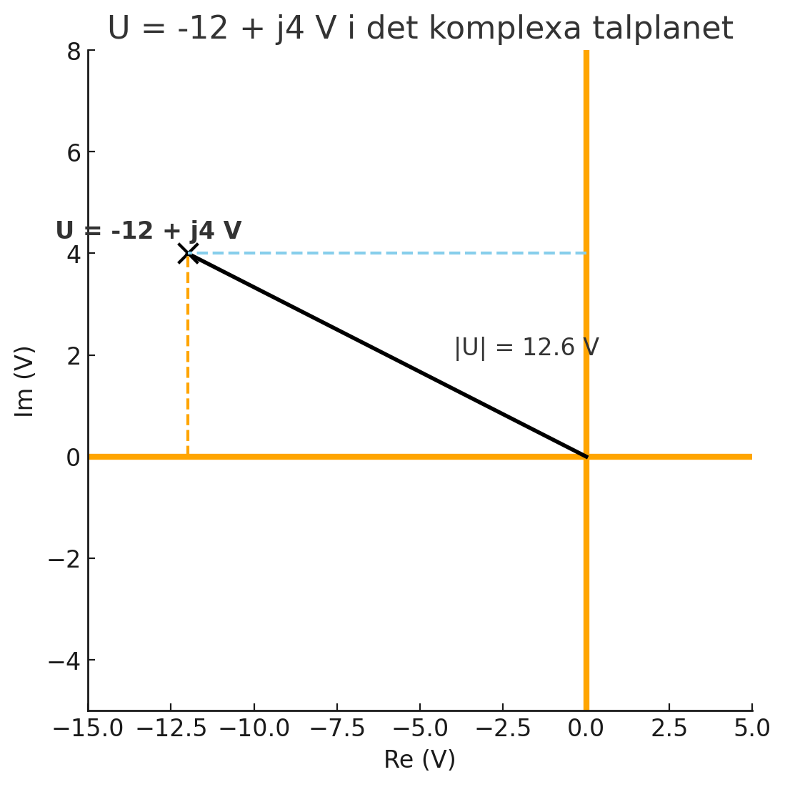
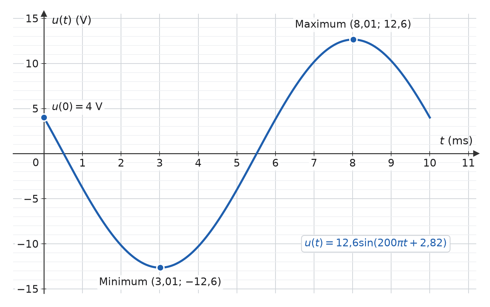
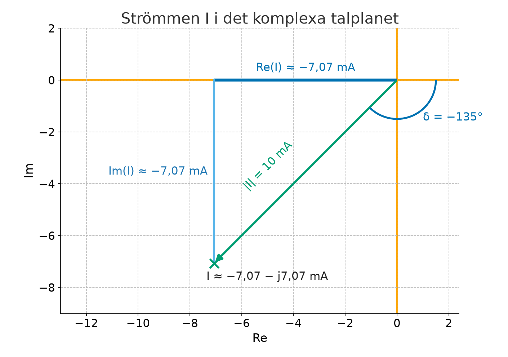
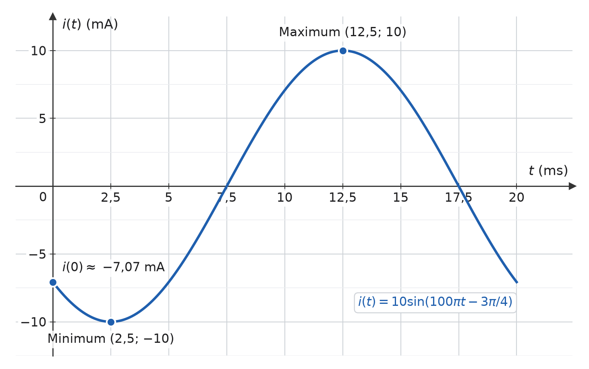

# L16 - Lösningsförslag till lektionsuppgifter

## Del 1 - Repetitionsuppgifter

### 1.1 – Ström i en RL-krets
En resistor $R = 100\thinspace\Omega$ och en spole $L = 1\thinspace mH$ är seriekopplade och matas med spänningen $U = 10\angle 0°\thinspace V$, med frekvensen $f = 50\thinspace kHz$. Spolens impedans ges av

```math
Z_L = j\omega L = j2\pi f L
```

**a)** Beräkna spolens impedans $Z_L$. Behåll $\pi$ i svaret och avrunda först på slutet.

**b)** Beräkna kretsens totala impedans $Z = R + Z_L$ på både rektangulär och polär form.

**c)** Beräkna strömmen $I = \frac{U}{Z}$ på både polär och rektangulär form.

---

### Lösning
**a)** Vi beräknar först vinkelhastigheten, med $\pi$ kvar:

```math
\omega = 2\pi f = 2\pi \cdot 50\,000 = 100\,000\pi\,\text{rad/s}
```

Spolens impedans blir därmed

```math
Z_L = j\omega L = j \cdot 100\,000\pi \cdot 10^{-3} = j100\pi \approx j314{,}2\,\Omega
```

**b)** Vi adderar resistansen och spolens impedans:

```math
Z = R + Z_L = 100 + j100\pi \approx 100 + j314{,}2\,\Omega
```

Impedansens absolutbelopp och fasvinkel blir

```math
|Z| = \sqrt{100^2 + (100\pi)^2} = 100\sqrt{1 + \pi^2} \approx 329{,}7\,\Omega, \qquad \delta_z = \tan^{-1}\left(\frac{100\pi}{100}\right) = \tan^{-1}(\pi) \approx 72{,}3°
```

$Z$ ligger i första kvadranten, så vinkeln behöver inte korrigeras:

```math
Z \approx 100 + j314{,}2 \approx 329{,}7\angle 72{,}3°\,\Omega
```

**c)** Vid division på polär form divideras beloppen och vinklarna subtraheras:

```math
I = \frac{U}{Z} \approx \frac{10\angle 0°}{329{,}7\angle 72{,}3°} \approx 0{,}0303\angle{-72{,}3°}\,A = 30{,}3\angle{-72{,}3°}\,mA
```

På rektangulär form blir strömmen

```math
I \approx 30{,}3\cos(-72{,}3°) + j30{,}3\sin(-72{,}3°) \approx 9{,}20 - j28{,}90\,mA
```

**Kontroll:** Med nämnarens konjugat blir $I = \frac{10(100 - j314{,}2)}{100^2 + 314{,}2^2} \approx \frac{1000 - j3142}{108\thinspace 700} \approx 0{,}00920 - j0{,}02890\thinspace A$.

**Svar:** a) $Z_L = j100\pi \approx j314{,}2\thinspace\Omega$. b) $Z \approx 100 + j314{,}2 \approx 329{,}7\angle 72{,}3°\thinspace\Omega$. c) $I \approx 30{,}3\angle{-72{,}3°}\thinspace mA \approx 9{,}20 - j28{,}90\thinspace mA$.

---

### 1.2 – Ström i en RC-krets
Spolen i uppgift 1.1 byts mot en kondensator $C = 10\thinspace nF$. Spänningen $U = 10\angle 0°\thinspace V$, frekvensen $f = 50\thinspace kHz$ och resistorn $R = 100\thinspace\Omega$ är desamma. Kondensatorns impedans ges av

```math
Z_C = \frac{1}{j\omega C} = -\frac{j}{2\pi f C}
```

**a)** Beräkna kondensatorns impedans $Z_C$. Behåll $\pi$ i svaret och avrunda först på slutet.

**b)** Beräkna kretsens totala impedans $Z = R + Z_C$ på både rektangulär och polär form.

**c)** Beräkna strömmen $I = \frac{U}{Z}$ på både polär och rektangulär form.

**d)** Jämför strömmen med strömmen i uppgift 1.1. Vad är nästan lika, och vad skiljer sig?

---

### Lösning
**a)** Vinkelhastigheten är densamma som i uppgift 1.1, $\omega = 100\thinspace 000\pi\thinspace\text{rad/s}$. Kondensatorns impedans blir därmed

```math
Z_C = -\frac{j}{\omega C} = -\frac{j}{100\,000\pi \cdot 10 \cdot 10^{-9}} = -\frac{j}{10^{-3}\pi} = -j\frac{1000}{\pi} \approx -j318{,}3\,\Omega
```

**b)** Vi adderar resistansen och kondensatorns impedans:

```math
Z = R + Z_C \approx 100 - j318{,}3\,\Omega
```

Impedansens absolutbelopp och fasvinkel blir

```math
|Z| \approx \sqrt{100^2 + (-318{,}3)^2} \approx 333{,}6\,\Omega, \qquad \delta_z = \tan^{-1}\left(\frac{-318{,}3}{100}\right) \approx -72{,}6°
```

$Z$ ligger i fjärde kvadranten, så vinkeln behöver inte korrigeras:

```math
Z \approx 100 - j318{,}3 \approx 333{,}6\angle{-72{,}6°}\,\Omega
```

**c)** Vi dividerar på polär form:

```math
I = \frac{U}{Z} \approx \frac{10\angle 0°}{333{,}6\angle{-72{,}6°}} \approx 0{,}0300\angle 72{,}6°\,A = 30{,}0\angle 72{,}6°\,mA
```

På rektangulär form blir strömmen

```math
I \approx 30{,}0\cos(72{,}6°) + j30{,}0\sin(72{,}6°) \approx 8{,}98 + j28{,}59\,mA
```

**d)** Strömmarna är nästan lika stora, $30{,}3\thinspace mA$ respektive $30{,}0\thinspace mA$, eftersom spolens och kondensatorns impedanser är nästan lika stora: $|Z_L| = 100\pi \approx 314\thinspace\Omega$ och $|Z_C| = \frac{1000}{\pi} \approx 318\thinspace\Omega$. Fasvinklarna har däremot motsatt tecken:

* I RL-kretsen är strömmens fasvinkel ungefär $-72°$, så strömmen ligger **efter** spänningen.
* I RC-kretsen är strömmens fasvinkel ungefär $+73°$, så strömmen ligger **före** spänningen.

Spolen och kondensatorn har alltså motsatt effekt på strömmens fas, eftersom $Z_L$ är positivt imaginär och $Z_C$ negativt imaginär.

**Svar:** a) $Z_C = -j\frac{1000}{\pi} \approx -j318{,}3\thinspace\Omega$. b) $Z \approx 100 - j318{,}3 \approx 333{,}6\angle{-72{,}6°}\thinspace\Omega$. c) $I \approx 30{,}0\angle 72{,}6°\thinspace mA \approx 8{,}98 + j28{,}59\thinspace mA$. d) Nästan samma belopp, men motsatt fasvinkel.

---

## Del 2 - Nytt stoff

### 2.1 - Rektangulär form => Eulers form

En spänning $u(t)$  i en växelströmskrets kan representeras av en fasor U, som på rektangulär form skrivs enligt nedan:

```math
U = -12 + j4 V
```

**a)** Rita ut fasorn $U$ i det komplexa talplanet (x-axeln = reell del, y-axeln = imaginär del).

**b)** Uttryck fasorn $U$ på Eulers form, dvs. bestäm absolutbeloppet $|U|$ samt fasvinkeln $δ$ så att $U = |U|e^{jδ}$.

**c)** Anta att spänningens frekvens $f = 100$ $Hz$. Bestäm vinkelhastigheten $w$.

**d)** Skriv motsvarande komplexa tidsfunktion för spänningen på Eulers form, dvs $u(t)=|U|*e^{j(wt+δ)}$.

**e)** Rita spänningens sinuskurva $u(t) = |U|\sin(wt + δ)$ över en period $T$.

**Notering**: Fasorn $U$ utgör den komplexa spänningen $u(t)$ utan tidsberoendet.

---

### Lösning

**a)** Vi ritar ut fasorn $U$ i det komplexa talplanet, såsom visas i nedanstående figur:



**b)** Vi bestämmer först fasorns absolutbelopp $|U|$ med Pythagoras sats:

```math
|U| = \sqrt{(-12)^2 + 4^2} = \sqrt{144 + 16} = \sqrt{160} \approx 12,6 V
```

Vi bestämmer sedan fasvinkeln $δ$ med $tan^{-1}$:

```math
δ = \tan^{-1} \big({\frac{U_{im}}{U_{re}}}\big) = \tan^{-1} \big({\frac{4}{-12}} \big) \approx -0,32 \pm k * \pi rad \approx -18,4° \pm k * 180°
```

Eftersom $U$ ligger i andra kvadranten $(90°≤δ≤180°)$ adderar vi $\pi$ radianer ($180°$) till fasvinkeln:

```math
δ \approx -0,32 + \pi \approx 2,8\,\,rad \approx 161,6°
```

Vi kan därefter uttrycka fasorn $U$ med Eulers form:

```math
U \approx 12,6e^{j2,8}\,\,V
```

**c)** Vinkelhastigheten $w$ beräknas med hjälp av frekvensen $f=100$ $Hz$:

```math
w = 2{\pi}f = 2{\pi} * 100 = 200{\pi}\,\,rad/s
```

**d)** Vi skriver om fasor $U$ till motsvarande komplexa spänning u(t) genom att lägga till frekvenskomponenten $wt$:

```math
u(t) \approx 12,6e^{j(wt + 2,8)}\,\,V
```

Vi sätter in den bestämda vinkelhastigheten $w=200π$ $rad/s$ i det bestämda uttrycket för $u(t)$:

```math
u(t) \approx 12,6e^{j(200{\pi}t + 2,8)}\,\,V
```

**e)** Spänningen som sinuskurva blir

```math
u(t) = |U|\sin(wt + \delta) \approx 12{,}6\sin(200\pi t + 2{,}82)\,V
```

Periodtiden är $T = \frac{1}{f} = \frac{1}{100} = 10\thinspace ms$. Kurvan startar i

```math
u(0) \approx 12{,}6\sin(2{,}82) \approx 4\,V,
```

vilket är fasorns imaginärdel. Kurvans maximum nås när vinkeln är $\frac{5\pi}{2}$ (ett kvarts varv efter ett helt varv):

```math
200\pi t + 2{,}82 = \frac{5\pi}{2} \quad \Rightarrow \quad t = \frac{5\pi/2 - 2{,}82}{200\pi} \approx 8{,}01\,ms
```

På samma sätt passerar kurvan noll nedåt vid $t \approx 0{,}51\thinspace ms$ (vinkeln $\pi$), når minimum $-12{,}6\thinspace V$ vid $t \approx 3{,}01\thinspace ms$ (vinkeln $\frac{3\pi}{2}$) och passerar noll uppåt vid $t \approx 5{,}51\thinspace ms$ (vinkeln $2\pi$). Efter en period, $t = 10\thinspace ms$, är kurvan tillbaka i $4\thinspace V$:



---

### 2.2 - Eulers form => rektangulär form

En ström $i(t)$ i en växelströmskrets beskrivs av följande komplexa tidsfunktion på Eulers form:

```math
i(t) = 10e^{j(100\pi t - 3\pi/4)}\,mA
```

**a)** Ange strömmens absolutbelopp $|I|$, fasvinkel $\delta$ (i grader) samt vinkelhastighet $\omega$.

**b)** Bestäm strömmens frekvens $f$.

**c)** Skriv fasorn $I = |I|e^{j\delta}$ på rektangulär form.

**d)** Rita ut fasorn $I$ i det komplexa talplanet (x-axeln = reell del, y-axeln = imaginär del).

**e)** Rita strömmens sinuskurva $i(t) = |I|\sin(\omega t + \delta)$ över en period $T$.

**Notering**: Uppgiften går åt motsatt håll mot uppgift 2.1, från Eulers form till rektangulär form.

---

### Lösning
**a)** Vi jämför med formen $i(t) = |I|e^{j(\omega t + \delta)}$:

```math
|I| = 10\,mA, \qquad \omega = 100\pi\,\text{rad/s}, \qquad \delta = -\frac{3\pi}{4}\,\text{rad} = -\frac{3\pi}{4} \cdot \frac{180°}{\pi} = -135°
```

**b)** Frekvensen beräknas ur vinkelhastigheten:

```math
f = \frac{\omega}{2\pi} = \frac{100\pi}{2\pi} = 50\,Hz
```

**c)** Fasorn är $I = 10e^{-j3\pi/4}\thinspace mA$. Med Eulers formel blir den reella och den imaginära delen

```math
I = 10\left(\cos(-135°) + j\sin(-135°)\right) = 10\left(-\frac{\sqrt{2}}{2} - j\frac{\sqrt{2}}{2}\right) = -5\sqrt{2} - j5\sqrt{2} \approx -7{,}07 - j7{,}07\,mA
```

Både den reella och den imaginära delen är negativa, så fasorn ligger i tredje kvadranten, vilket stämmer med vinkeln $-135°$.

**d)** Vi ritar ut fasorn $I$ i det komplexa talplanet, såsom visas i nedanstående figur:



**e)** Strömmen som sinuskurva blir

```math
i(t) = |I|\sin(\omega t + \delta) = 10\sin\left(100\pi t - \frac{3\pi}{4}\right)\,mA
```

Periodtiden är $T = \frac{1}{f} = \frac{1}{50} = 20\thinspace ms$. Kurvan startar i

```math
i(0) = 10\sin(-135°) \approx -7{,}07\,mA,
```

vilket är fasorns imaginärdel. Fasen $-135°$ innebär att kurvan är förskjuten $\frac{135°}{360°} \cdot 20 = 7{,}5\thinspace ms$ åt höger jämfört med en vanlig sinuskurva. Kurvan når därför minimum $-10\thinspace mA$ vid $t = 2{,}5\thinspace ms$, passerar noll uppåt vid $t = 7{,}5\thinspace ms$, når maximum $10\thinspace mA$ vid $t = 12{,}5\thinspace ms$ och passerar noll nedåt vid $t = 17{,}5\thinspace ms$. Efter en period, $t = 20\thinspace ms$, är kurvan tillbaka i $-7{,}07\thinspace mA$:



**Svar:** a) $|I| = 10\thinspace mA$, $\delta = -135°$, $\omega = 100\pi\thinspace\text{rad/s}$. b) $f = 50\thinspace Hz$. c) $I = -5\sqrt{2} - j5\sqrt{2} \approx -7{,}07 - j7{,}07\thinspace mA$. e) $i(t) = 10\sin(100\pi t - 3\pi/4)\thinspace mA$, med periodtiden $20\thinspace ms$.

---

## Del 3 – Extrauppgifter
### 3.1 – Eulers formel

---

### Lösning
Eulers formel $e^{j\delta} = \cos\delta + j\sin\delta$ används rakt av.

**a)** $e^{j\pi/6} = \cos 30° + j\sin 30° = \frac{\sqrt{3}}{2} + j\frac{1}{2} \approx 0{,}866 + j0{,}5$

**b)** $e^{j\pi/4} = \cos 45° + j\sin 45° = \frac{\sqrt{2}}{2} + j\frac{\sqrt{2}}{2} \approx 0{,}707 + j0{,}707$

**c)** $e^{j2\pi/3} = \cos 120° + j\sin 120° = -\frac{1}{2} + j\frac{\sqrt{3}}{2} \approx -0{,}5 + j0{,}866$

**d)** $e^{-j\pi/3} = \cos(-60°) + j\sin(-60°) = \frac{1}{2} - j\frac{\sqrt{3}}{2} \approx 0{,}5 - j0{,}866$

**e)** $e^{-j3\pi/4} = \cos(-135°) + j\sin(-135°) = -\frac{\sqrt{2}}{2} - j\frac{\sqrt{2}}{2} \approx -0{,}707 - j0{,}707$

Talen ligger i olika kvadranter, men alla har beloppet $1$, eftersom $\cos^2\delta + \sin^2\delta = 1$.

---

### 3.2 – Eulerform till rektangulär form

---

### Lösning
**a)**

```math
z = 4\left(\cos 30° + j\sin 30°\right) = 4(0{,}866 + j0{,}5) \approx 3{,}46 + j2
```

**b)**

```math
z = 5\left(\cos 60° + j\sin 60°\right) = 5(0{,}5 + j0{,}866) = 2{,}5 + j4{,}33
```

**c)**

```math
z = 2\left(\cos(-45°) + j\sin(-45°)\right) \approx 1{,}41 - j1{,}41
```

**d)**

```math
z = 10\left(\cos 120° + j\sin 120°\right) = 10(-0{,}5 + j0{,}866) = -5 + j8{,}66
```

---

### 3.3 – Rektangulär form till Eulerform

---

### Lösning
**a)** $|z| = \sqrt{9 + 9} = 3\sqrt{2} \approx 4{,}24$, kvadrant I:

```math
z \approx 4{,}24\,e^{j\pi/4}
```

**b)** $|z| = \sqrt{4 + 4} = 2\sqrt{2} \approx 2{,}83$, kvadrant II:

```math
z \approx 2{,}83\,e^{j3\pi/4}
```

**c)** $|z| = \sqrt{1 + 3} = 2$, kvadrant IV:

```math
\delta = \tan^{-1}\left(\frac{-\sqrt{3}}{1}\right) = -\frac{\pi}{3} \quad \Rightarrow \quad z = 2\,e^{-j\pi/3}
```

**d)** $|z| = \sqrt{16 + 9} = 5$, kvadrant III. $\tan^{-1}\left(\frac{-3}{-4}\right) \approx 0{,}64$ rad pekar in i kvadrant I, så vi drar bort $\pi$:

```math
\delta \approx 0{,}64 - \pi \approx -2{,}50\,\text{rad} \quad \Rightarrow \quad z \approx 5\,e^{-j2{,}50}
```

---

### 3.4 – Multiplikation och division i polär form
$z_1 = 4\thinspace\angle\thinspace 30°$, $z_2 = 3\thinspace\angle\thinspace 45°$

---

### Lösning
**a)** Beloppen multipliceras och vinklarna adderas:

```math
z_1z_2 = 12\,\angle\,75°
```

**b)** Beloppen divideras och vinklarna subtraheras:

```math
\frac{z_1}{z_2} = \frac{4}{3}\,\angle\,(-15°) \approx 1{,}33\,\angle\,-15°
```

**c)**

```math
z_1^2 = 16\,\angle\,60°
```

**d)** På rektangulär form kräver en multiplikation fyra delprodukter och hantering av $j^2$. På polär form räcker en multiplikation och en addition. Skillnaden blir ännu tydligare vid potenser och division.

---

### 3.5 – Jämför metoderna
$z_1 = 3 + j4$, $z_2 = 1 + j$

---

### Lösning
**a)**

```math
z_1z_2 = 3 + j3 + j4 + j^2 4 = 3 - 4 + j7 = -1 + j7
```

**b)**

```math
|z_1| = 5, \quad \delta_1 = \arctan\left(\frac{4}{3}\right) \approx 53{,}1° \quad \Rightarrow \quad z_1 = 5\,\angle\,53{,}1°
```

```math
|z_2| = \sqrt{2} \approx 1{,}41, \quad \delta_2 = 45° \quad \Rightarrow \quad z_2 = 1{,}41\,\angle\,45°
```

**c)**

```math
z_1z_2 = 5 \cdot 1{,}41\,\angle\,(53{,}1° + 45°) \approx 7{,}07\,\angle\,98{,}1°
```

**d)** Kontrollera svaret från **a)**:

```math
|-1 + j7| = \sqrt{1 + 49} = \sqrt{50} \approx 7{,}07 \quad ✓
```

```math
\delta = \arctan\left(\frac{7}{-1}\right) + 180° \approx -81{,}9° + 180° = 98{,}1° \quad ✓
```

Samma tal, bara uttryckt på två sätt.

---

### 3.6 – Division i polär form

---

### Lösning
**a)**

```math
\frac{10}{2}\,\angle\,(80° - 20°) = 5\,\angle\,60°
```

**b)**

```math
\frac{12}{4}\,\angle\,(0° - 90°) = 3\,\angle\,-90°
```

**c)**

```math
\frac{6}{3}\,\angle\,(-30° - 60°) = 2\,\angle\,-90°
```

**d)** Eftersom $j = 1\thinspace\angle\thinspace 90°$ ger division med $j$ att beloppet är oförändrat medan fasvinkeln **minskar med $90°$**. Geometriskt roterar talet ett kvarts varv medurs.

---

### 3.7 – Potenser av komplexa tal
$z = 2\thinspace\angle\thinspace 30°$

---

### Lösning
**a)**

```math
z^2 = 2^2\,\angle\,(2 \cdot 30°) = 4\,\angle\,60°
```

**b)**

```math
z^3 = 8\,\angle\,90° = 8(\cos 90° + j\sin 90°) = j8
```

**c)**

```math
z^4 = 16\,\angle\,120°
```

**d)** Beloppet upphöjs och vinkeln multipliceras:

```math
z^n = |z|^n\,\angle\,(n\delta)
```

Det är de Moivres formel, och den är en direkt följd av multiplikationsregeln.

---

### 3.8 – Fasor ur tidsfunktion

---

### Lösning
Fasorn bär amplituden och fasen; vinkelhastigheten skrivs inte med.

**a)** $U = 10\thinspace\angle\thinspace \dfrac{\pi}{6} = 10\thinspace\angle\thinspace 30°$

**b)** $U = 4\thinspace\angle\thinspace -\dfrac{\pi}{2} = 4\thinspace\angle\thinspace -90°$

**c)** $I = 6\thinspace\angle\thinspace 0°$

**d)** Fasorerna måste tillhöra signaler med **samma vinkelhastighet** $\omega$. Annars ändras deras inbördes fasläge hela tiden, och en fast fasorsumma existerar inte.

---

### 3.9 – Tidsfunktion ur fasor
$\omega = 100\pi\thinspace\text{rad/s}$

---

### Lösning
**a)** $45° = \dfrac{\pi}{4}$:

```math
u(t) = 8\sin\left(100\pi t + \frac{\pi}{4}\right)\,\text{V}
```

**b)**

```math
u(t) = 5\sin\left(100\pi t - \frac{\pi}{2}\right)\,\text{V}
```

**c)** Först fasorn på polär form:

```math
|I| = \sqrt{9 + 16} = 5\,\text{mA}, \qquad \delta = \arctan\left(\frac{4}{3}\right) \approx 0{,}927\,\text{rad}
```

```math
i(t) = 5\sin(100\pi t + 0{,}927)\,\text{mA}
```

**d)** Talet ligger i kvadrant III, så $180°$ måste läggas till:

```math
|I| = \sqrt{4 + 4} \approx 2{,}83\,\text{mA}, \qquad \delta = 45° + 180° = 225° \equiv -135° \approx -2{,}36\,\text{rad}
```

```math
i(t) = 2{,}83\sin(100\pi t - 2{,}36)\,\text{mA}
```

---

### 3.10 – Fasoraddition
$U_1 = 6\thinspace\angle\thinspace 0°\thinspace\text{V}$, $U_2 = 8\thinspace\angle\thinspace 90°\thinspace\text{V}$

---

### Lösning
**a)**

```math
U_1 = 6 + j0, \qquad U_2 = 0 + j8
```

**b)**

```math
U = 6 + j8\,\text{V}
```

**c)**

```math
|U| = \sqrt{36 + 64} = 10\,\text{V}, \qquad \delta = \arctan\left(\frac{8}{6}\right) \approx 53{,}1°
```

```math
U = 10\,\angle\,53{,}1°\,\text{V}
```

**d)** Med $53{,}1° \approx 0{,}927\thinspace\text{rad}$:

```math
u(t) = 10\sin(100\pi t + 0{,}927)\,\text{V}
```

Notera att $|U| = 10\thinspace\text{V}$, inte $6 + 8 = 14\thinspace\text{V}$ – fasorerna står vinkelrätt mot varandra.

---

### 3.11 – Impedans ur spänning och ström
$U = 20\thinspace\angle\thinspace 60°\thinspace\text{V}$, $I = 4\thinspace\angle\thinspace 15°\thinspace\text{A}$

---

### Lösning
**a)** Beloppen divideras, vinklarna subtraheras:

```math
Z = \frac{20}{4}\,\angle\,(60° - 15°) = 5\,\angle\,45°\,\Omega
```

**b)**

```math
Z = 5\cos 45° + j5\sin 45° \approx 3{,}54 + j3{,}54\,\Omega
```

**c)** **Induktiv** – imaginärdelen är positiv och fasvinkeln ligger mellan $0°$ och $90°$.

**d)** Realdelen är resistansen och imaginärdelen reaktansen:

```math
R \approx 3{,}54\,\Omega, \qquad X \approx 3{,}54\,\Omega
```

Att de är lika stora är just vad fasvinkeln $45°$ betyder.

---

### 3.12 – Impedans för spole och kondensator
$\omega = 1000\thinspace\text{rad/s}$, $L = 20\thinspace\text{mH}$, $C = 50\thinspace\mu\text{F}$

---

### Lösning
**a)**

```math
Z_L = j\omega L = j \cdot 1000 \cdot 0{,}020 = j20\,\Omega
```

**b)**

```math
Z_C = -\frac{j}{\omega C} = -\frac{j}{1000 \cdot 50 \times 10^{-6}} = -\frac{j}{0{,}05} = -j20\,\Omega
```

**c)**

```math
Z = 15 + j20 - j20 = 15\,\Omega
```

**d)** De reaktiva delarna tar exakt ut varandra och impedansen blir rent resistiv. Detta kallas **resonans** och inträffar när $\omega L = \dfrac{1}{\omega C}$. Vid resonans är impedansen som minst i en seriekrets, och strömmen därmed som störst.

---

### 3.13 – Rotation med $j$
$z = 3 + j4$

---

### Lösning
**a)**

```math
jz = j(3 + j4) = j3 + j^2 4 = -4 + j3
```

**b)**

```math
|z| = \sqrt{9 + 16} = 5, \qquad |jz| = \sqrt{16 + 9} = 5
```

Längden är oförändrad.

**c)**

```math
\delta_z = \arctan\left(\frac{4}{3}\right) \approx 53{,}1°
```

```math
\delta_{jz} = \arctan\left(\frac{3}{-4}\right) + 180° \approx -36{,}9° + 180° = 143{,}1°
```

Skillnaden är $143{,}1° - 53{,}1° = 90°$.

**d)** Multiplikation med $j$ **roterar talet $90°$ moturs** utan att ändra dess längd. Det följer direkt av att $j = 1\thinspace\angle\thinspace 90°$: beloppet multipliceras med $1$ och vinkeln ökar med $90°$. Det är också förklaringen till att en spole, vars impedans är $j\omega L$, förskjuter spänningen $90°$ relativt strömmen.

---

### 3.14 – Sant eller falskt

---

### Lösning
**a)** **Falskt.** Talen kan ha olika fasvinklar. Till exempel har $3 + j4$ och $5$ båda beloppet $5$, men de är inte lika.

**b)** **Falskt.** Beloppen **multipliceras**: $|z_1z_2| = |z_1||z_2|$. Det är fasvinklarna som adderas.

**c)** **Sant.** $\dfrac{z_1}{z_2} = \dfrac{|z_1|}{|z_2|}\thinspace\angle\thinspace(\delta_1 - \delta_2)$.

**d)** **Falskt.** En fasor bär bara **amplitud och fas**. Vinkelhastigheten $\omega$ anges separat och förutsätts vara gemensam för alla fasorer i beräkningen.

**e)** **Falskt.** $\tan^{-1}\frac{b}{a}$ ger bara rätt vinkel i kvadrant I och IV. Ligger talet i kvadrant II eller III måste $\pi$ (eller $180°$) läggas till eller dras bort, till exempel för $z = -4 - j3$ i uppgift 3.3 d).

**f)** **Falskt.** Multiplikation är enklast på polär form eller Eulerform. Rektangulär form är i stället bäst vid addition och subtraktion.

---

## Del 4 – Matematik i C

### 4.1 – Rotation med $j$ i C

**a)** Med $j^2 = -1$:

```math
jz = j3 + j^2 4 = -4 + j3, \qquad j^2 z = -z = -3 - j4
```

```math
j^3 z = -jz = 4 - j3, \qquad j^4 z = z = 3 + j4
```

**b)** Vi multiplicerar in $j$ och använder att $j^2 = -1$:

```math
j(a + jb) = ja + j^2 b = -b + ja
```

Realdelen i $jz$ är alltså $-b$ och imaginärdelen $a$, vilket är vad `complex_rotate_j()` ska returnera. Se lösningen i [`code/main.c`](./code/main.c). Koden förklaras i [`code/README.md`](./code/README.md). Programmet skriver ut talen från a) och deras argument:

| Tal | Rektangulär form | Argument |
|-----|------------------|----------|
| $z$ | $3 + j4$ | $53{,}13^{\circ}$ |
| $jz$ | $-4 + j3$ | $143{,}13^{\circ}$ |
| $j^2 z$ | $-3 - j4$ | $-126{,}87^{\circ}$ |
| $j^3 z$ | $4 - j3$ | $-36{,}87^{\circ}$ |
| $j^4 z$ | $3 + j4$ | $53{,}13^{\circ}$ |

`atan2()` ger vinkeln mellan $-180^{\circ}$ och $180^{\circ}$, så $233{,}13^{\circ}$ skrivs som $-126{,}87^{\circ}$ och $323{,}13^{\circ}$ som $-36{,}87^{\circ}$.

**c)** Argumentet ökar med $90^{\circ}$ vid varje multiplikation, medan beloppet är $5$ hela tiden: multiplikation med $j$ vrider talet ett kvarts varv moturs. Efter fyra kvarts varv är talet tillbaka, vilket stämmer med att $j^4 = (j^2)^2 = (-1)^2 = 1$.

**d)** Talet ändras inte, utan $3 + j4$ skrivs ut varje gång (se avsnittet om uppgift 4.1 d i [`code/README.md`](./code/README.md)). Parametern är `const complex_t*`, så `complex_rotate_j()` kan inte ändra $z$ utan returnerar resultatet som ett nytt tal, och utan `z =` tas returvärdet aldrig om hand.

---
