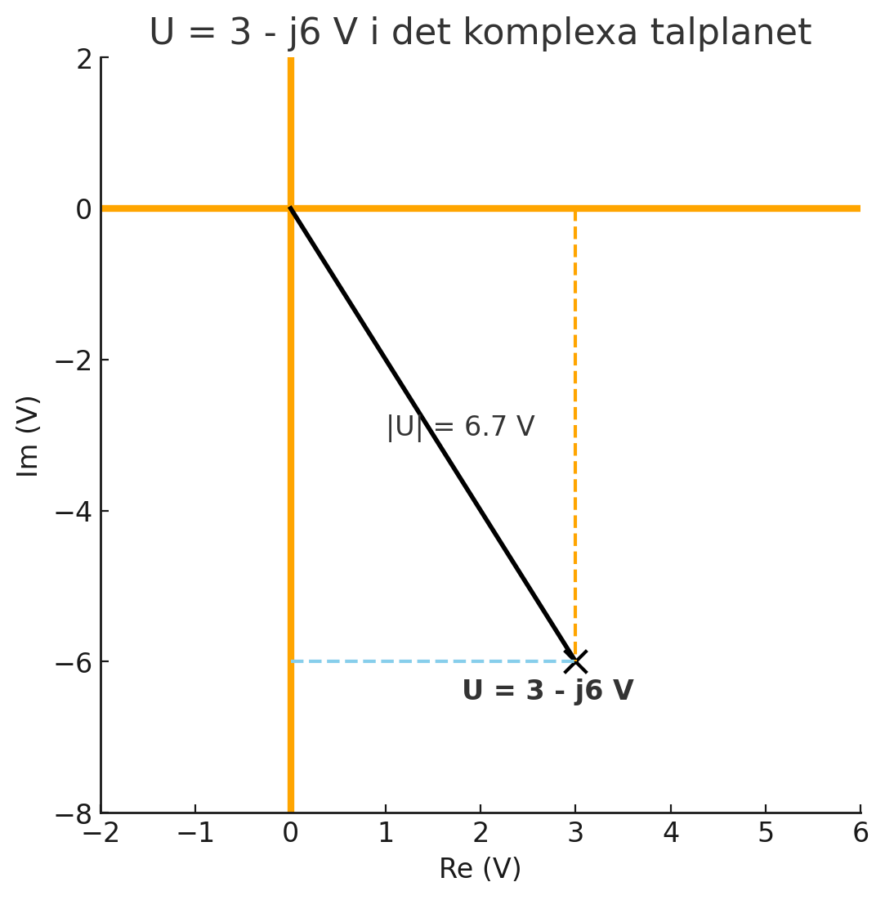
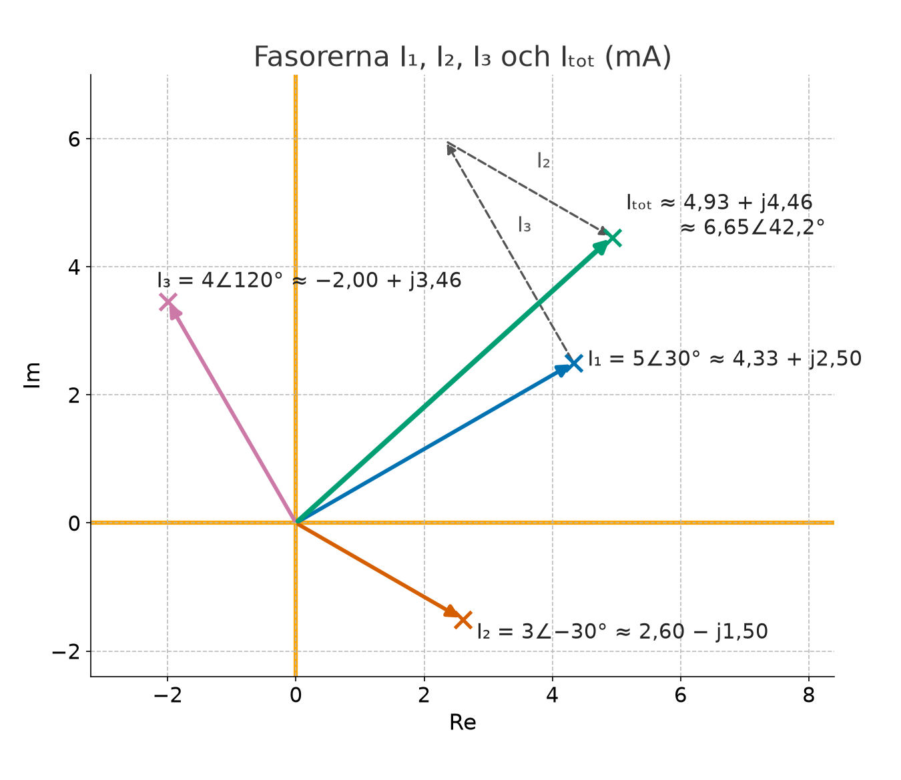

# L17 - Lösningsförslag till lektionsuppgifter

## Del 1 - Repetitionsuppgifter

### 1.1 - Impedans i en RC-krets

En resistor $R$ och en kondensator $C$ är seriekopplade och matas med spänningen $U = 10\angle 0°\thinspace V$. Strömmen genom kretsen mäts till $I = 50\angle 30°\thinspace mA$, och frekvensen är $f = 1\thinspace kHz$.

**a)** Beräkna kretsens impedans $Z = \frac{U}{I}$ på polär form.

**b)** Omvandla $Z$ till rektangulär form, $Z = R - jX_C$, och bestäm resistansen $R$ samt kondensatorns reaktans $X_C$.

**c)** Beräkna kapacitansen $C$ som ger den beräknade reaktansen, där $X_C = \frac{1}{\omega C}$.

---

### Lösning
**a)** Vid division på polär form divideras beloppen och vinklarna subtraheras:

```math
Z = \frac{U}{I} = \frac{10\angle 0°}{0{,}05\angle 30°} = \frac{10}{0{,}05}\angle(0° - 30°) = 200\angle{-30°}\,\Omega
```

**b)** Vi omvandlar till rektangulär form med cosinus och sinus:

```math
Z = 200\cos(-30°) + j200\sin(-30°) = 200 \cdot \frac{\sqrt{3}}{2} - j200 \cdot \frac{1}{2} \approx 173{,}2 - j100\,\Omega
```

Jämfört med $Z = R - jX_C$ är alltså resistansen $R \approx 173{,}2\thinspace\Omega$ och kondensatorns reaktans $X_C = 100\thinspace\Omega$. Imaginärdelen är negativ, vilket stämmer med att kretsen är kapacitiv.

**c)** Vinkelhastigheten är $\omega = 2\pi f = 2\pi \cdot 1000 = 2000\pi\thinspace\text{rad/s}$. Vi löser ut $C$ ur $X_C = \frac{1}{\omega C}$:

```math
C = \frac{1}{\omega X_C} = \frac{1}{2000\pi \cdot 100} = \frac{1}{200\,000\pi} \approx 1{,}59 \cdot 10^{-6}\,F = 1{,}59\,\mu F
```

**Svar:** a) $Z = 200\angle{-30°}\thinspace\Omega$. b) $R \approx 173{,}2\thinspace\Omega$, $X_C = 100\thinspace\Omega$. c) $C \approx 1{,}59\thinspace\mu F$.

---

### 1.2 - Rektangulär form => Eulers form

En spänning $u(t)$  i en växelströmskrets kan representeras av en fasor U, som på rektangulär form skrivs enligt nedan:

```math
U = 3 - j6\,\,V
```

**a)** Rita ut fasorn $U$ i det komplexa talplanet (x-axeln = reell del, y-axeln = imaginär del).

**b)** Uttryck fasorn $U$ på Eulers form, dvs. bestäm absolutbeloppet $|U|$ samt fasvinkeln $δ$ så att $U = |U|e^{jδ}$.

**c)** Anta att spänningens frekvens $f = 50$ $Hz$. Bestäm vinkelhastigheten $w$.

**d)** Skriv $u(t)$ som en tidsberoende funktion $u(t)=|U|*e^{j(wt+δ)}$.


### Lösning

**a)** Vi ritar ut fasorn $U$ i det komplexa talplanet, såsom visas i nedanstående figur:



**b)** Vi bestämmer först fasorns absolutbelopp $|U|$ med Pythagoras sats:

```math
|U| = \sqrt{3^2 + (-6)^2} = \sqrt{9 + 36} = \sqrt{45} \approx 6,7 V
```

Vi bestämmer sedan fasvinkeln $δ$ med $tan^{-1}$:

```math
δ = \tan^{-1} \big({\frac{U_{im}}{U_{re}}}\big) = \tan^{-1} \big({\frac{-6}{3}} \big) \approx -1,1 \pm k * \pi\,\,rad \approx -63,4^{\circ} \pm k * 180^{\circ}
```

Eftersom $U$ ligger i fjärde kvadranten $(270^{\circ}≤δ≤360^{\circ})$ och $-63,4^{\circ} = 360^{\circ} - 63,4^{\circ} = 296,6^{\circ}$ är den bestämda fasvinkeln korrekt.

Vi kan därefter uttrycka fasorn $U$ med Eulers form:

```math
U \approx 6,7e^{-j1,1}\,\,V
```

**c)** Vinkelhastigheten $w$ beräknas med hjälp av frekvensen $f=50$ $Hz$:

```math
w = 2{\pi}f = 2{\pi} * 50 = 100{\pi}\,\,rad/s
```

**d)** Vi skriver om fasor $U$ till motsvarande komplexa spänning u(t) genom att lägga till frekvenskomponenten $wt$:

```math
u(t) \approx 6,7e^{j(wt - 1,1)}\,\,V
```

Vi sätter in den bestämda vinkelhastigheten $w=100π$ $rad/s$ i det bestämda uttrycket för $u(t)$:

```math
u(t) \approx 6,7e^{j(100{\pi}t - 1,1)}\,\,V
```

---

## Del 2 - Nytt stoff

### 2.1 - Addition av tre strömmar i AC-krets

En nod i en elektrisk krets matas med tre sinusformade strömmar: 

```math
i_1(t) = 5{\sin (\omega t + 30^{\circ})}\,\,mA
```

```math
i_2(t) = 3{\sin (\omega t - 30^{\circ})}\,\,mA
```

```math
i_3(t) = 4{\sin (\omega t + 120^{\circ})}\,\,mA
```

Den totala strömmen i kretsen $i_{tot}(t)$ beräknas enligt nedan:

```math
i_{tot}(t) = i_1(t) + i_2(t) + i_3(t)
```

**a)** Skriv om strömmarna $i_1(t)$, $i_2(t)$ samt $i_3(t)$ till fasor $I_1$, $I_2$ samt $I_3$ i komplex rektangulär form.

**b)** Beräkna fasorsumman $I_{tot} = I_1 + I_2 + I_3$.

**c)** Rita ut fasorerna i det komplexa talplanet (x-axeln = reell del, y-axeln = imaginär del).

**d)** Omvandla tillbaka resultatet till en sinusformad ström i tidsdomänen på följande form:

```math
i_{tot}(t) = |I_{tot}|{\sin}(\omega t + δ)
```

### Lösning

**a)** Vi omvandlar sinusströmmarna till motsvarande fasor en efter en:

```math
I_1 = 5{\cos (30^{\circ})} + j5{\sin (30^{\circ})} \approx 4,3 + j2,5\,\,mA
```

```math
I_2 = 3{\cos (-30^{\circ})} + j3{\sin (-30^{\circ})} \approx 2,6 - j1,5\,\,mA
```

```math
I_3 = 4{\cos (120^{\circ})} + j4{\sin (120^{\circ})} \approx -2 + j3,5\,\,mA
```

**b)** Vi summerar strömmarna på rektangulär form och erhåller då den totala strömmen $I_{tot}$:

```math
I_{tot} = I_1 + I_2 + I_3 \approx 4,3 + j2,5 + 2,6 - j1,5 - 2 + j3,5\,\,mA
```

Vi summerar den reella delen av $I_{tot}$:

```math
I_{tot,re} \approx 4,3 + 2,6 - 2 \approx 4,9\,\,mA
```

Vi summerar sedan den imaginära delen av $I_{tot}$:

```math
I_{tot,im} \approx 2,5 - 1,5 + 3,5 \approx 4,5\,\,mA
```

Den totala strömmen $I_{tot}$ kan därmed skrivas ut som visas nedan:

```math
I_{tot} \approx 4,9 + j4,5\,\,mA
```

**c)** Vi ritar ut fasorerna i det komplexa talplanet enligt nedanstående figur:



De streckade pilarna visar additionen: $I_3$ läggs till i spetsen av $I_1$, och $I_2$ i spetsen av $I_1 + I_3$. Summans spets hamnar i $I_{tot}$.

**d)** Vi omvandlar fasorsumman $I_{tot}$ till motsvarande sinusformad ström i tidsdomänen:

```math
i_{tot}(t) = |I_{tot}| \sin {({\omega}t + δ_{tot})},
```

där

```math
|I_{tot}| \approx \sqrt{4,9^2 + 4,5^2} \approx 6,6\,\,mA
```

samt

```math
δ_{tot} \approx \tan^{-1} \big({\frac{4,464}{4,928}} \big) \approx 42,2^{\circ} \pm k * 180^{\circ}
```

Eftersom $I_{tot}$ ligger i första kvadranten $(0°≤δ_{tot}≤90°)$ är den beräknade fasvinkeln $δ_{tot}$ korrekt.

Därmed kan sinusströmmen $i_{tot}(t)$ uttryckas enligt nedan:

```math
i_{tot}(t) \approx 6,6 \sin {({\omega}t + 42,2^{\circ})}\,\,mA
```

---
## Del 3 – Extrauppgifter
### 3.1 – Fasor ur sinussignal

---

### Lösning
Amplituden och fasen läses av direkt ur $|U|\sin(\omega t + \delta)$.

**a)** $U = 12\thinspace\angle\thinspace 60°$

**b)** $U = 5\thinspace\angle\thinspace -45°$

**c)** $I = 2\thinspace\angle\thinspace 0°$

**d)** $I = 7\thinspace\angle\thinspace 180°$, vilket på rektangulär form är $-7$. En fasförskjutning på $180°$ motsvarar alltså ett teckenbyte.

---

### 3.2 – Fasor på rektangulär form

---

### Lösning
**a)** $10 + j0$

**b)** $0 + j4$

**c)**

```math
6\cos 30° + j6\sin 30° \approx 5{,}20 + j3{,}00
```

**d)**

```math
5\cos(-53{,}1°) + j5\sin(-53{,}1°) \approx 3 - j4
```

---

### 3.3 – Addition av två spänningar
$u_1(t) = 3\sin(\omega t)$ V, $u_2(t) = 4\sin(\omega t + 90°)$ V

---

### Lösning
**a)**

```math
U_1 = 3\,\angle\,0°, \qquad U_2 = 4\,\angle\,90°
```

**b)**

```math
U_1 = 3 + j0, \qquad U_2 = 0 + j4
```

**c)**

```math
U = 3 + j4 \quad \Rightarrow \quad |U| = 5\,\text{V}, \quad \delta = \arctan\left(\frac{4}{3}\right) \approx 53{,}1°
```

```math
U = 5\,\angle\,53{,}1°\,\text{V}
```

**d)**

```math
u_{\text{tot}}(t) = 5\sin(\omega t + 53{,}1°)\,\text{V}
```

Notera att amplituden blir $5\thinspace\text{V}$ och inte $3 + 4 = 7\thinspace\text{V}$, eftersom signalerna inte är i fas.

---

### 3.4 – Addition av tre fasorer

---

### Lösning
**a)**

```math
U_1 = 10 + j0, \qquad U_2 = 0 + j5, \qquad U_3 = 0 - j5
```

**b)**

```math
U = 10 + j(5 - 5) = 10 + j0\,\text{V}
```

**c)**

```math
U = 10\,\angle\,0°\,\text{V}
```

**d)** $U_2$ och $U_3$ har samma belopp men fasvinklar som skiljer sig med $180°$. De är alltså motriktade i det komplexa talplanet, och deras imaginärdelar $+j5$ och $-j5$ summerar till noll. Två lika stora signaler i motfas släcker ut varandra helt.

---

### 3.5 – Summa och differens av två fasorer
$U_1 = 8\thinspace\angle\thinspace 30°$, $U_2 = 8\thinspace\angle\thinspace -30°$

---

### Lösning
**a)**

```math
U_1 = 8\cos 30° + j8\sin 30° \approx 6{,}93 + j4
```

```math
U_2 = 8\cos(-30°) + j8\sin(-30°) \approx 6{,}93 - j4
```

**b)** Imaginärdelarna tar ut varandra:

```math
U_1 + U_2 \approx 13{,}86 + j0 = 13{,}86\,\angle\,0°\,\text{V}
```

**c)** Realdelarna tar ut varandra:

```math
U_1 - U_2 = 0 + j8 = 8\,\angle\,90°\,\text{V}
```

**d)** Fasorerna är varandras konjugat. Summan av ett konjugatpar är därför alltid **rent reell** och differensen **rent imaginär**. Summan har dessutom fasvinkeln $0°$ – mitt emellan de båda ursprungliga vinklarna, vilket är rimligt av symmetriskäl.

---

### 3.6 – Multiplikation och division av fasorer

---

### Lösning
**a)** Belopp multipliceras, vinklar adderas:

```math
20\,\angle\,60°
```

**b)** Belopp divideras, vinklar subtraheras:

```math
4\,\angle\,60°
```

**c)**

```math
12\,\angle\,-60°
```

**d)**

```math
3\,\angle\,-90°
```

---

### 3.7 – Impedans för R, L och C
$\omega = 2000\thinspace\text{rad/s}$, $R = 100\thinspace\Omega$, $L = 50\thinspace\text{mH}$, $C = 5\thinspace\mu\text{F}$

---

### Lösning
**a)** Ett motstånd har rent reell impedans:

```math
Z_R = 100\,\Omega, \qquad \delta = 0°
```

**b)**

```math
Z_L = j\omega L = j \cdot 2000 \cdot 0{,}050 = j100\,\Omega, \qquad \delta = +90°
```

**c)**

```math
Z_C = -\frac{j}{\omega C} = -\frac{j}{2000 \cdot 5 \times 10^{-6}} = -\frac{j}{0{,}01} = -j100\,\Omega, \qquad \delta = -90°
```

**d)** Fasvinkeln hos impedansen anger hur spänningen ligger relativt strömmen:

* **Motstånd:** ström och spänning i fas.
* **Spole:** spänningen ligger $90°$ **före** strömmen – strömmen släpar efter.
* **Kondensator:** spänningen ligger $90°$ **efter** strömmen – strömmen ligger före.

Notera att $|Z_L| = |Z_C| = 100\thinspace\Omega$ vid just denna frekvens, alltså råder resonans.

---

### 3.8 – Serie-RL-krets
$R = 40\thinspace\Omega$, $X_L = 30\thinspace\Omega$

---

### Lösning
**a)**

```math
Z = 40 + j30\,\Omega
```

**b)**

```math
|Z| = \sqrt{1600 + 900} = 50\,\Omega, \qquad \delta_Z = \arctan\left(\frac{30}{40}\right) \approx 36{,}9°
```

**c)**

```math
I = \frac{U}{Z} = \frac{100\,\angle\,0°}{50\,\angle\,36{,}9°} = 2\,\angle\,-36{,}9°\,\text{A}
```

**d)** Strömmens fasvinkel är negativ, alltså ligger strömmen **efter** spänningen. Det är typiskt för en induktiv krets.

---

### 3.9 – Serie-RC-krets
$R = 60\thinspace\Omega$, $X_C = 80\thinspace\Omega$

---

### Lösning
**a)** En kapacitiv reaktans bidrar med negativ imaginärdel:

```math
Z = 60 - j80\,\Omega
```

**b)**

```math
|Z| = \sqrt{3600 + 6400} = 100\,\Omega, \qquad \delta_Z = \arctan\left(\frac{-80}{60}\right) \approx -53{,}1°
```

**c)**

```math
I = \frac{200\,\angle\,0°}{100\,\angle\,-53{,}1°} = 2\,\angle\,53{,}1°\,\text{A}
```

**d)** Strömmens fasvinkel är positiv, alltså ligger strömmen **före** spänningen – kännetecknet för en kapacitiv krets.

---

### 3.10 – Serie-RLC-krets
$R = 20\thinspace\Omega$, $X_L = 60\thinspace\Omega$, $X_C = 45\thinspace\Omega$

---

### Lösning
**a)** Reaktanserna motverkar varandra:

```math
Z = 20 + j(60 - 45) = 20 + j15\,\Omega
```

**b)**

```math
|Z| = \sqrt{400 + 225} = 25\,\Omega, \qquad \delta_Z = \arctan\left(\frac{15}{20}\right) \approx 36{,}9°
```

**c)**

```math
I = \frac{50\,\angle\,0°}{25\,\angle\,36{,}9°} = 2\,\angle\,-36{,}9°\,\text{A}
```

**d)** **Induktiv**, eftersom $X_L > X_C$ ger en positiv imaginärdel.

---

### 3.11 – Resonans
$R = 10\thinspace\Omega$, $L = 100\thinspace\text{mH}$, $C = 10\thinspace\mu\text{F}$

---

### Lösning
**a)**

```math
\omega_0 = \frac{1}{\sqrt{LC}} = \frac{1}{\sqrt{0{,}100 \cdot 10 \times 10^{-6}}} = \frac{1}{\sqrt{10^{-6}}} = 1000\,\text{rad/s}
```

**b)**

```math
f_0 = \frac{\omega_0}{2\pi} = \frac{1000}{2\pi} \approx 159\,\text{Hz}
```

**c)**

```math
X_L = \omega_0 L = 1000 \cdot 0{,}100 = 100\,\Omega
```

```math
X_C = \frac{1}{\omega_0 C} = \frac{1}{1000 \cdot 10 \times 10^{-6}} = 100\,\Omega
```

**d)** Reaktanserna är lika stora och tar ut varandra:

```math
Z = 10 + j(100 - 100) = 10\,\Omega
```

Impedansen är alltså **rent resistiv** och lika med $R$. I en seriekrets är det samtidigt det minsta möjliga värdet på $|Z|$, vilket gör att strömmen blir som störst vid resonansfrekvensen.

---

### 3.12 – Spänningsdelning i en AC-krets
$Z_R = 30\thinspace\Omega$, $Z_L = j40\thinspace\Omega$, $U = 100\thinspace\angle\thinspace 0°\thinspace\text{V}$

---

### Lösning
**a)**

```math
Z_{\text{tot}} = 30 + j40\,\Omega, \qquad |Z_{\text{tot}}| = 50\,\Omega, \qquad \delta_Z \approx 53{,}1°
```

**b)**

```math
I = \frac{100\,\angle\,0°}{50\,\angle\,53{,}1°} = 2\,\angle\,-53{,}1°\,\text{A}
```

**c)** Motståndet har fasvinkeln $0°$, så bara beloppet ändras:

```math
U_R = 30 \cdot I = 60\,\angle\,-53{,}1°\,\text{V}
```

**d)** Spolen har fasvinkeln $+90°$:

```math
U_L = \left(40\,\angle\,90°\right) \cdot I = 80\,\angle\,36{,}9°\,\text{V}
```

**e)** Skriv båda på rektangulär form:

```math
U_R \approx 60(0{,}6 - j0{,}8) = 36 - j48
```

```math
U_L \approx 80(0{,}8 + j0{,}6) = 64 + j48
```

```math
U_R + U_L = 100 + j0 = U \quad ✓
```

Som **fasorer** summerar delspänningarna till matningsspänningen, precis som KVL kräver. Beloppen gör det däremot inte: $60 + 80 = 140\thinspace\text{V} \neq 100\thinspace\text{V}$. En voltmeter som mäter varje komponent för sig visar alltså värden som verkar strida mot KVL – förklaringen är att de ligger $90°$ ur fas med varandra.

---

### 3.13 – Beräkna fasen ur en ekvation
$u(t) = 10\sin(100\pi t + \delta)$ V, $u(5\thinspace\text{ms}) = 5\thinspace\text{V}$

---

### Lösning
**a)** Sätt in $t = 0{,}005$ och $u = 5$. Eftersom $100\pi \cdot 0{,}005 = 0{,}5\pi$:

```math
10\sin(0{,}5\pi + \delta) = 5 \quad \Rightarrow \quad \sin\left(\frac{\pi}{2} + \delta\right) = 0{,}5
```

**b)** Sinusekvationen $\sin v = 0{,}5$ har lösningarna $v = \dfrac{\pi}{6}$ och $v = \pi - \dfrac{\pi}{6} = \dfrac{5\pi}{6}$.

Fall 1:

```math
\frac{\pi}{2} + \delta_1 = \frac{\pi}{6} \quad \Rightarrow \quad \delta_1 = \frac{\pi}{6} - \frac{\pi}{2} = -\frac{\pi}{3} \approx -1{,}05\,\text{rad}
```

Fall 2:

```math
\frac{\pi}{2} + \delta_2 = \frac{5\pi}{6} \quad \Rightarrow \quad \delta_2 = \frac{5\pi}{6} - \frac{\pi}{2} = \frac{\pi}{3} \approx 1{,}05\,\text{rad}
```

**c)** Kontroll:

```math
10\sin\left(\frac{\pi}{2} - \frac{\pi}{3}\right) = 10\sin\frac{\pi}{6} = 5\,\text{V} \quad ✓
```

```math
10\sin\left(\frac{\pi}{2} + \frac{\pi}{3}\right) = 10\sin\frac{5\pi}{6} = 5\,\text{V} \quad ✓
```

Båda faserna stämmer. En enda mätpunkt räcker alltså inte för att bestämma fasen entydigt – man behöver också veta om signalen är på väg upp eller ner.

---

### 3.14 – Parallellkopplade impedanser
$Z_1 = 10\thinspace\Omega$, $Z_2 = j10\thinspace\Omega$

---

### Lösning
**a)** Produkt genom summa, sedan förlängning med nämnarens konjugat:

```math
Z = \frac{10 \cdot j10}{10 + j10} = \frac{j100}{10 + j10} \cdot \frac{10 - j10}{10 - j10} = \frac{j1000 - j^2 1000}{100 + 100}
```

```math
Z = \frac{1000 + j1000}{200} = 5 + j5\,\Omega
```

**b)**

```math
|Z| = \sqrt{25 + 25} = 5\sqrt{2} \approx 7{,}07\,\Omega, \qquad \delta = \arctan\left(\frac{5}{5}\right) = 45°
```

**c)** Seriekopplingen ger $Z = 10 + j10\thinspace\Omega$ med $|Z| = 10\sqrt{2} \approx 14{,}1\thinspace\Omega$. Parallellkopplingen har alltså hälften så stort belopp.

**d)** Båda har fasvinkeln $45°$. Eftersom de två impedanserna har lika stora belopp bidrar de lika mycket, och resultatet hamnar mitt emellan $0°$ och $90°$ oavsett kopplingssätt.

---

### 3.15 – Från fasordomän till tidsdomän
$i(t) = 4\sin(500t - 30°)$ A, $Z = 25\thinspace\angle\thinspace 60°\thinspace\Omega$

---

### Lösning
**a)**

```math
I = 4\,\angle\,-30°\,\text{A}
```

**b)** Belopp multipliceras, vinklar adderas:

```math
U = ZI = 25 \cdot 4\,\angle\,(60° - 30°) = 100\,\angle\,30°\,\text{V}
```

**c)** Vinkelhastigheten är oförändrad, $\omega = 500\thinspace\text{rad/s}$:

```math
u(t) = 100\sin(500t + 30°)\,\text{V}
```

**d)** Spänningen ligger $30° - (-30°) = 60°$ **före** strömmen, vilket är exakt impedansens fasvinkel. Kretsen är induktiv.

---

### 3.16 – Två strömmar i en nod
$i_1(t) = 6\sin(\omega t + 45°)$ mA, $i_2(t) = 8\sin(\omega t - 45°)$ mA

---

### Lösning
**a)**

```math
I_1 = 6\,\angle\,45°\,\text{mA}, \qquad I_2 = 8\,\angle\,-45°\,\text{mA}
```

**b)**

```math
I_1 = 6\cos 45° + j6\sin 45° \approx 4{,}24 + j4{,}24
```

```math
I_2 = 8\cos(-45°) + j8\sin(-45°) \approx 5{,}66 - j5{,}66
```

**c)** Addera real- och imaginärdelar var för sig:

```math
I_{\text{tot}} \approx 9{,}90 - j1{,}41\,\text{mA}
```

```math
|I_{\text{tot}}| = \sqrt{9{,}90^2 + 1{,}41^2} \approx 10{,}0\,\text{mA}
```

```math
\delta = \arctan\left(\frac{-1{,}41}{9{,}90}\right) \approx -8{,}1°
```

**d)**

```math
i_{\text{tot}}(t) = 10{,}0\sin(\omega t - 8{,}1°)\,\text{mA}
```

Summan blir alltså $10{,}0\thinspace\text{mA}$, inte $6 + 8 = 14\thinspace\text{mA}$. Strömmarna ligger $90°$ isär och adderas därför geometriskt.

---

### 3.17 – Sant eller falskt

---

### Lösning
**a)** **Falskt.** Alla fasorer i en beräkning måste ha **samma** vinkelhastighet. Har signalerna olika frekvens ändras deras inbördes fasläge hela tiden och summan blir inte en enkel sinussignal.

**b)** **Sant.** $Z_L = j\omega L$ är rent imaginär och positiv, alltså $\angle\thinspace 90°$.

**c)** **Falskt.** Real- och imaginärdel adderas geometriskt: $|Z| = \sqrt{R^2 + X^2}$.

**d)** **Sant.** En rent resistiv impedans har fasvinkeln $0°$, så ström och spänning når sina toppvärden samtidigt.

**e)** **Falskt.** I en kapacitiv krets ligger strömmen **före** spänningen. Impedansens fasvinkel är negativ, vilket ger strömmen en positiv fasvinkel.

**f)** **Sant.** Vid resonans är $X_L = X_C$, reaktanserna tar ut varandra och $Z = R$.

---

## Del 4 – Matematik i C

### 4.1 – Fasoraddition i C

**a)**

```math
U_1 = 2\angle 45^{\circ} = 2\cos 45^{\circ} + j\,2\sin 45^{\circ} \approx 1{,}414 + j1{,}414
```

```math
U_2 = 3\angle{-60^{\circ}} = 3\cos 60^{\circ} - j\,3\sin 60^{\circ} \approx 1{,}500 - j2{,}598
```

```math
U_{tot} = U_1 + U_2 \approx 2{,}914 - j1{,}184 \approx 3{,}146\angle{-22{,}11^{\circ}}
```

Beloppet är $\sqrt{2{,}914^2 + 1{,}184^2} \approx 3{,}146$ och argumentet $\arctan\frac{-1{,}184}{2{,}914} \approx -22{,}11^{\circ}$, i kvadrant IV. Alltså är $u_{tot}(t) \approx 3{,}146\sin(\omega t - 22{,}11^{\circ})\,\text{V}$.

**b)** Se lösningen i [`code/main.c`](./code/main.c). Koden förklaras i [`code/README.md`](./code/README.md). Programmet skriver ut följande:

```text
--------------------------------------------------------------------------------
Rectangular form:	Z = 2.91421 - j1.18386
Polar form:		    Z = 3.1455 < -22.1088
--------------------------------------------------------------------------------

u1(0) + u2(0) = -1.18386
Im(Utot)      = -1.18386
```

De två sista raderna hör till c).

**c)** $u_1(0) + u_2(0) = 2\sin 45^{\circ} + 3\sin(-60^{\circ}) \approx 1{,}414 - 2{,}598 = -1{,}184\,\text{V}$, samma som imaginärdelen av $U_{tot}$. Vid $t = 0$ är en sinusspänning $|U|\sin(\omega t + \delta)$ lika med $|U|\sin\delta$, och det är just imaginärdelen av fasorn $|U|\angle\delta$. Eftersom summan av två fasorer har summan av imaginärdelarna, blir $u_1(0) + u_2(0)$ imaginärdelen av $U_{tot}$. Värdet på $\omega$ spelar ingen roll, eftersom $\omega t = 0$ vid $t = 0$. Funktionen `sine_value()` och anropen finns i [`code/main.c`](./code/main.c).

---
